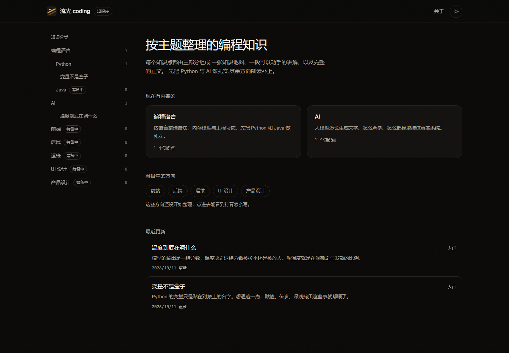
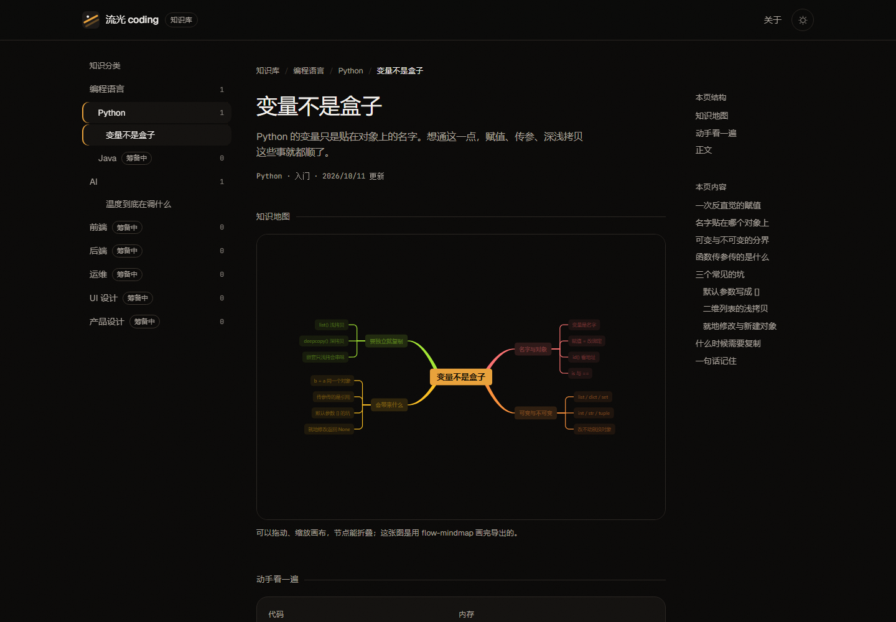
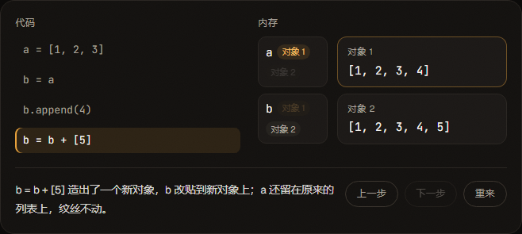

# 流光 coding 知识库

按主题整理的编程知识库。每个知识点由三部分组成:**一张知识地图**、**一段可以动手的讲解**、**完整的正文**。

线上地址:<https://xz333221.github.io/liuguang-coding/>(推送到 `main` 后由 GitHub Actions 自动部署)
早先做的那版课程落地页留档在 [/about/](https://xz333221.github.io/liuguang-coding/about/)。







## 现在有什么

| 分类 | 状态 | 内容 |
| --- | --- | --- |
| 编程语言 → Python | 可用 | 变量不是盒子 |
| 编程语言 → Java | 筹备中 | 紧随 Python 之后开始整理 |
| AI | 可用 | 温度到底在调什么 |
| 前端 / 后端 / 运维 / UI 设计 / 产品设计 | 筹备中 | 还没开始写，不要点进去找内容 |

每个分类页下面都挂着**站外权威资料**(一手文档、教材、课程)，出处集中在 `src/data/resources.ts`。

分类的开关、顺序、说明都写在 `src/data/catalog.ts` 一个文件里。每个分类有 `active`(正常)、`soon`(置灰，点进去是"还在整理"的空状态)、`hidden`(完全不出现)三种状态。

## 一个知识点由什么组成

```
src/content/knowledge/<分类>/<文件名>.md   → 正文(markdown) + frontmatter
public/mindmaps/<名字>.mindmap.json        → 知识地图(flow-mindmap 的导出文件)
src/demos/<名字>.astro                     → 动手讲解(自带动画/交互的组件)
```

三者通过 frontmatter 关联:

```yaml
---
title: 变量不是盒子
summary: 一句话摘要，列表页和页头都用它
category: python          # 必须是 catalog.ts 里的叶子分类 id
order: 1                  # 同分类内排序
level: 入门               # 入门 / 进阶 / 深入
tags: [内存模型, 引用]
updated: 2026-10-11
mindmap: python-variables.mindmap.json   # 可选
demo: python-variables                   # 可选，指向 src/demos/<名字>.astro
sources:                                 # 可选，正文里说法的出处，会渲染成一节「参考资料」
  - title: Python 语言参考 · 数据模型
    url: https://docs.python.org/zh-cn/3/reference/datamodel.html
    note: 对象的身份、类型、值与可变性的准确定义。
---
```

正文写普通的 markdown 就行：标题会自动生成右侧目录，代码块由 Astro 的 Shiki 做双主题高亮(深浅各一套 token 颜色)。

## 内容来源与版权

- **正文都是自己写的**，依据是每篇末尾「参考资料」里列的一手文档(语言规范、官方 FAQ、库文档、原始论文)。事实与结论可以引用，成段的文字不搬。
- **站外资料只做索引**：每个分类的「站外权威资料」列在 `src/data/resources.ts`，是一组链接加一句"适合解决什么问题"，不转载内容。各家许可不同(MDN 正文是 CC-BY-SA，官方文档各有条款)，要复用请以原站声明为准。
- 页面里出现的**示例数据都标注了**：温度那篇的 logits 是演示用的样例，不是某个模型的真实输出;而正文里那张概率对照表是我们按公式实算的，可以自己复算。

## 常驻问答面板

右下角常驻一个「问一问」。打开后是从右侧滑出的窄栏(移动端整屏),页头的「问答」和文章标题下的「问这篇」都能把它拉出来。

- **文章跟着问题一起发出去**:当前文章的标题、摘要、正文原文作为请求级上下文注入 system 提示，不进对话历史。输入框里有个附件片子(X)可以摘掉,和 zen-gitsync 文件空间里那个文件片子一个意思。
- 对话按文章存在浏览器里(每篇一份,最多 40 条),面板开合状态也记在本机。
- 回答走 SSE 流式渲染,支持 Markdown(代码块、表格、加粗),回答过程中可以「停止」。

### 怎么接模型:两种方式

**一、代理(推荐)**。密钥放在服务器上,浏览器里什么都不用填:

```bash
UPSTREAM_BASE_URL=https://api.openai.com/v1 \
UPSTREAM_API_KEY=sk-xxx \
ALLOWED_ORIGIN=https://xz333221.github.io \
node server/chat-proxy.mjs
```

代理自带三道闸:来源白名单、每 IP 每小时限流(默认 30 次)、强制 `max_tokens` 上限。然后把站点构建时的 `PUBLIC_CHAT_PROXY` 指向它(GitHub Actions 里加一个变量,或在 `.env` 里写),也可以在面板的「设置」里临时填代理地址。

**二、浏览器直连(BYOK)**。设置里填 Base URL、API Key、模型名,密钥只写进本机浏览器的 localStorage。注意:**大多数官方接口不允许网页直接调用(没有 CORS 头)**,这条路只在支持跨域的接口上可行,不然会看到面板给出"被跨域拦下"的提示。

不管哪种方式,**仓库里都不放任何密钥**;面板只发送当前文章和你的问题,不发别的站点数据。

### 本地怎么验

```bash
node scripts/mock-llm.mjs            # 假接口,按 OpenAI 的 SSE 格式回放
# 在面板设置里把 Base URL 填成 http://localhost:4399,Key 随便填,模型填 mock
```

这个假接口会把收到的请求记到 `tmp/mock-llm.log`,方便确认"文章确实被带上了"。

## 加一个知识点

1. **写正文**：在 `src/content/knowledge/<分类>/` 下新建 `<文件名>.md`，填好 frontmatter。文件名就是地址的最后一段(`/python/<文件名>/`)，所以要在全站唯一。
2. **画导图**：用 [flow-mindmap](https://github.com/xz333221/flow-mindmap) 画完，右键导出 JSON，存成 `public/mindmaps/<名字>.mindmap.json`，然后在 frontmatter 里写 `mindmap:`。
   - 节点文字尽量短(10 字以内)。面板是固定高度的，图越宽，自动缩放后字越小。
3. **做讲解**：在 `src/demos/` 下新建 `<名字>.astro`，写 HTML + CSS(+ 少量 JS)，frontmatter 里写 `demo:` 即可，不需要注册。
   - 讲解里的样式请用站内令牌(`var(--ink)` / `var(--line)` / `var(--accent)` 等)，这样深浅两套主题自动跟着变。
   - 动效记得在 `prefers-reduced-motion: reduce` 下关掉。
   - 参考现成的两个：`python-variables.astro`(用 `data-step` 驱动 CSS 逐帧讲解)、`ai-temperature.astro`(真算 softmax，滑块实时重画)。

## 加一个分类

改 `src/data/catalog.ts`：加一条记录，父分类用 `children` 带子分类。叶子分类会自动出现在导航、首页与路由里；`status: 'soon'` 的会置灰，`'hidden'` 的完全不出现。

## 技术栈

| 项 | 选择 | 为什么 |
| --- | --- | --- |
| 站点框架 | Astro 7(static) | 一篇文章一页静态 HTML，正文不用等 JS |
| 知识地图 | flow-mindmap(Vue 3 island) | 现成的导图组件，`client:only="vue"` 挂载，只读预览模式 |
| 动手讲解 | 原生 HTML/CSS/JS(每个讲解一个 `.astro`) | 不引入框架，能继承站内令牌，浅色深色自动适配 |
| 落地页 `/about` | React island(早先那版) | 直接复用，只在这一页加载 |
| 样式 | Tailwind v4 + CSS 变量令牌 | 深浅两套主题共用一批语义变量 |
| 正文高亮 | Astro 内置 Shiki(双主题) | 代码块跟随主题切换 |

## 目录结构

```
astro.config.mjs            Astro 配置(集成、base、Shiki 双主题)
src/
  content.config.ts         内容集合定义(frontmatter 校验 + id 规则)
  content/knowledge/        正文 markdown,按分类分目录
  data/catalog.ts           分类树(顺序 / 状态 / 说明)
  data/resources.ts         各分类的站外权威资料索引
  lib/content.ts            取数据与拼地址的公共函数(含 withBase)
  lib/chat.ts               问答面板的配置、提示词与 SSE 流式读取
  lib/softmax.ts            温度讲解用的计算,SSR 与浏览器共用
  demos/*.astro             动手讲解
  components/kb/            知识库界面(Sidebar / MindMapPanel / Toc / Breadcrumb …)
  components/chat/          常驻问答面板(React island)
  components/ui/, data/, lib/motion.ts, App.tsx   落地页那套(只在 /about 用)
  layouts/Base.astro        页面外壳(主题预置、颗粒层、跳转链接)
  layouts/DocsLayout.astro  知识库外壳(头部、侧栏、页脚、问答面板)
  pages/                    路由:/、/[category]/、/[category]/[slug]/、/about、/404
  styles/global.css         设计令牌 + 全局基础样式
  styles/kb.css             知识库界面、正文排版与问答面板样式
server/chat-proxy.mjs       可选的模型代理(密钥放服务器,见「常驻问答面板」)
public/mindmaps/            导图 JSON
public/photos/              落地页照片(来源见下)
```

## 设计约定

- **单一强调色**：全站只有琥珀色 `#e9a23b`。导图分支的多色来自 flow-mindmap 自带色板，属于图表本身。
- **圆角规则**：交互控件(按钮、输入、胶囊)一律 `rounded-full`；容器(卡片、图片、代码块、导图面板)一律 `18px`；行内代码 `6px`。
- **深浅两套主题**：默认深色(品牌基调)，页面加载前由 `Base.astro` 里的内联脚本定好，避免闪白；读者手动切过之后记在 `localStorage`。所有颜色都走语义令牌，组件里不写死色值。
- **动效必须有理由**：导图里的展开/缩放是交互本身，讲解里的位移与高亮用来指示"哪一行在动、哪个对象被改了"。`prefers-reduced-motion: reduce` 下全部关掉。

## 本地运行

```bash
npm install
npm run dev        # http://localhost:4321
npm run build      # 构建到 dist/
npm run check      # astro check:类型 + 模板检查
npm run lint       # oxlint
npm run preview    # 预览 dist
node scripts/check-live.mjs   # 检查线上 Pages 是否正常
```

部署走 `.github/workflows/deploy.yml`：推 `main` 触发，构建时用 `BASE_PATH=/<仓库名>/` 注入 Vite 的 `base`，所以站内链接统一走 `withBase()`。

## 已知边界

- **问答面板默认没有配置模型**：不填接口就用不了，站点里不放密钥。公开站点直接用代理时要自己加限流(代理脚本里带了默认值)。
- **还没有搜索**，只有分类导航 + 目录。
- 只有 2 个知识点，Java 与其余分类都还是空的。
- 讲解目前只有两个，都是手写的 `.astro`；还没有沉淀出"讲解模板"。
- 导图是构建前的静态 JSON，站内不能改图(要改用 flow-mindmap 编辑，再重新导出)。
- 站外资料是**人工挑选的索引**，不是自动抓取，也没有做链接存活检查。
- 手动切换主题/追加问答历史都只存本机浏览器，换设备不同步。
- `/about` 那版落地页用的课程、价格、学员信息都是演示数据，邮箱表单没有后端。

## 素材说明

`public/photos/` 下的照片来自 Unsplash(按 Unsplash License 免费使用)，只用在 `/about`，统一做了灰度加暖色双色调处理。品牌标记是自制几何图形。
