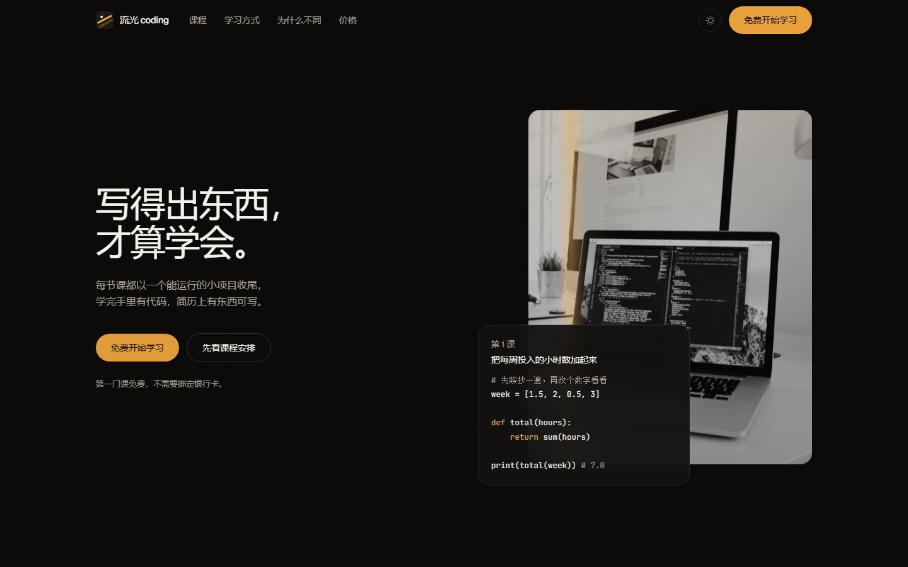
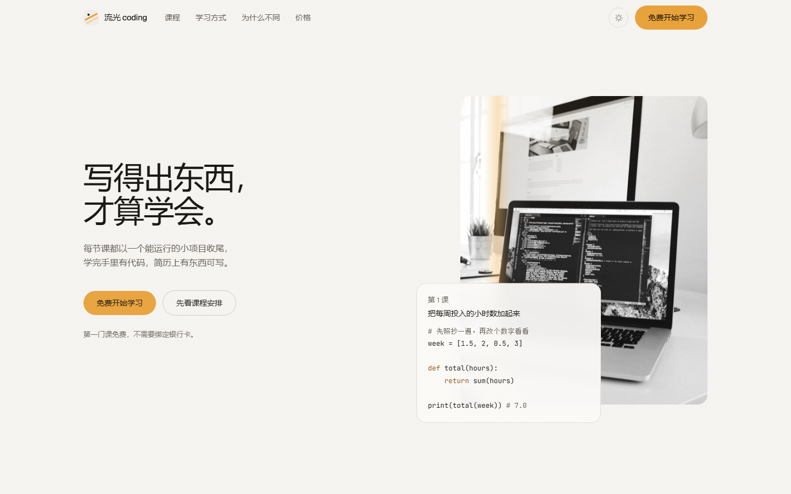
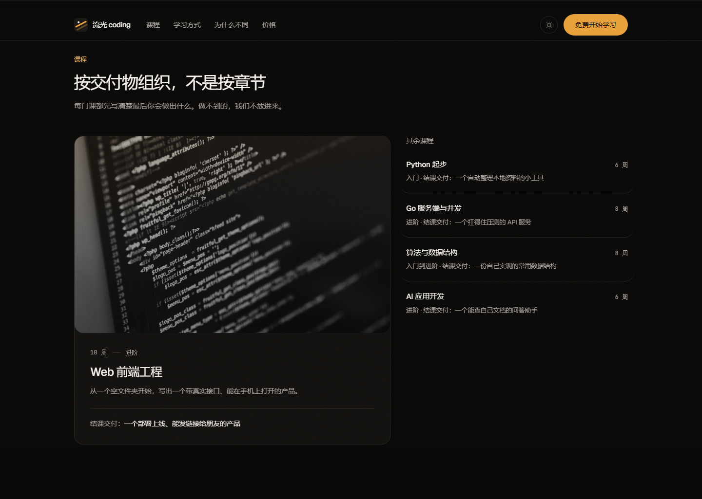

# 流光 coding

一个编程学习平台的落地页。项目驱动的课程、按交付物组织的课程目录、学员反馈与价格方案,深浅两套主题。

线上预览:<https://xz333221.github.io/liuguang-coding/>(推送到 `main` 后由 GitHub Actions 自动部署)







## 这是什么

这是一个**前端落地页**,不是完整的教学产品。页面里的课程、价格、学员反馈都是演示数据,
表单只有前端校验,没有后端。真正的课程体系、账号、支付都还没做(见文末的待办)。

设计流程参考了本机的 `taste-skill`(anti-slop frontend skill),按它的要求先做判读再动手:

> **Design Read:** 面向中文自学者与转行者的开发者教育落地页,采用 dark tech / 终端微光语言,
> 底座是 Tailwind v4 设计令牌 + 原生组件 + Motion,不用现成组件库的默认样式。
>
> **三档位:** `DESIGN_VARIANCE 8`(非对称栅格、主推课大图 + 紧凑行)・
> `MOTION_INTENSITY 6`(入场错峰、滚动淡入、按钮物理反馈、Hero 扫光)・
> `VISUAL_DENSITY 4`(常规留白,数字与元信息用等宽)

## 技术栈

| 项 | 选择 |
| --- | --- |
| 构建 | Vite 8 + React 19 + TypeScript |
| 样式 | Tailwind v4(`@tailwindcss/vite`,语义化 CSS 变量,无 `tailwind.config.js`) |
| 动效 | Motion(`motion/react`) |
| 图标 | Phosphor(界面图标)+ simple-icons(技术栈品牌图形) |
| 字体 | Geist Variable + JetBrains Mono Variable,`@fontsource-variable` 自托管 |

## 本地运行

```bash
npm install
npm run dev        # http://localhost:5173
npm run build      # 类型检查 + 生产构建
npm run preview    # 预览 dist
node scripts/check-live.mjs   # 检查 Pages 线上是否正常(标题、样式产物)
```

图片素材只用在 `public/photos/` 下,重新拉取:`node scripts/fetch-photos.mjs`(来源见「素材说明」)。

## 设计约定

- **单一强调色。** 全站只有琥珀色 `#e9a23b` 一个强调色,对应品牌里的「光」。中性色统一偏暖,
  不混冷暖两套灰。深浅两套主题共用同一批语义变量(`--canvas` / `--surface` / `--ink` / `--accent` …),
  组件里只写 `bg-canvas`、`text-ink` 这类语义类名,不写死颜色。
- **圆角规则。** 交互控件(按钮、输入框、开关)一律胶囊 `rounded-full`;容器(卡片、图片、面板)
  一律 `18px`。规则写在 `src/index.css` 顶部,不临场发挥。
- **深色是默认。** 品牌基调是深色;首屏前由 `index.html` 里的内联脚本定下主题,避免闪白。
  读者手动切过浅色后记在 `localStorage`,刷新保持。
- **动效必须有理由。** Hero 的斜向扫光是品牌「流光」本身;其余动效只用来提示层级(滚动淡入)、
  反馈操作(按钮按下)、衔接状态(表单发送中)。`prefers-reduced-motion: reduce` 下全部退化为静态。
- **不用 scroll 事件。** 吸顶导航的状态靠 `IntersectionObserver` 观察页面顶部哨兵。

## 结构

```
src/
  App.tsx                 区块编排(z-index 只有三层:40 导航 / 50 颗粒 / 60 跳转链接)
  index.css               设计令牌、双主题变量、少数几个自定义动效类
  data/site.ts            全站文案与结构数据(演示数据集中在这里)
  lib/motion.ts           全站共用缓动
  components/
    Nav.tsx               吸顶导航 + 移动端展开
    Hero.tsx              非对称分栏首屏 + 真实课程片段卡片
    TechStack.tsx         技术栈跑马灯(整页唯一的横向滚动)
    Courses.tsx           主推课大图卡 + 其余课程紧凑行
    LearningPath.tsx      学习节奏(纵向时间线)
    Why.tsx               差异点 bento 网格
    Voices.tsx            学员反馈(两栏错开)
    Pricing.tsx           两个方案,会员卡强调
    PreviewRequest.tsx    邮箱表单(空 / 错误 / 加载 / 成功四态)
    Footer.tsx
    ui/                   Reveal、Actions、Photo、Mark、SectionHeader、ThemeToggle
```

## 无障碍与性能

- 所有图片有描述性 `alt`;照片加载失败时回落到同色系兜底底纹,不出现破图。
- 表单:标签在输入框上方(不用 placeholder 当标签)、错误提示 `aria-describedby`、
  成功态 `role="status"`;按钮文字与实际背景对比度达到 WCAG AA。
- 全站键盘可达,`:focus-visible` 有统一的强调色描边,顶部有「跳到主要内容」。
- 图片按用途给足 `aspect-ratio` 占位,避免 CLS;字体自托管并 `font-display: swap`。
- 构建产物:JS 约 138 KB(gzip)、CSS 约 9.5 KB(gzip)。

## 素材说明

`public/photos/` 下的四张照片来自 Unsplash(按 Unsplash License 免费使用),在页面里统一做了
灰度 + 暖色双色调处理,只作演示占位。品牌图形(流光标记、favicon)是自制几何标记。

## 待办

- 接真实后端:邮箱订阅接口(现在只有前端校验与状态模拟)。
- 课程详情页 / 学习端页面(本页只承担落地页职责)。
- 替换演示数据:课程、价格、学员反馈都需要真实内容。
- 登录与支付入口:目前所有 CTA 都指向页内表单,没有真实注册流程。
