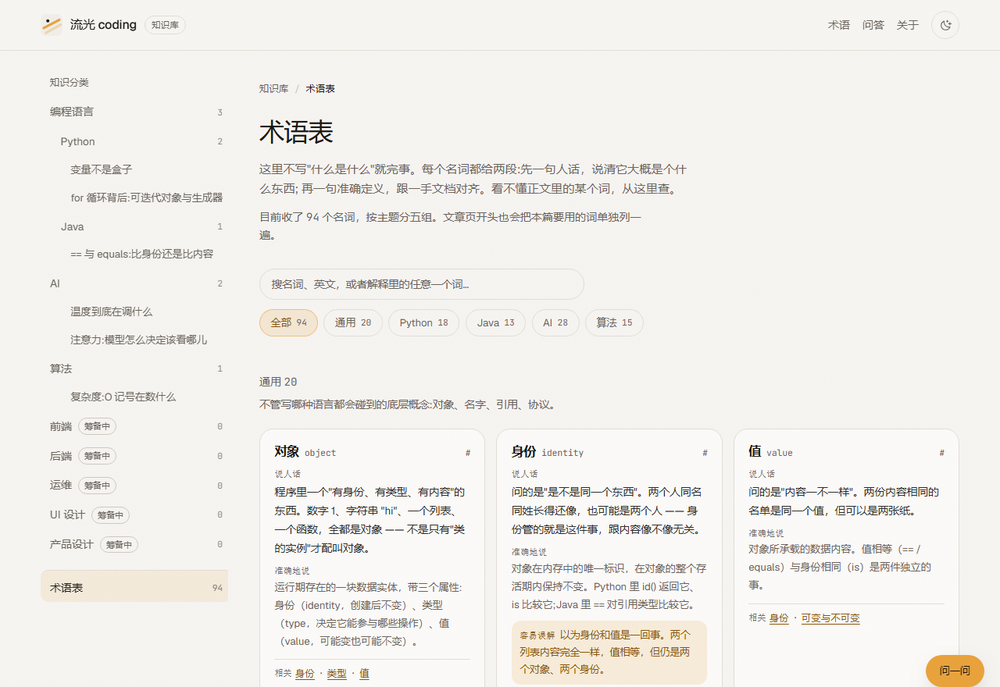
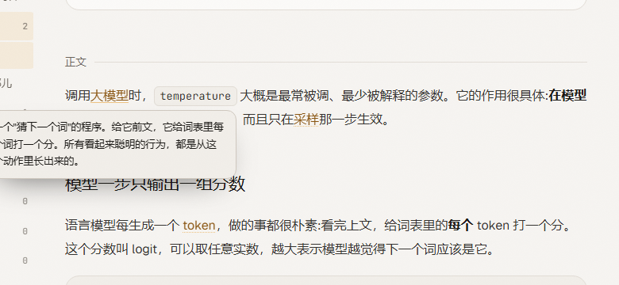

# 流光 coding 知识库

按主题整理的编程知识库。每个知识点由三部分组成:**一张知识地图**、**一段可以动手的讲解**、**完整的正文**。
仓库里同时包含**前端站点**与**服务端**(站点托管、问答接口、模型配置)，部署目标是 <https://coding.flowdash.cn>。

早先那版课程落地页留档在 `/about`。


## 现在有什么

| 分类 | 状态 | 内容 |
| --- | --- | --- |
| 编程语言 → Python | 可用 | 变量是一个名字 · for 循环背后:可迭代对象与生成器 |
| 编程语言 → Java | 可用 | == 与 equals:比身份还是比内容 |
| AI | 可用 | 温度到底在调什么 · 注意力:模型怎么决定该看哪儿 |
| 算法 | 可用 | 复杂度:O 记号在数什么 |
| 前端 / 后端 / 运维 / UI 设计 / 产品设计 | 筹备中 | 还没开始写，不要点进去找内容 |
| 术语表 | 可用 | 基础名词单独收在一处，每个一句人话 + 一句准确定义，见下 |
| 闯关游戏 | 可用 | AI 应用开发 + Python 两个题库的选择题闯关，见下 |

每个分类页下面都挂着**站外权威资料**(一手文档、教材、课程)，出处集中在 `src/data/resources.ts`。

分类的开关、顺序、说明都写在 `src/data/catalog.ts` 一个文件里。每个分类有 `active`(正常)、`soon`(置灰，点进去是"还在整理"的空状态)、`hidden`(完全不出现)三种状态。

## 一个知识点由什么组成

```
src/content/knowledge/<分类>/<文件名>.md   → 正文(markdown) + frontmatter
public/mindmaps/<名字>.mindmap.json        → 知识地图(flow-mindmap 的导出文件)
src/demos/<名字>.astro                     → 动手讲解(自带动画/交互的组件)
```

三者通过 frontmatter 关联:

```yaml
---
title: 变量是一个名字
summary: 一句话摘要，列表页和页头都用它
category: python          # 必须是 catalog.ts 里的叶子分类 id
order: 1                  # 同分类内排序
level: 入门               # 入门 / 进阶 / 深入
tags: [内存模型, 引用]
updated: 2026-10-11
mindmap: python-variables.mindmap.json   # 可选
demo: python-variables                   # 可选，指向 src/demos/<名字>.astro
terms: ["variable", "object", "identity"] # 可选，本篇要先交代清楚的名词，见「术语表」一节
sources:                                 # 可选，正文里说法的出处，会渲染成一节「参考资料」
  - title: Python 语言参考 · 数据模型
    url: https://docs.python.org/zh-cn/3/reference/datamodel.html
    note: 对象的身份、类型、值与可变性的准确定义。
---
```

正文写普通的 markdown 就行：标题会自动生成右侧目录，代码块由 Astro 的 Shiki 做双主题高亮(深浅各一套 token 颜色)。

## 术语表

站点有一张 **术语表**(`/glossary/`)，把知识点里出现的名词单独收在一处。每个名词都给两段解释，这是刻意的：

- **说人话** —— 一句话讲清它大概是个什么东西，允许用类比。读者卡住时看这段。
- **准确地说** —— 定义式的说法，跟一手文档对齐。读者要查准的时候看这段。

只写通俗会失真，只写专业就是这套内容原本的问题，所以两段都不能省。





名词数据在 `src/data/glossary/`，一个分组一个文件(`common` / `python` / `java` / `ai` / `algorithm`)，类型与汇总在 `index.ts`。一条记录长这样：

```ts
{
  id: 'sampling',              // 锚点 id，也是文章 frontmatter 里引用的 key，全站唯一
  term: '采样',
  en: 'sampling',
  aliases: ['抽样'],           // 正文里可能出现的其他写法，自动标注会一起匹配
  group: 'ai',
  plain: '按概率"抽签"决定这一步到底输出哪个词……',
  formal: '依概率分布随机抽取一个候选作为输出……',
  misread: '以为模型输出的就是概率最高那个词。',   // 可选
  related: ['temperature', 'decoding'],          // 可选
  see: 'ai/temperature-and-sampling',            // 可选，想深入看哪篇
  source: { title: '…', url: '…' },              // 可选，只用仓库里已在用的一手链接
  linkable: false,                                // 可选，太通用的词设成 false，不参与正文标注
}
```

### 文章里怎么用

frontmatter 写 `terms: ["采样对应的 id", ...]`(id 一律加引号，否则 YAML 会把 `null` 这类词解析成非字符串)，正文会自动标注：这些词在正文里**第一次**出现时变成带虚线底线的链接，悬停弹出那句「说人话」，点进去是术语表里的完整条目。

名词就在正文里就地解释，读到哪讲到哪 —— 不在文章开头另铺一屏卡片。

自动标注由 `src/lib/markdown-terms.ts` 实现，在构建期完成，产物里直接就是带链接的 HTML，不依赖客户端 JS。几条规则：

- 只标注 frontmatter 里声明过的名词，不在正文里瞎猜；
- 每个名词整篇只标第一次出现；
- 逐文本节点处理并**往上检查祖先**，行内代码、代码块、链接、标题底下的一律不碰（只看父节点是不够的，`**加粗**` 会把文本再包一层）；
- 拉丁字母开头的词要求词边界，免得 `token` 命中 `tokens`。

> Astro 7 默认的 markdown 引擎是 Sätteri，`markdown.remarkPlugins` 已经废弃(要用得额外装 `@astrojs/markdown-remark`)。所以这里的插件是 Sätteri 的 hast 插件，通过 `markdown.processor: satteri({ hastPlugins: [...] })` 注册，见 `astro.config.mjs`。

**改术语表后必须清构建缓存**：Astro 把渲染好的 markdown 缓存了两处 —— `node_modules/.astro/data-store.json` 和仓库根的 `.astro/data-store.json`。改插件、改 `astro.config.mjs`、增删或改名文章都不会让它失效，页面看着像没生效(旧的文章地址也会一直留着)。改完删掉这两处再构建。

## 闯关游戏

站点有一个 `/game/` 的闯关游戏，把知识点当关卡刷。目前两个题库:**AI 应用开发** 与 **Python**,各走各的解锁线。

- **一关一个主题**:AI 库从提示词、上下文与记忆,到检索、工具调用、多智能体与微调;Python 库从变量与对象、相等性、迭代协议,到装饰器、类、并发与内存。
- **题型都是选择题**:看术语选解释、看解释选术语、判断题、面试场景题。答完一题给一段解析，接得住追问的那种;能指回站内讲解的地方都挂了「查术语表 / 看讲解」。
- **答错进错题本**:答错的题自动收进来，答对一次就移出去，可以只刷错题。
- **逐关解锁 + 星级**:同一题库里上一关过了才开下一关，按历史最好正确率给 1~3 星;两个题库之间不互相锁。
- **进度只存本机**:`localStorage`(键 `lg-game:ai:v1`)，和主题、问答历史一个路子，换设备不同步。
- **键盘能加速**:`1`–`4` 选选项，回车下一题。

题目数据在 `src/data/game/`，一个题库一个文件(`ai.ts` / `python.ts`)，类型与取数函数在 `types.ts` / `index.ts`;
`index.ts` 里的 `decks` 是题库清单，加第三个题库就在这里加一条。
界面是 React island(`src/components/game/GameApp.tsx`，`client:only` 挂载，进度读写都在浏览器侧)，样式在 `src/styles/game.css`。

## 内容来源与版权

- **正文都是自己写的**，依据是每篇末尾「参考资料」里列的一手文档(语言规范、官方 FAQ、库文档、原始论文)。事实与结论可以引用，成段的文字不搬。
- **站外资料只做索引**：每个分类的「站外权威资料」列在 `src/data/resources.ts`，是一组链接加一句"适合解决什么问题"，不转载内容。各家许可不同(MDN 正文是 CC-BY-SA，官方文档各有条款)，要复用请以原站声明为准。
- 页面里出现的**示例数据都标注了**：温度那篇的 logits 是演示用的样例，不是某个模型的真实输出;而正文里那张概率对照表是我们按公式实算的，可以自己复算。

## 常驻问答面板

右下角常驻一个「问一问」。打开后是从右侧滑出的窄栏(移动端整屏),页头的「问答」和文章标题下的「问这篇」都能把它拉出来。

- **文章跟着问题一起发出去**:当前文章的标题、摘要、正文原文作为请求级上下文注入 system 提示，不进对话历史。输入框里有个附件片子(X)可以摘掉,和 zen-gitsync 文件空间里那个文件片子一个意思。
- 对话按文章存在浏览器里(每篇一份,最多 40 条),面板开合状态也记在本机。
- 回答走 SSE 流式渲染,支持 Markdown(代码块、表格、加粗),回答过程中可以「停止」。

### 模型从哪儿来

面板「设置」里有一个下拉,分两组:

- **服务端（密钥不在浏览器）**：列出服务器上存着的模型(`GET /api/ai-model/models/saved`)。选中后请求只带一个 `modelId`,服务端自己去取密钥调模型 —— 这是部署后的正常用法,读者什么都不用配。
- **本机（浏览器直连用）**：本地兜底存的配置,带密钥直连模型接口。只在没接服务端时用得上(大多数官方接口会因跨域被拦)。

两条路都通过 **ai-model-form** 的 `<AddModelForm>` 来配置:供应商预设(OpenAI、DeepSeek、Moonshot、智谱、Qwen、MiniMax、Ollama、火山方舟等 22 个,带 logo 与中文)、模型列表自动拉取、连接测试、保存。表单原来依赖它的 Express 中间件,这里:

| 表单要的路由 | 部署后(同源服务) | 纯静态时(浏览器兜底) |
| --- | --- | --- |
| `GET /providers`、`GET /models?endpoint=`、`POST /test` | 走 `ai-model-form/server` 中间件 | 浏览器本地实现(列表与测连接受跨域限制) |
| `POST /models`、`GET /models/saved`、`DELETE /models/:id` | 走 `server/store.mjs`,落盘 + 只回掩码 | 存 localStorage |

不管哪条路,**仓库里都不放密钥**;面板只发送当前文章和你的问题。

### 本地怎么验

```bash
node scripts/mock-llm.mjs    # 假模型接口:http://localhost:4399
```

- 只跑前端(`npm run dev`)时:面板「设置 → 添加模型」里接口地址填 `http://localhost:4399`,模型名随便填,走浏览器直连。
- 前后端一起跑(`npm run build && npm run dev:server`)时:访问 `http://127.0.0.1:8787`,在弹窗里存模型 —— 它落到 `server/data/models.json`,面板下拉里会出现在「服务端」那组。

假接口会把收到的请求记到 `tmp/mock-llm.log`,方便确认"文章被带上了""用的是哪个模型""密钥是谁加的"。

## 加一个知识点

1. **写正文**：在 `src/content/knowledge/<分类>/` 下新建 `<文件名>.md`，填好 frontmatter。文件名就是地址的最后一段(`/python/<文件名>/`)，所以要在全站唯一。
2. **画导图**：用 [flow-mindmap](https://github.com/xz333221/flow-mindmap) 画完，右键导出 JSON，存成 `public/mindmaps/<名字>.mindmap.json`，然后在 frontmatter 里写 `mindmap:`。
   - 节点文字尽量短(10 字以内)。面板是固定高度的，图越宽，自动缩放后字越小。
3. **做讲解**：在 `src/demos/` 下新建 `<名字>.astro`，写 HTML + CSS(+ 少量 JS)，frontmatter 里写 `demo:` 即可，不需要注册。
   - 讲解里的样式请用站内令牌(`var(--ink)` / `var(--line)` / `var(--accent)` 等)，这样深浅两套主题自动跟着变。
   - 动效记得在 `prefers-reduced-motion: reduce` 下关掉。
   - 参考现成的两个：`python-variables.astro`(用 `data-step` 驱动 CSS 逐帧讲解)、`ai-temperature.astro`(真算 softmax，滑块实时重画)。
4. **补名词**：正文里凡是"上来就说它是什么"的词，先在 `src/data/glossary/` 对应分组的文件里补一条(两段解释都要写)，再把 id 填进这篇的 `terms:`。
   - 写 id 时打错字会让构建直接失败 —— 这是故意的，术语表漏一个词比页面静默少一节更容易发现。
   - 一个名词只写一次，多篇文章可以共用；`see` 指向最能讲清它的那篇。

## 加一个分类

改 `src/data/catalog.ts`：加一条记录，父分类用 `children` 带子分类。叶子分类会自动出现在导航、首页与路由里；`status: 'soon'` 的会置灰，`'hidden'` 的完全不出现。

## 技术栈

| 项 | 选择 | 为什么 |
| --- | --- | --- |
| 站点框架 | Astro 7(static) | 一篇文章一页静态 HTML，正文不用等 JS |
| 知识地图 | flow-mindmap(Vue 3 island) | 现成的导图组件，`client:only="vue"` 挂载，只读预览模式 |
| 动手讲解 | 原生 HTML/CSS/JS(每个讲解一个 `.astro`) | 不引入框架，能继承站内令牌，浅色深色自动适配 |
| 正文名词标注 | Sätteri hast 插件(`src/lib/markdown-terms.ts`) | 构建期完成，产物直接是带链接的 HTML，不依赖客户端 JS |
| 落地页 `/about` | React island(早先那版) | 直接复用，只在这一页加载 |
| 样式 | Tailwind v4 + CSS 变量令牌 | 深浅两套主题共用一批语义变量 |
| 正文高亮 | Astro 内置 Shiki(双主题) | 代码块跟随主题切换 |

## 目录结构

```
astro.config.mjs            Astro 配置(集成、base、Shiki 双主题)
src/
  content.config.ts         内容集合定义(frontmatter 校验 + id 规则)
  content/knowledge/        正文 markdown,按分类分目录
  data/catalog.ts           分类树(顺序 / 状态 / 说明)
  data/resources.ts         各分类的站外权威资料索引
  data/game/                闯关题库(types / index / ai)
  lib/content.ts            取数据与拼地址的公共函数(含 withBase)
  lib/chat.ts               问答面板的配置、提示词与 SSE 流式读取
  lib/chat-models.ts        模型配置的存取 + 没部署中间件时的本地兜底后端
  lib/softmax.ts            温度讲解用的计算,SSR 与浏览器共用
  demos/*.astro             动手讲解
  components/kb/            知识库界面(Sidebar / MindMapPanel / Toc / Breadcrumb …)
  components/chat/          常驻问答面板(React)+ 模型配置弹窗(Vue,内嵌 ai-model-form)
  components/game/          闯关游戏(React island)
  components/ui/, data/, lib/motion.ts, App.tsx   落地页那套(只在 /about 用)
  layouts/Base.astro        页面外壳(主题预置、颗粒层、跳转链接)
  layouts/DocsLayout.astro  知识库外壳(头部、侧栏、页脚、问答面板)
  pages/                    路由:/、/[category]/、/[category]/[slug]/、/game、/glossary、/about、/404
  styles/global.css         设计令牌 + 全局基础样式
  styles/kb.css             知识库界面、正文排版与问答面板样式
  styles/game.css           闯关游戏界面
server/
  index.mjs                 Express 服务:静态站点 + /api/chat + /api/ai-model
  chat.mjs                  问答接口(SSE 透传、限流、模型解析)
  store.mjs                 模型配置落盘(0600,只给浏览器回掩码)
deploy/
  liuguang-coding.service   systemd 单元示例
  nginx.conf.sample         coding.flowdash.cn 反代示例(SSE 关缓冲)
scripts/
  deploy-on-server.sh       服务器上的一键发布
  mock-llm.mjs              假模型接口,本地验收
  check-live.mjs            线上/本地健康检查
  fetch-photos.mjs          拉落地页照片
public/mindmaps/            导图 JSON
public/photos/              落地页照片(来源见下)
```

## 设计约定

- **单一强调色**：全站只有琥珀色 `#e9a23b`。导图分支的多色来自 flow-mindmap 自带色板，属于图表本身。
- **圆角规则**：交互控件(按钮、输入、胶囊)一律 `rounded-full`；容器(卡片、图片、代码块、导图面板)一律 `18px`；行内代码 `6px`。
- **深浅两套主题**：默认深色(品牌基调)，页面加载前由 `Base.astro` 里的内联脚本定好，避免闪白；读者手动切过之后记在 `localStorage`。所有颜色都走语义令牌，组件里不写死色值。
- **动效必须有理由**：导图里的展开/缩放是交互本身，讲解里的位移与高亮用来指示"哪一行在动、哪个对象被改了"。`prefers-reduced-motion: reduce` 下全部关掉。

## 本地运行

```bash
npm install
npm run dev          # 只跑前端:http://localhost:4321
npm run build        # 构建站点到 dist/
npm run dev:server   # 只跑服务端:http://127.0.0.1:8787(先 build,否则没有静态站点)
npm run start        # 服务端:发 dist 静态站 + /api/* 接口
npm run check        # astro check:类型 + 模板检查
npm run lint         # oxlint
node scripts/mock-llm.mjs   # 假模型接口(监听 4399),本地验收用
```

前端与服务端分开跑时,在面板「设置」里把代理地址填成 `http://127.0.0.1:8787/api/chat`;
同源部署时用构建变量写死,读者什么都不用配。假接口会把收到的请求记到 `tmp/mock-llm.log`,方便确认"文章被带上了""用的是哪个模型"。

## 部署(coding.flowdash.cn)

一个 Node 进程同时负责两件事:发静态站点、发接口。nginx 只做反代。

```
coding.flowdash.cn ──nginx──> 127.0.0.1:8787  server/index.mjs
                                              ├── /*               站点(dist,带缓存头)
                                              ├── POST /api/chat   问答,SSE 透传
                                              └── /api/ai-model/*  模型配置与预设
```

各路由归属:

| 路由 | 实现 | 说明 |
| --- | --- | --- |
| `POST /api/chat` | `server/chat.mjs` | 从模型仓库取端点与密钥去调模型,SSE 原样转发。**密钥不出服务端**;带来源白名单、每 IP 每小时限流(默认 60)、`max_tokens` 上限 |
| `POST/GET/DELETE /api/ai-model/models[/saved]` | `server/store.mjs` | 模型配置落盘(`server/data/models.json`,权限 0600,已 gitignore),给浏览器只回掩码 |
| `GET /providers`、`GET /models?endpoint=`、`POST /test` | `ai-model-form/server` | 供应商预设、实时模型列表、连接测试,直接复用你那个中间件 |

首次部署:

```bash
# 服务器上
git clone git@github.com:xz333221/liuguang-coding.git /opt/liuguang-coding
cd /opt/liuguang-coding
sudo cp deploy/liuguang-coding.service /etc/systemd/system/
sudo systemctl daemon-reload && sudo systemctl enable --now liuguang-coding
sudo cp deploy/nginx.conf.sample /etc/nginx/sites-enabled/coding.flowdash.cn.conf  # 按需改证书路径
sudo nginx -t && sudo systemctl reload nginx
```

以后每次发布:

```bash
APP_DIR=/opt/liuguang-coding bash scripts/deploy-on-server.sh
```

这个脚本做四件事:拉 `main`、`npm ci`、用 `PUBLIC_CHAT_PROXY=/api/chat PUBLIC_MODEL_API=/api/ai-model` 构建站点、重启服务并做健康检查。

可选环境变量(`deploy/liuguang-coding.service` 里已指到 `/opt/liuguang-coding/.env.server`,该文件不进仓库):

| 变量 | 用途 |
| --- | --- |
| `PORT` / `DATA_DIR` | 端口(默认 8787)、模型配置目录(默认 `server/data`) |
| `ALLOWED_ORIGIN` | 只有跨域部署才需要;同源留空 |
| `RATE_LIMIT` / `MAX_TOKENS` | 限流条数与单次回答上限 |
| `UPSTREAM_BASE_URL` / `UPSTREAM_API_KEY` / `DEFAULT_MODEL` | 仓库里一条模型都没有时的兜底 |

## 已知边界

- **问答要服务端在跑**：接口与站点同源,`/api/chat` 由 `server/index.mjs` 提供;纯静态托管(比如 GitHub Pages)只能用浏览器直连那一路,大多数官方接口会被 CORS 拦下。
- 模型配置存在服务器上(`server/data/models.json`)或浏览器里,取决于你从哪条路径添加;**服务端那份含明文密钥,别提交、别备份到公开位置**。
- **还没有搜索**，只有分类导航 + 目录。
- 只有 6 个知识点，前端 / 后端 / 运维 / UI 设计 / 产品设计都还是空的。
- 讲解目前只有六个，都是手写的 `.astro`；还没有沉淀出"讲解模板"。
- 导图是构建前的静态 JSON，站内不能改图(要改用 flow-mindmap 编辑，再重新导出)。
- 站外资料是**人工挑选的索引**，不是自动抓取，也没有做链接存活检查。
- 手动切换主题/追加问答历史都只存本机浏览器，换设备不同步。
- `/about` 那版落地页用的课程、价格、学员信息都是演示数据，邮箱表单没有后端。
- 闯关游戏的进度与错题本只存在本机浏览器里，换设备不同步;题库目前有 AI 应用开发与 Python 两个。

## 素材说明

`public/photos/` 下的照片来自 Unsplash(按 Unsplash License 免费使用)，只用在 `/about`，统一做了灰度加暖色双色调处理。品牌标记是自制几何图形。
