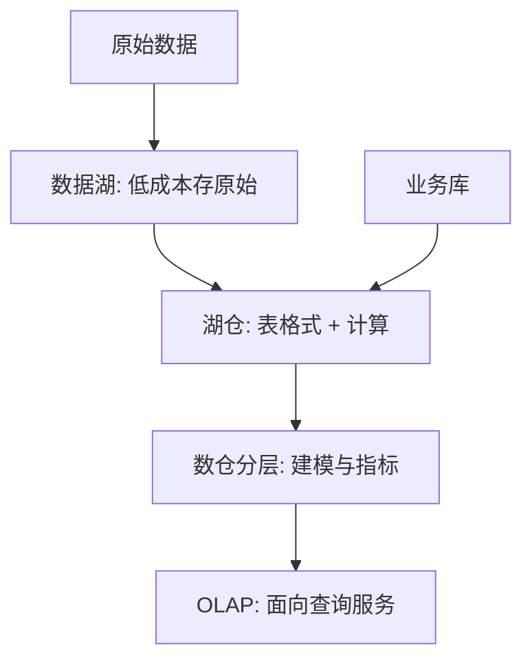

四类形态经常被混用：数仓、数据湖、湖仓、OLAP。它们解决的不是同一个问题，选错会在成本、时效与口径上同时付出代价。

## 数据仓库

- 面向主题、集成、相对稳定；
- 强调分层建模与一致口径；
- 传统以 Hive/MPP 数据库承载；
- 适合报表、指标、对账等确定性分析。

数仓的核心不是存储，而是“模型与口径”。没有分层与指标治理，换什么引擎都只是更快的混乱。

## 数据湖

- 保存原始与半结构化数据，Schema-on-read；
- 存储成本低，适合海量留存与回溯；
- 早期数据湖缺少事务与表管理，容易变成“数据沼泽”；
- 需要元数据、分区与文件格式规范。

## 湖仓

湖仓在对象存储上增加表格式（Iceberg、Hudi、Delta）：

- 提供 ACID、快照与时间旅行；
- 支持 Spark、Flink、Trino 等多引擎读写；
- 存算分离，计算资源按需扩缩；
- 仍需数仓分层与治理，表格式不等于建模。

湖仓适合“一份数据、多种计算”的平台，不适合把它当万能数据库做高频点查。

## OLAP

- 面向分析查询，列存 + 向量化 + MPP；
- ClickHouse 擅长单表聚合与实时写入；
- Doris/StarRocks 提供明细/聚合模型与 Join 能力；
- Trino 擅长联邦查询，把多个数据源拼在一起；
- OLAP 通常服务 BI、看板与即席查询，不承担主数据存储。

## 选型矩阵

| 需求 | 优先选择 |
| --- | --- |
| 稳定报表与一致指标 | 数仓分层 + OLAP |
| 海量原始数据留存 | 数据湖 / 湖仓 |
| 批流共用一份表 | 湖仓（Iceberg/Hudi） |
| 实时大屏与单表聚合 | ClickHouse / Doris |
| 跨源即席查询 | Trino |
| 高频点查业务 | 关系型数据库，不是 OLAP |

## 组合方式

常见落地是：

1. 业务库与日志进入数据湖；
2. 湖仓表格式统一元数据与事务；
3. Spark/Flink 做分层加工；
4. 结果写入 OLAP 供查询；
5. 数仓模型与指标治理贯穿始终。

## 常见误区

- **湖仓替代数仓**：有表格式不等于有模型；
- **OLAP 当存储**：副本与冷数据成本高；
- **数据湖没有元数据**：找不到表、不知道口径；
- **所有查询都上 Trino**：高并发低延迟场景不如专用 OLAP；
- **忽略小文件**：湖仓查询被元数据与文件数拖垮。

## 小结

- 数仓解决建模与口径，数据湖解决低成本留存；
- 湖仓在对象存储上提供表事务与多引擎访问；
- OLAP 面向查询服务，不承担主存储；
- 组合通常为“湖仓存储 + 数仓分层 + OLAP 服务”；
- 选型先看延迟、成本与口径要求，而不是组件热度。
