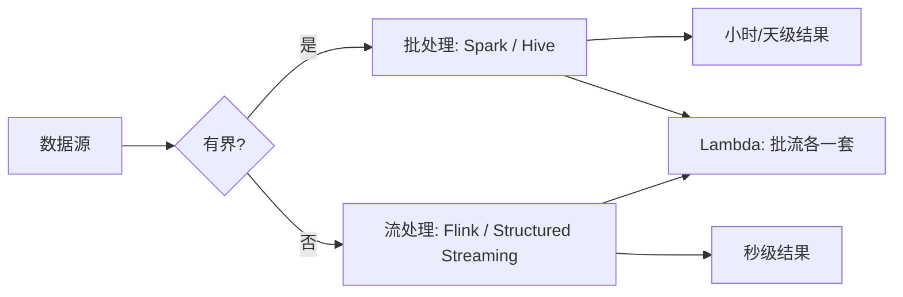

“实时”不是越早越好。批处理成本低、结果稳定；流处理延迟低、状态复杂。选型取决于业务对延迟的真实要求，而不是技术栈的时髦程度。

## 有界与无界

- **有界流**：有明确开始与结束，可以排序、全量计算，例如每日订单文件；
- **无界流**：持续产生、没有终点，必须边到边算，例如点击流、传感器数据。

Flink 把两者统一为“流”，批只是有界流的一种；Spark 以批为核心，Structured Streaming 用微批模拟流。概念统一不等于实现相同，延迟与状态能力差别很大。

## 对比

| 维度 | 批处理 | 流处理 |
| --- | --- | --- |
| 延迟 | 分钟到小时 | 秒到亚秒 |
| 吞吐 | 高 | 中到高 |
| 状态 | 可用磁盘全量 | 需要状态后端与 Checkpoint |
| 容错 | 重跑任务 | 从 Checkpoint 恢复 |
| 成本 | 低 | 常驻资源，成本高 |
| 复杂度 | 低 | 时间语义、乱序、Exactly-once |

## Lambda 与 Kappa

**Lambda**：同一份数据跑批与流两条链路，批层保证准确，流层保证及时，查询时合并结果。

- 优点：批层可重算，流层故障影响小；
- 缺点：两套代码、两套口径，维护成本高。

**Kappa**：只保留流链路，历史数据通过重放消息重建。

- 优点：一套逻辑、口径一致；
- 缺点：对消息保留与流处理稳定性要求高。

多数团队从 Lambda 起步，随着流处理成熟逐步收敛到 Kappa 或“流批一体”。

## 微批与真实时

- Spark Structured Streaming 默认微批，延迟通常在秒级，适合准实时；
- Flink 是事件驱动，单条处理，延迟可到毫秒级；
- “微批”在吞吐与延迟之间折中，故障恢复按批次；
- 真实时场景（风控、告警）需要事件时间与低延迟，选 Flink 更合适。

## 什么时候用批

- 日报、月报、对账；
- 历史数据回溯与重算；
- 大规模 ETL 与模型训练样本；
- 对延迟不敏感、对成本敏感。

## 什么时候用流

- 实时监控与告警；
- 实时推荐特征；
- 订单状态流转与风控；
- 需要持续更新的大屏指标。

## 常见误区

- **所有数据都上流**：成本高，状态与乱序问题成倍增加；
- **用批模拟实时**：缩短调度间隔不等于流处理，小文件与重复计算更严重；
- **忽略乱序**：只按到达时间处理，结果随网络抖动变化；
- **两套口径**：Lambda 下批与流各写一套 SQL，指标对不上。

## 小结

- 有界数据用批，无界数据用流；
- 批成本低、流延迟低，复杂度与成本随实时性上升；
- Lambda 双链路准确但维护重，Kappa 单链路口径一致但依赖流稳定；
- 微批适合准实时，真实时选 Flink；
- 先确认真实延迟要求，再决定架构。
