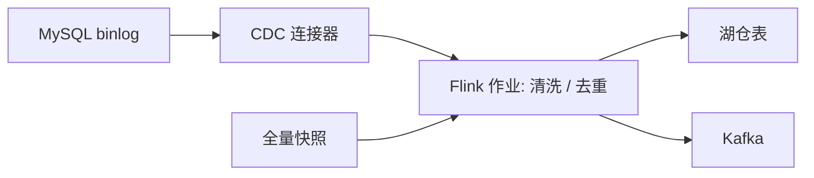

CDC（Change Data Capture）把数据库的插入、更新、删除变成一条条变更事件。相比定时全量同步，它延迟低、对源库压力小，但需要处理位点、去重与 Schema 变化。



## 实现方式

| 方式 | 原理 | 影响 |
| --- | --- | --- |
| 日志式 | 解析 binlog/redo | 对源库影响小，实时 |
| 查询式 | 轮询时间戳/自增 ID | 有延迟，难捕获删除 |
| 触发器式 | 触发器写变更表 | 侵入源库，性能差 |

生产优先日志式。MySQL 需要开启 `binlog_format=ROW`，并授予复制权限。

## Flink CDC

- 支持 MySQL、PostgreSQL、Oracle、MongoDB 等连接器；
- 先做全量快照，再切换到增量 binlog；
- 全量与增量之间要保证不重不漏；
- 写入湖仓时按主键 upsert，保证最终一致。

```sql
CREATE TABLE mysql_orders (
  id BIGINT,
  amount DECIMAL(12,2),
  PRIMARY KEY (id) NOT ENFORCED
) WITH (
  'connector' = 'mysql-cdc',
  'hostname' = '10.0.0.11',
  'database-name' = 'shop',
  'table-name' = 'orders'
);
```

## 全量与增量衔接

1. 记录快照开始时的 binlog 位点；
2. 读取全量数据并写入下游；
3. 从记录的位点开始回放增量；
4. 下游按主键 upsert，覆盖快照期间的重复变更。

位点必须与快照一致，否则会漏数据或重复。作业重启后从 Checkpoint/Savepoint 恢复位点。

## 去重与幂等

- 下游表必须有主键；
- Sink 使用 upsert 语义；
- 重复事件按主键覆盖，结果不变；
- 删除事件要传递墓碑（delete）标记；
- 端到端 Exactly-once 依赖 Checkpoint 与事务 Sink。

## DDL 变更

- 源表加列、改类型会改变事件结构；
- 连接器能否自动同步 Schema 取决于版本与配置；
- 湖仓表要支持 Schema 演进；
- 变更前评估下游兼容性，必要时暂停同步。

## 大事务与位点

- 大事务会产生大量 binlog，回放时内存与延迟上升；
- binlog 保留时间要覆盖最长中断时间；
- 位点过期后只能重新全量；
- 监控延迟与位点差距。

## 常见问题

- **binlog 未开启**：无法捕获变更；
- **全量与增量重复**：下游没有 upsert；
- **DDL 导致作业失败**：Schema 不兼容；
- **删除未同步**：下游仍有旧记录；
- **位点过期**：需要重新初始化。

## 小结

- CDC 优先日志式，MySQL 需 ROW 格式与复制权限；
- Flink CDC 先全量后增量，位点要一致；
- 下游按主键 upsert，保证幂等；
- DDL 与位点保留是长期运维重点；
- 监控延迟、位点与数据一致性。
