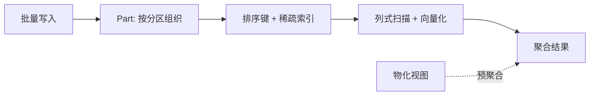

ClickHouse 为“大宽表聚合”设计：一次写入、批量读取、按列扫描。它能在单表上做到很高的吞吐，但不是通用数据库，Join 与高频点查都要谨慎。



## MergeTree

```sql
CREATE TABLE events (
  dt Date,
  user_id UInt64,
  event String,
  amount Decimal(12,2)
) ENGINE = MergeTree
PARTITION BY toYYYYMM(dt)
ORDER BY (dt, user_id);
```

- `PARTITION BY` 决定数据目录，按时间分区便于删除与裁剪；
- `ORDER BY` 是排序键，决定稀疏索引与读取顺序；
- 主键默认与排序键一致，可单独指定；
- 数据写入生成 Part，后台合并（merge）为更大 Part。

## 索引与扫描

- 稀疏索引：每 N 行记录一次主键，适合范围扫描；
- 跳数索引（minmax、set、bloom）辅助过滤；
- 查询只读需要的列，列存压缩率高；
- 向量化执行与 SIMD 提升 CPU 利用率。

## 写入

- 批量写入，避免单条 INSERT；
- 每次写入生成 Part，Part 过多会触发合并压力；
- 分区键基数不宜过高，避免目录与 Part 爆炸；
- 写入前按排序键排序可减少合并成本；
- 使用 Buffer 表或异步写入削峰。

## 物化视图

```sql
CREATE MATERIALIZED VIEW daily_gmv
ENGINE = SummingMergeTree
ORDER BY (dt)
AS SELECT dt, sum(amount) AS gmv
FROM events
GROUP BY dt;
```

物化视图在写入时增量计算，查询直接读预聚合结果。它适合固定维度的指标，不适合任意维度组合。

## 不适合的场景

- 高频单行点查：用关系型数据库或 KV；
- 多表复杂 Join：ClickHouse 的 Join 能力有限，需宽表化；
- 频繁更新与删除：MergeTree 的更新代价高；
- 强事务需求：不支持完整事务语义。

## 常见问题

- **Part 过多**：写入批次太碎，合并跟不上；
- **分区过细**：按天/小时分区导致目录过多；
- **Join 内存爆炸**：大表 Join 用 broadcast，注意内存限制；
- **物化视图口径变化**：需要重建并回填；
- **TTL 配置缺失**：历史数据无限增长。

## 小结

- MergeTree 以分区、排序键与 Part 组织数据；
- 列存 + 稀疏索引 + 向量化适合大范围聚合；
- 批量写入、控制 Part 数量是稳定性的关键；
- 物化视图用于固定维度的预聚合；
- 点查、复杂 Join 与频繁更新不是它的强项。
