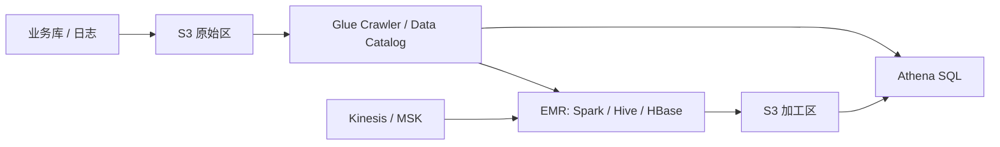

AWS 的大数据方案是“存储与计算彻底分开”：S3 存数据，EMR 按需拉起计算，Glue 维护元数据，Athena 直接查 S3。理解这套组合，比记住单个服务名更重要。

## S3

- 桶与对象，按前缀组织，没有真正的目录；
- 生命周期规则把冷数据转到低频/归档存储；
- 版本控制防止误删与覆盖；
- 桶策略与 IAM 控制访问，禁止公共读；
- 按存储量、请求次数与流量计费。

S3 是数据湖的底座。小文件会放大请求成本与查询时间，写入端要合并。

## EMR

- 托管 Hadoop、Spark、Hive、HBase、Flink、Presto；
- 支持按需、预留与 Spot 实例，Spot 可显著降低成本但可能被回收；
- EMR on EKS 把作业跑在 Kubernetes；
- 存算分离：数据在 S3，集群只负责计算；
- 集群可以短生命周期运行，任务结束即释放。

适合批处理、临时分析、需要 Hadoop 生态的任务。长期常驻的集群要考虑成本与闲置。

## Glue

- **Data Catalog**：表、分区与 Schema 的元数据；
- **Crawler**：扫描 S3 自动推断 Schema；
- **ETL 作业**：基于 Spark 的脚本化转换；
- 与 Athena、EMR、Redshift 共享元数据；
- 作业可按需运行，按 DPU 计费。

Glue 的价值是“一份元数据，多处使用”。没有 Catalog，Athena 与 EMR 各自维护表定义，口径容易分叉。

## Athena

- 直接对 S3 上的数据执行 SQL；
- 按扫描数据量计费，分区与列式格式能显著降低成本；
- 适合即席查询与轻量报表；
- 不适合高频、低延迟的服务化查询；
- 结果可写回 S3 或供 BI 使用。

## 典型链路

1. 日志/CDC 落到 S3 原始区；
2. Glue Crawler 或手动建表写入 Data Catalog；
3. EMR 跑 Spark 清洗，输出 Parquet 到加工区；
4. Athena 查询加工区，BI 工具接入；
5. 生命周期把冷分区转归档。

## 成本要点

- S3 请求与流量常被忽略，小文件与跨区传输会放大账单；
- EMR 用 Spot + 短生命周期集群，避免长期闲置；
- Athena 按扫描量计费，分区裁剪与列式格式是成本关键；
- Glue 按 DPU 计费，避免频繁小作业。

## 常见问题

- **S3 小文件**：查询慢、请求费用高；
- **没有分区**：Athena 扫描全量数据；
- **EMR 集群常驻**：夜间闲置仍计费；
- **Catalog 与数据不一致**：Crawler 推断错误或分区未更新；
- **跨区读取**：计算与存储不同区域，流量费用高。

## 小结

- S3 是存储底座，EMR 提供托管计算，Glue 管元数据，Athena 做查询；
- 存算分离让计算按需伸缩，但小文件会放大成本；
- 分区与列式格式决定 Athena 的扫描费用；
- Spot 与短生命周期集群能显著降低 EMR 成本；
- 元数据统一到 Glue Catalog，避免多套表定义。
