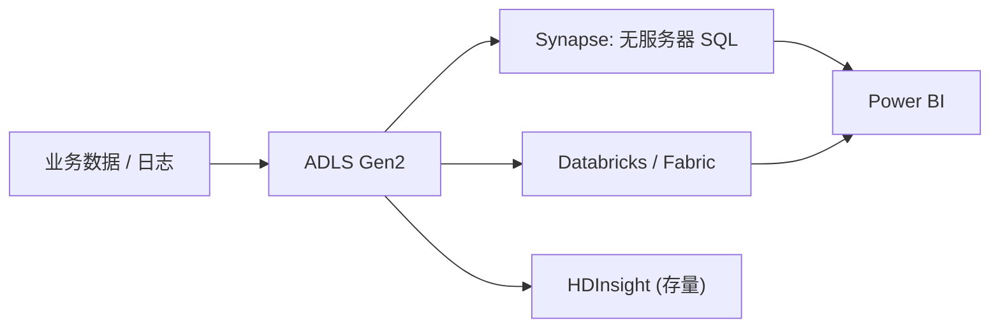

Azure 的大数据栈以 ADLS Gen2 为存储、Synapse 为分析中枢，HDInsight 曾是托管 Hadoop 的主要入口，但已进入退役周期。选型时要把“历史包袱”和“新项目”分开看。

## ADLS Gen2

- 基于 Blob Storage，开启分层命名空间（HNS）；
- 支持目录语义与 POSIX 权限，适合 Hadoop 生态；
- 与 Synapse、Databricks、HDInsight 共享存储；
- 生命周期管理冷热分层；
- 仍需控制小文件与请求成本。

## HDInsight

- 托管 Hadoop、Spark、Hive、HBase、Kafka、Storm；
- 与 ADLS、Synapse 集成；
- **已宣布退役计划**，官方建议迁移到 Microsoft Fabric、Azure Databricks 或 Synapse；
- 存量集群可以继续运行，但新项目不应再以 HDInsight 为首选；
- 迁移时重点核对 HBase/Kafka 等组件的替代方案。

## Synapse Analytics

- 统一工作区：SQL 池、Spark 池、数据集成与 BI；
- **专用 SQL 池**：预置资源，适合稳定数仓负载；
- **无服务器 SQL 池**：按查询扫描计费，适合探索与轻量查询；
- 支持 OPENROWSET 直接查 ADLS 文件；
- 与 Power BI 集成紧密。

## Azure Databricks

- 基于 Spark 的托管平台，Notebook、作业与 Delta Lake；
- 适合数据工程、机器学习与湖仓；
- 与 ADLS、Synapse、Power BI 集成；
- 成本按集群与 DBU 计费，需要治理闲置集群。

## Microsoft Fabric

- 统一 SaaS 分析平台：OneLake、数据工厂、数仓、实时分析；
- 适合希望减少自建集群的团队；
- 与 Power BI 深度整合；
- 迁移 HDInsight 时作为候选之一。

## 典型链路

1. 数据落到 ADLS Gen2；
2. Databricks 或 Synapse Spark 清洗，写回 Delta/Parquet；
3. Synapse SQL 池对外提供查询；
4. Power BI 做展现；
5. 存量 HDInsight 集群逐步迁移。

## 成本与治理

- 专用 SQL 池按 DWU 计费，闲置也会产生成本；
- 无服务器 SQL 按扫描量计费，分区与列存能降低成本；
- Databricks 集群要设置自动终止；
- ADLS 生命周期把冷数据转低频；
- 统一用 Unity Catalog 或 Purview 管理元数据与权限。

## 常见问题

- **新项目继续选 HDInsight**：生命周期风险高；
- **专用 SQL 池长期空转**：成本远高于无服务器查询；
- **ADLS 小文件**：查询与请求费用上升；
- **多套元数据**：Synapse、Databricks、HDInsight 各维护一份；
- **权限模型割裂**：存储、工作区与 BI 各自授权。

## 小结

- ADLS Gen2 是 Azure 大数据存储底座，支持目录与权限；
- HDInsight 已宣布退役，存量迁移、新项目选 Fabric/Databricks/Synapse；
- Synapse 提供专用与无服务器 SQL 池，按负载选择；
- Databricks 适合湖仓与机器学习，Fabric 适合 SaaS 化分析；
- 元数据与权限要跨服务统一，避免多套口径。
