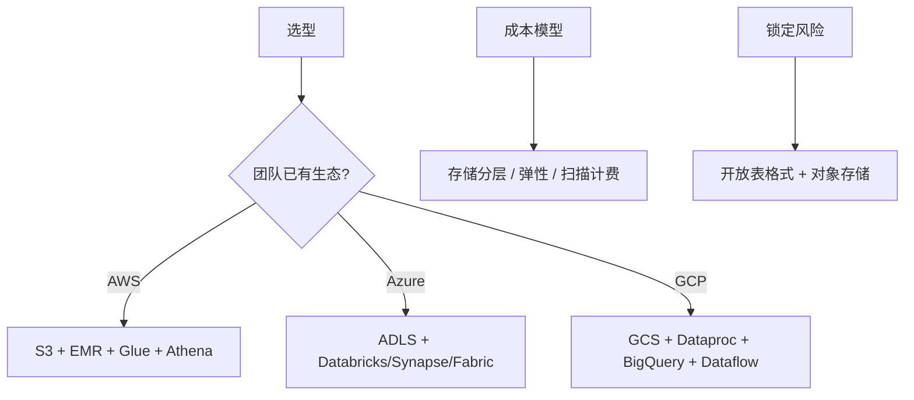

三家云都能跑 Hadoop/Spark，但计费方式、托管程度与生态侧重不同。选型不是“哪家功能多”，而是“哪种成本模型与团队能力匹配”。

## 能力对照

| 能力 | AWS | Azure | GCP |
| --- | --- | --- | --- |
| 对象存储 | S3 | ADLS Gen2 | GCS |
| 托管 Hadoop/Spark | EMR | HDInsight（退役）/Databricks | Dataproc |
| 元数据 | Glue Catalog | Purview / Unity Catalog | Dataplex |
| 无服务器查询 | Athena | Synapse 无服务器 SQL | BigQuery |
| 流处理 | Kinesis / MSK | Event Hubs | Pub/Sub + Dataflow |
| 数仓 | Redshift | Synapse 专用池 | BigQuery |

## 成本模型

- **按扫描量**：Athena、BigQuery，查询越宽越贵，分区与列存是关键；
- **按资源**：EMR、Dataproc、Synapse 专用池，闲置也计费；
- **按作业**：Glue、Dataflow Serverless，按实际资源与时长；
- **存储分层**：S3/ADLS/GCS 的冷归档能大幅降低长期成本；
- **流量**：跨区、跨云与出口流量常被忽略。

成本优化顺序：消除闲置 → 存储分层 → 查询裁剪 → 弹性伸缩 → 预留折扣。

## 锁定与开放格式

- 托管服务越深，迁移成本越高；
- 数据放在对象存储、用 Iceberg/Delta/Hudi 管表，可降低计算引擎锁定；
- SQL 方言差异仍然存在，迁移需要改写；
- 元数据（Catalog）是迁移的隐性成本；
- 多引擎共享同一份开放表，是降低锁定的现实做法。

## 迁移步骤

1. 盘点数据量、表、任务与依赖；
2. 选择目标存储与表格式；
3. 搬迁历史数据，校验行数与校验和；
4. 改写 SQL/作业，处理方言与函数差异；
5. 双跑一段时间，对比结果与延迟；
6. 切换流量，保留回滚路径；
7. 下线旧集群与权限。

## 合规与安全

- 数据驻留要求决定可用区域；
- 分级分类、脱敏与审计要跨服务统一；
- 密钥管理用云 KMS，避免应用内硬编码；
- 行业合规（如航空 AMBER）需要额外隔离与访问审批。

## 常见问题

- **只看单价**：忽略扫描量、流量与闲置；
- **一次性全迁**：没有双跑，问题在上线后暴露；
- **深度绑定专有格式**：后续换引擎成本高；
- **元数据未迁移**：表能读但权限、血缘丢失；
- **忽略出口流量**：跨云备份与查询产生高额费用。

## 小结

- 三家云能力接近，差异在计费模型与生态；
- 扫描计费看分区与列存，资源计费看弹性与闲置；
- 开放表格式 + 对象存储能降低锁定；
- 迁移要盘点、双跑、校验、保留回滚；
- 合规与数据驻留是选型的硬约束。
