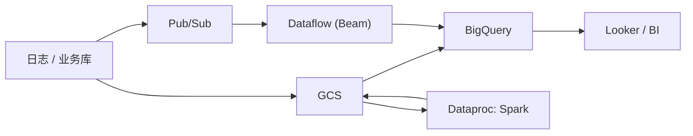

GCP 的大数据组合偏“无服务器”：GCS 存数据，BigQuery 直接查，Dataproc 只在需要 Spark 时临时拉起，Dataflow 处理流式管道。选型时要算清扫描量与集群闲置。



## GCS

- 桶与对象，按前缀组织；
- 存储类别：Standard、Nearline、Coldline、Archive；
- 生命周期规则自动转档与删除；
- 与 BigQuery、Dataproc、Dataflow 原生集成；
- 按存储量、操作与流量计费。

GCS 是数据湖底座，列式文件与分区同样能降低下游扫描成本。

## Dataproc

- 托管 Hadoop/Spark/HBase/Presto；
- 集群模式按需创建，支持自动伸缩与抢占式实例；
- Dataproc Serverless 无需管理集群，按作业资源计费；
- 与 GCS、BigQuery、Cloud Storage 连接器集成；
- 适合需要 Spark 生态、又不想长期维护集群的任务。

## BigQuery

- 无服务器数仓，列存 + 分布式执行；
- 按扫描字节计费，分区与聚簇能显著减少扫描；
- 支持标准 SQL、嵌套与数组；
- BI Engine 提供低延迟缓存；
- 与 GCS、Pub/Sub、Dataflow 集成。

```sql
CREATE TABLE dataset.orders
PARTITION BY DATE(created_at)
CLUSTER BY user_id
AS SELECT * FROM dataset.raw_orders;
```

分区裁剪与聚簇是成本控制的关键。`SELECT *` 与无分区过滤会按全表计费。

## Dataflow

- 基于 Apache Beam，流批统一 API；
- 自动扩缩 worker，按使用资源计费；
- 支持窗口、水位线与 Exactly-once；
- 适合实时 ETL、事件处理与数据同步；
- 与 Pub/Sub、BigQuery、GCS 连接。

## 典型链路

1. 业务数据导出到 GCS，日志进 Pub/Sub；
2. Dataflow 清洗与聚合，写入 BigQuery；
3. Dataproc 处理需要 Spark 的批任务；
4. BigQuery 对外提供分析与 BI；
5. 生命周期把冷数据转到 Coldline/Archive。

## 成本要点

- BigQuery 按扫描量计费，分区/聚簇/列裁剪最有效；
- Dataproc 集群自动终止，避免闲置；
- Dataflow 的 worker 数量与时长直接决定成本；
- GCS 存储类别与请求费用要一起看；
- 跨区域流量会产生额外费用。

## 常见问题

- **BigQuery 全表扫描**：没有分区过滤或用了 `SELECT *`；
- **Dataproc 集群常驻**：任务结束后仍在计费；
- **Dataflow 扩缩过大**：峰值 worker 数推高成本；
- **GCS 小文件**：下游查询打开文件过多；
- **跨区读取**：计算与存储不同区域。

## 小结

- GCS 是存储底座，生命周期管理冷热分层；
- Dataproc 提供托管 Spark，Serverless 模式减少集群运维；
- BigQuery 是无服务器数仓，按扫描量计费，分区与聚簇控制成本；
- Dataflow 用 Beam 统一流批，适合实时管道；
- GCP 方案的关键是控制扫描量与计算闲置。
