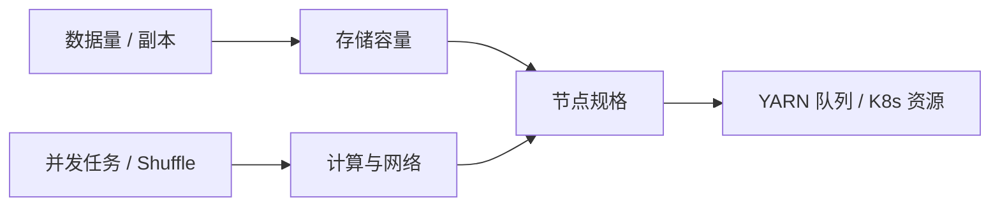

集群规划不是“买几台机器”，而是让存储、计算与网络在同一预算下匹配业务负载。配比失衡时，要么磁盘空着 CPU 打满，要么 CPU 空闲磁盘写满。

## 存算配比

- 先按原始数据量 × 副本数 × 增长预留估算存储；
- 中间结果与 Shuffle 需要额外磁盘；
- 计算按峰值并发任务与单任务资源估算；
- 存算一体集群按磁盘与 CPU 比例选型，存算分离则分别扩缩；
- 网络带宽影响 Shuffle 与多副本写入。

## 节点规格

- 磁盘：容量型与高性能盘分开，热数据用 SSD；
- CPU：核数决定并行度，超线程对大作业有收益；
- 内存：影响缓存与容器密度，YARN 以内存为主要调度单位；
- 网络：万兆起步，跨机架流量大的集群要评估收敛比。

## YARN 队列

- 按业务线划分队列，设置最小/最大容量；
- 核心任务高优先级，报表任务低优先级；
- 开启抢占或预留，避免大作业饿死小任务；
- 队列 ACL 控制提交权限；
- 监控队列使用率与排队时长。

## Kubernetes

- 用 requests/limits 声明资源，避免超卖；
- 按 namespace 隔离团队，配合 ResourceQuota；
- 大数据作业用 Operator 管理，注意 Driver/Executor 的资源申请；
- 弹性伸缩按队列长度或资源利用率触发。

## 多租户

- 资源隔离：队列/命名空间；
- 数据隔离：库表权限与脱敏；
- 任务隔离：优先级与并发限制；
- 成本分摊：按队列/标签统计资源使用。

## 扩容时机

- 存储使用率持续超过 70%；
- 队列长期排队，任务等待时间上升；
- Shuffle 与网络成为瓶颈；
- 扩容前先优化小文件、倾斜与资源浪费。

## 常见问题

- **磁盘先满**：数据增长快于计算需求；
- **CPU 打满但吞吐低**：任务并行度或 Shuffle 配置不合理；
- **队列配置失衡**：一个队列占满集群；
- **资源超卖**：容器 OOM 或节点不稳定；
- **扩容不扩网络**：计算增加后 Shuffle 更慢。

## 小结

- 容量由存储、计算与网络共同决定；
- 存算一体看配比，存算分离分别扩缩；
- YARN 队列与 K8s 配额实现资源隔离；
- 多租户要同时考虑资源、数据与成本；
- 扩容前先排查浪费与倾斜。
