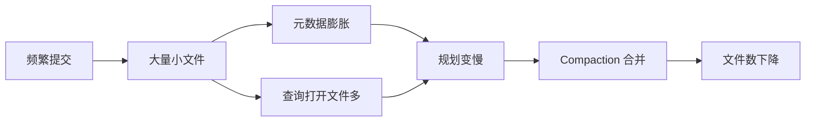

流式写入每隔几分钟提交一次，每次生成一批小文件。文件数增长后，查询规划、打开文件与元数据读取都会变慢，最终把小问题放大成平台问题。



## 成因

- 流式作业 Checkpoint 间隔短，频繁提交；
- 分区粒度过细，每个分区文件数少但目录多；
- 并发写入产生大量小文件；
- 上游数据量小、批次多；
- 更新操作生成删除文件与日志文件。

## 影响

- 元数据（Manifest/日志）文件数增长；
- 查询需要打开更多文件，IO 与 CPU 上升；
- 对象存储按请求计费，成本增加；
- 备份与同步变慢；
- 极端情况下超过元数据管理上限。

## Iceberg 的维护

```sql
-- Spark 过程
CALL catalog.system.rewrite_data_files(
  table => 'db.orders',
  options => map('target-file-size-bytes', '134217728')
);
```

- `rewrite_data_files` 合并小文件；
- `expire_snapshots` 清理旧快照；
- `remove_orphan_files` 删除孤儿文件；
- 按分区或表级调度，避免一次重写全表。

## Hudi 与 Delta

- Hudi：compaction 把 MoR 的日志合并为列式文件，可在线或离线调度；
- Delta：`OPTIMIZE` 合并小文件，`Z-ORDER` 优化多维过滤；
- 三者都需要清理旧版本与孤儿文件，否则存储持续增长。

## 调度策略

1. 低峰期运行，避免与主作业争抢资源；
2. 按分区增量执行，先处理最近与最热分区；
3. 设置目标文件大小（如 128–512MB）；
4. 记录合并前后文件数与查询耗时；
5. 合并后再做快照过期与孤儿清理。

## 监控

- 每张表的文件数与平均文件大小；
- 小文件占比（小于目标大小一半）；
- 元数据文件数量与大小；
- 查询规划时间与打开文件数；
- 合并任务的耗时与资源。

## 常见问题

- **只合并不清理**：旧快照与孤儿文件继续占空间；
- **一次全表合并**：资源消耗大、失败重跑成本高；
- **目标文件过大**：并行度下降，单任务变慢；
- **合并与写入冲突**：并发提交导致冲突，需要协调；
- **忽略分区表**：只处理热分区，冷分区继续膨胀。

## 小结

- 小文件来自频繁提交与细分区；
- 影响元数据、查询、成本与备份；
- Iceberg/Hudi/Delta 都提供合并与清理工具；
- 合并在低峰按分区增量执行；
- 监控文件数与平均大小，定期维护。
