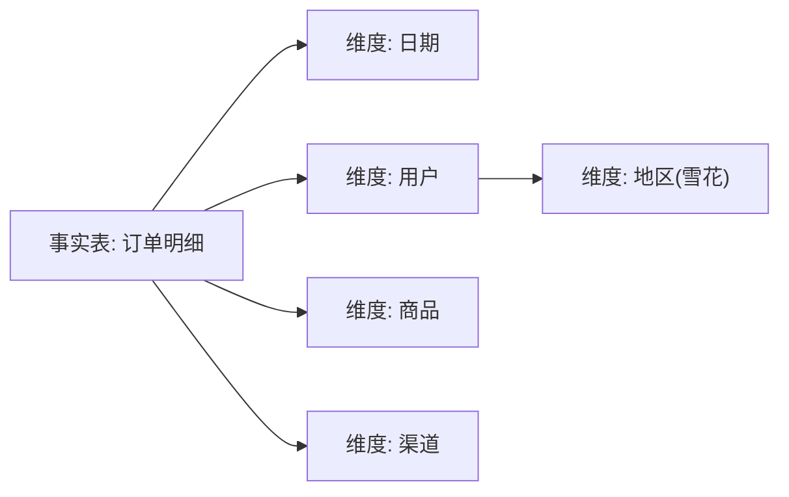

维度建模解决“业务人员怎么问数”：用一个可理解的事实表，加上若干描述维度，支撑切片、钻取与对比。它不追求范式最小，而追求查询直观与一致。

## 先声明粒度

粒度是事实表一行代表什么，例如“一次订单支付”“一天一个商品库存”。粒度必须在建模开始时确定，后续指标与维度都要围绕它。

粒度不清会导致：同一事实表混入不同粒度、指标重复计算、维度关联错误。

## 事实表类型

| 类型 | 含义 | 示例 |
| --- | --- | --- |
| 事务事实 | 一个业务事件一行 | 支付流水 |
| 周期快照 | 固定周期一行 | 每日库存 |
| 累积快照 | 一个流程一行，字段随阶段更新 | 订单履约 |

事实表通常只存数值度量与外键，描述性字段放到维度表。

## 维度表

- 描述业务实体：用户、商品、门店、日期；
- 使用代理键（自增/哈希），与业务键分离；
- 包含常用分层字段（品类、地区、渠道）；
- 日期维度预生成，包含节假日、周、月等属性；
- 维度要统一，避免每个事实表各建一套。

## 星型与雪花

- **星型**：事实表直接关联扁平维度，查询简单、Join 少；
- **雪花**：维度再规范化，减少冗余但增加 Join；
- 分析场景优先星型，维度冗余换来查询性能与可读性；
- 只有在维度层级复杂且变化频繁时才考虑雪花。

## 缓慢变化维

- **SCD1**：直接覆盖，不保留历史；
- **SCD2**：新增版本行，记录生效/失效时间与当前标志；
- **SCD3**：增加“上一值”列，只保留有限历史。

SCD2 能支持“按当时维度分析历史事实”，但事实表要记录维度代理键，而不是业务键。

## 代理键与业务键

- 业务键来自源系统，可能变化或重复；
- 代理键由数仓生成，稳定且唯一；
- 事实表存代理键，维度表同时保留业务键用于追溯；
- 代理键不要复用，避免历史关联错乱。

## 常见问题

- **粒度混用**：订单表里既有订单又有明细，指标翻倍；
- **维度不统一**：用户维度多套编码，口径对不上；
- **直接存业务键**：源系统改键后历史无法关联；
- **过度雪花**：Join 层数过多，查询变慢；
- **SCD 策略缺失**：历史分析只能用当前维度。

## 小结

- 维度建模先定粒度，再定事实与维度；
- 事实表存度量与外键，维度表存描述与层级；
- 分析优先星型，雪花只在必要时使用；
- 代理键保证历史稳定，SCD2 保留维度历史；
- 建模的核心是业务可理解与口径一致。
