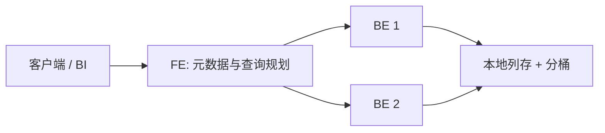

Doris 与 StarRocks 面向“实时报表 + 多表关联”的分析场景：MPP 执行让 Join 可以并行，主键模型支持更新，适合明细与汇总共存的看板。

## 架构

- **FE**：管理元数据、解析 SQL、生成分布式计划；
- **BE**：存储数据、执行扫描与聚合；
- 数据按分区与分桶分布到 BE；
- MPP 执行把查询拆成多个片段并行运行。

## 数据模型

| 模型 | 特点 | 适用 |
| --- | --- | --- |
| 明细模型 | 保留所有行 | 原始明细、宽表 |
| 聚合模型 | 按 key 预聚合 | 固定维度指标 |
| 主键模型 | 按主键更新 | 需要 upsert 的实时表 |

主键模型支持删除与更新，适合 CDC 同步；聚合模型在写入时合并，查询快但灵活性差。

## 分区与分桶

- 分区通常按日期，便于生命周期管理；
- 分桶按哈希，决定数据在 BE 上的分布；
- 分桶数影响并行度与数据倾斜；
- 分区裁剪与分桶裁剪能显著减少扫描。

## 物化视图

- 预计算常用聚合与 Join；
- 查询优化器可自动命中物化视图；
- 适合固定报表与高频查询；
- 需要维护刷新策略与存储成本。

## 与 ClickHouse 的差异

| 维度 | ClickHouse | Doris/StarRocks |
| --- | --- | --- |
| 单表聚合 | 很强 | 强 |
| 多表 Join | 较弱 | 较强 |
| 更新 | 代价高 | 主键模型支持 |
| 运维复杂度 | 中 | 中到高 |
| 生态 | 广 | 国内使用较多 |

## 常见问题

- **分桶不合理**：数据倾斜或并行度不足；
- **物化视图未命中**：查询条件与视图定义不匹配；
- **主键模型写入放大**：更新频繁导致合并压力；
- **小文件/小版本过多**：需要 compaction；
- **FE 单点**：生产要部署多 FE 并配置高可用。

## 小结

- FE 规划、BE 执行，MPP 让 Join 并行；
- 明细、聚合、主键模型按更新与查询需求选择；
- 分区裁剪与分桶是性能基础；
- 物化视图适合固定报表，需维护刷新；
- 多表 Join 与更新场景比 ClickHouse 更合适。
