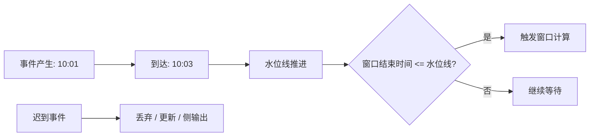

按处理时间计算简单，但结果取决于网络与调度；按事件时间计算才能得到可重放的业务结果。代价是要处理乱序，水位线就是“我认为某时间之前的数据已经到齐”的声明。



## 三种时间

| 时间 | 含义 | 用途 |
| --- | --- | --- |
| 事件时间 | 事件实际发生的时间 | 业务统计、可重放 |
| 摄入时间 | 进入 Flink 的时间 | 折中方案 |
| 处理时间 | 算子处理时的系统时间 | 低延迟、结果不稳定 |

事件时间来自数据本身，要求上游写入准确的时间戳。时间戳缺失或错误，水位线与窗口都会失效。

## 水位线

水位线是数据流中的特殊标记，表示“时间小于该值的事件应该已经到达”。生成策略：

- **周期性**：按处理时间间隔生成，适合大多数场景；
- **标点式**：遇到特定事件时生成；
- **单调递增**：假设时间戳基本有序；
- **有界乱序**：允许一定延迟，常用 `bounded-out-of-orderness`。

水位线推进过快会丢迟到数据，过慢会增加延迟与状态。按业务乱序程度设置容忍时间。

## 窗口

- **滚动窗口**：固定长度、不重叠；
- **滑动窗口**：固定长度、有步长、可重叠；
- **会话窗口**：按活动间隔切分，适合用户行为；
- 窗口结果通常按 key 聚合，keyBy 后并行计算。

```sql
SELECT TUMBLE_START(ts, INTERVAL '1' MINUTE) AS w,
       COUNT(*) AS cnt
FROM clicks
GROUP BY TUMBLE(ts, INTERVAL '1' MINUTE);
```

## 迟到数据

- **允许迟到**：窗口在水位线之后仍保留一段时间；
- **侧输出**：把超过容忍时间的迟到数据写到旁路，后续补算；
- **丢弃**：严格实时场景可接受少量丢失，但必须明确业务影响；
- **更新结果**：下游支持 upsert 时，可以修正已输出的窗口结果。

无论哪种策略，都要监控迟到数据的比例。比例突然升高，通常意味着上游时间戳或网络出现问题。

## 常见问题

- **时间戳单位错误**：毫秒与秒混用，窗口永远不触发；
- **水位线不推进**：某个分区没有数据，空闲分区拖住全局水位线；
- **窗口状态过大**：key 基数高、窗口长，Checkpoint 变慢；
- **乱序严重**：容忍时间不足，结果偏小；
- **时区问题**：事件时间与展示时区不一致。

## 小结

- 事件时间保证可重放，处理时间延迟低但不稳定；
- 水位线表达“数据到齐”的假设，设置要匹配乱序程度；
- 窗口按业务选择滚动、滑动或会话；
- 迟到数据要明确容忍、侧输出或丢弃策略；
- 监控水位线与迟到比例，能提前发现上游问题。
