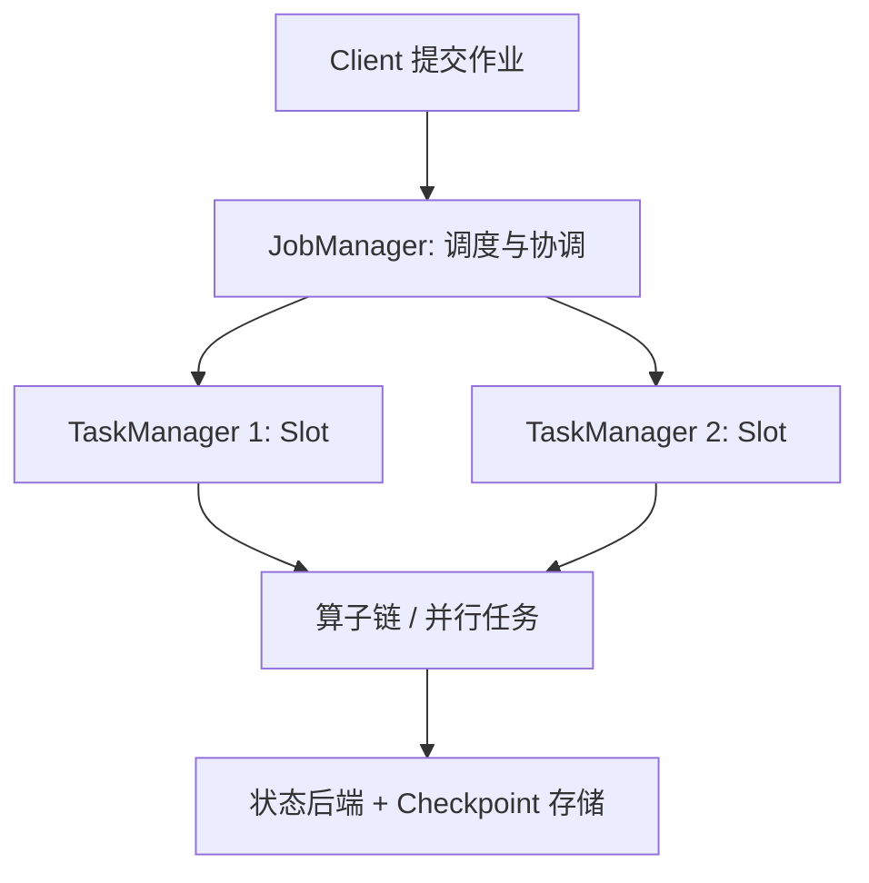

Flink 把“流”作为统一抽象：批是有界流，实时是无界流。运行时由 JobManager 协调、TaskManager 执行，状态与 Checkpoint 让它在故障后仍能保证一致性。

## 组件

- **JobManager**：接收作业、生成执行图、调度任务、协调 Checkpoint；
- **TaskManager**：提供 Slot，执行并行任务，管理本地状态；
- **Slot**：资源槽，决定单个 TaskManager 能并行多少任务；
- **Client**：提交作业、取消作业，不参与运行时调度。

JobManager 故障会导致作业重启，生产通常配合 Kubernetes Operator 或 HA 配置。

## 有界与无界

- **无界流**：持续到达，必须常驻运行；
- **有界流**：有明确结束，Flink 用批优化执行；
- 同一套 API 处理两种输入，但状态与容错策略不同；
- 实时数仓通常是无界流 + 有界维表。

## 并行度与算子链

- 并行度决定每个算子的并行实例数；
- 算子链把能合并的算子放在同一线程，减少序列化与网络；
- `keyBy` 会引入网络 Shuffle，后续算子按 key 分区；
- 并行度受 Slot 总数限制，资源不足时作业等待。

## 部署方式

| 方式 | 特点 |
| --- | --- |
| Standalone | 简单，资源固定 |
| YARN | 与 Hadoop 集群共享资源 |
| Kubernetes | 容器化、弹性，生产常用 |
| 云托管 | 平台负责升级与扩缩 |

生产多用 Kubernetes + Operator，作业镜像化，Checkpoint 存对象存储。

## 背压

当下游处理不过来，上游会被反压：

- Flink 通过信用机制感知下游缓冲；
- 背压表现为上游吞吐下降、Checkpoint 变慢；
- 常见原因：下游算子慢、状态过大、外部依赖阻塞；
- 处理方向是扩容并行度、优化算子、异步 IO。

## 常见问题

- **Slot 不足**：作业一直等待资源，检查 TaskManager 数量与 Slot；
- **Checkpoint 超时**：状态大或背压导致，缩短间隔或扩容；
- **数据倾斜**：keyBy 后热点 key 集中，需加盐或预聚合；
- **算子链断开**：频繁网络传输，检查 `disableChaining` 与并行度；
- **外部依赖阻塞**：同步调用数据库把算子卡死，改用异步 IO。

## 小结

- JobManager 协调、TaskManager 执行、Slot 提供资源；
- 有界与无界统一为流，批是流的有界特例；
- 并行度、算子链与 keyBy 决定数据流动方式；
- 背压是下游过载的信号，先扩容与优化算子；
- 状态与 Checkpoint 是下一篇的核心。
