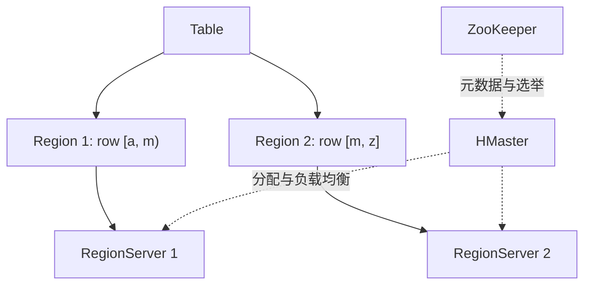

HBase 站在 HDFS 之上，提供按 RowKey 随机读写的能力。它不是“Hadoop 上的关系库”：没有 Schema 约束、没有跨行事务，查询方式由 RowKey 与 Scan 决定。



## 数据模型

| 概念 | 含义 |
| --- | --- |
| Namespace | 表的命名空间 |
| Table | 表，按 RowKey 排序 |
| Row | 一行，由 RowKey 唯一标识 |
| Column Family | 列族，建表时定义，存储与压缩的单位 |
| Qualifier | 列族下的列，可动态增加 |
| Cell | 行列交叉的值，带时间戳与版本 |
| Timestamp | 版本号，默认取写入时间 |

HBase 表是稀疏的：没有值的列不占空间；同一 Cell 可保留多个版本，按时间戳倒序读取。

## Region 与角色

- 表按 RowKey 范围切成 Region，每个 Region 只由一个 RegionServer 服务；
- Region 过大时分裂（split），由 HMaster 重新分配；
- HMaster 负责建表、Region 分配、负载均衡与故障恢复；
- ZooKeeper 保存元数据位置与 HMaster 选举；
- 数据实际存在 HDFS，RegionServer 提供读写路径。

## RowKey 设计

RowKey 决定读写分布与查询能力：

- 按字典序排序，范围 Scan 高效；
- 长度不宜过长，建议短且定长；
- 单调递增的 RowKey（时间戳、自增 ID）会集中写入最后一个 Region，形成热点；
- 散列前缀、加盐、反转可以打散热点；
- 查询模式决定 RowKey 组合，例如 `userId + 时间`。

```text
# 热点写法
20261127000001
20261127000002

# 加盐后
0a-20261127000001
7f-20261127000002
```

## 预分区

建表时预先切分 Region，避免写入初期只有一个 Region：

```bash
create 'orders', 'info', SPLITS => ['1', '3', '5', '7', '9']
```

- 分区边界要与 RowKey 分布匹配；
- 分区过多会增加元数据与 RegionServer 负担；
- 结合加盐前缀做预分区，写入可以均匀落到多个 Region。

## 列族设计

- 列族越少越好，通常 1–3 个；
- 同一列族的数据一起存储与压缩，访问模式要一致；
- 列族名尽量短，名字会写进每个 Cell；
- 版本数用 `VERSIONS` 控制，避免无限保留；
- TTL 让过期数据自动清理。

## 常见问题

- **RowKey 单调递增**：写入集中，Region 热点；
- **列族过多**：文件句柄与 flush 压力上升；
- **RowKey 过长**：索引与存储放大；
- **没有预分区**：初期写入全压在一个 Region；
- **把 HBase 当关系库**：复杂 Join 与事务不是它的强项。

## 小结

- HBase 是按 RowKey 排序的稀疏多维表，Cell 带时间戳；
- 表按 Region 切分，HMaster 分配，RegionServer 服务；
- RowKey 决定读写分布，避免单调递增导致热点；
- 加盐、散列、反转与预分区是打散热点的常用手段；
- 列族少而精，版本与 TTL 控制存储增长。
