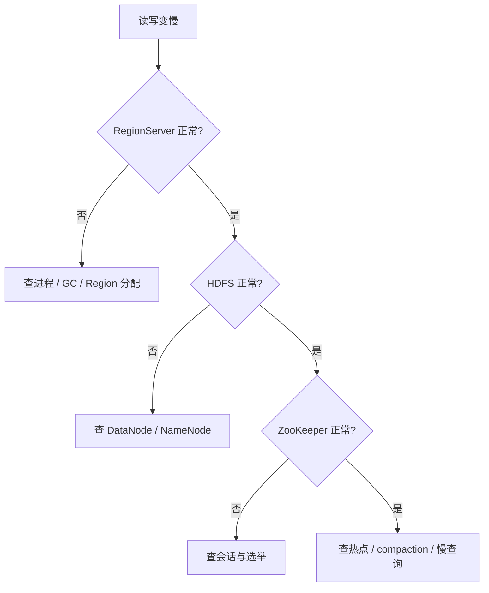

HBase 的问题很少只出在 HBase 本身：HDFS 抖动、ZooKeeper 会话超时、Region 热点都会表现为读写变慢。运维要先分清是存储层、协调层还是 RegionServer 层的问题。



## 集群角色

- **HMaster**：元数据管理、Region 分配、负载均衡；可部署备 Master；
- **RegionServer**：服务 Region 的读写，故障后 Region 会被重新分配；
- **ZooKeeper**：保存集群状态、Master 选举与 Region 位置；
- **HDFS**：实际数据存储，NameNode/DataNode 故障会直接传导到 HBase。

## 监控指标

| 层面 | 指标 |
| --- | --- |
| 集群 | Region 数、RegionServer 数、Master 状态 |
| RegionServer | 读写请求数、队列长度、GC 时间、堆内存 |
| Region | 大小、读写热点、split/merge 状态 |
| HDFS | 容量、块缺失、DataNode 存活 |
| ZooKeeper | 会话数、延迟、leader 状态 |

告警优先看：RegionServer 宕机、Region 处于 RIT（Region In Transition）、GC 停顿、HDFS 使用率。

## 常见故障

### RegionServer 宕机

- ZooKeeper 会话超时后，Master 把 Region 重新分配；
- 期间相关 Region 不可用，客户端重试；
- 恢复后避免立即重启大量 RegionServer，防止 Region 重新分配风暴。

### Region 热点

- 某个 Region 的读写请求远高于其他；
- 由 RowKey 单调递增或分区不均导致；
- 处理：预分区、加盐、拆分热点 Region、调整分片键。

### RIT（Region In Transition）

- Region 长时间处于 split/merge/assign 中间态；
- 常见于 Master 与 RegionServer 通信异常、HDFS 写入失败；
- 先用 `hbck` 检查一致性，再谨慎修复。

### compaction 堆积

- compaction 队列积压，读写延迟上升；
- 检查磁盘 IO 与 Region 文件数；
- 调整 compaction 策略或错峰执行大合并。

### ZooKeeper 会话超时

- 网络抖动或 GC 停顿导致会话过期；
- RegionServer 被 Master 判定失联；
- 检查 ZK 延迟、GC 日志与网络。

## split 与 merge

- Region 过大会自动 split，新 Region 由 Master 分配；
- 小 Region 过多时用 merge 合并，减少元数据与管理开销；
- 预分区能减少早期 split；
- split 策略可按大小或自定义策略。

## 备份与恢复

- **Snapshot**：轻量、快速，基于 HDFS 文件引用；恢复时 clone 或 restore；
- **Export/Import**：导出到 HDFS，适合跨集群迁移；
- **CopyTable**：集群间复制；
- 备份要覆盖表结构与数据，并定期恢复演练。

```bash
snapshot 'orders', 'orders-20261127'
clone_snapshot 'orders-20261127', 'orders_restore'
```

## 常见问题

- **只监控 HBase 不监控 HDFS**：底层故障被误判为 HBase 问题；
- **RegionServer 内存过大**：Full GC 导致会话超时与宕机；
- **备份只做 Export**：大数据量导出慢，Snapshot 更合适；
- **RIT 强行修复**：可能造成数据不一致，先查原因；
- **热点不处理**：单 Region 打满，扩容无效。

## 小结

- HBase 依赖 HDFS 与 ZooKeeper，排障要分层看；
- 监控 RegionServer、Region、GC 与 HDFS；
- RegionServer 故障会触发 Region 重新分配，避免重启风暴；
- 热点通过 RowKey、预分区与 split 处理；
- Snapshot 是首选备份方式，定期做恢复演练。
