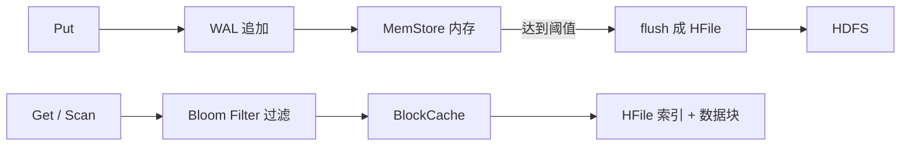

HBase 的读写不是直接改 HDFS 文件。写入先进入内存与日志，读取要跨 MemStore、BlockCache 与多个 HFile 查找。理解这条路径，才能解释写放大、读延迟与 compaction 卡顿。



## 写入路径

1. 客户端找到目标 Region 对应的 RegionServer；
2. 先追加 WAL（Write-Ahead Log），保证宕机可恢复；
3. 写入 MemStore，按 RowKey 排序；
4. MemStore 达到阈值后 flush 成 HFile；
5. HFile 写入 HDFS，复制由 HDFS 保证。

写入是“追加 + 内存排序”，因此随机写也能保持较高吞吐。代价是 flush 与 compaction 的写放大。

## 读取路径

- 先查 MemStore；
- 再查 BlockCache（热点数据块缓存）；
- 用 Bloom Filter 判断 HFile 是否可能包含目标 RowKey；
- 通过 HFile 索引定位数据块；
- 合并多个版本，按时间戳返回。

Scan 会按 RowKey 顺序跨 Region 读取，设置 `startRow`、`stopRow`、`caching` 与 `batch` 控制范围与批量。

## Compaction

- **Minor compaction**：合并少量小 HFile，减少文件数；
- **Major compaction**：合并一个 Region 的全部 HFile，清理过期版本与删除标记；
- compaction 消耗磁盘 IO 与网络，可能影响读写延迟；
- 大合并建议错峰，或使用 `MOB`/分层存储策略。

## 性能调优

| 方向 | 手段 |
| --- | --- |
| 写入 | 批量 Put、关闭自动 flush、合理 MemStore 大小 |
| 读取 | 缓存、Bloom Filter、限制 Scan 范围 |
| 分布 | RowKey 散列、预分区、避免热点 |
| 存储 | 压缩（Snappy/Zstd）、合理 HFile 大小 |
| 版本 | 控制 VERSIONS 与 TTL |

批量写入：

```java
try (Table table = connection.getTable(TableName.valueOf("orders"))) {
  List<Put> puts = new ArrayList<>();
  puts.add(new Put(Bytes.toBytes(rowKey)).addColumn(
    Bytes.toBytes("info"), Bytes.toBytes("amount"), Bytes.toBytes("199")));
  table.put(puts);
}
```

- 单条 Put 的 RPC 开销远大于批量；
- 批量不宜过大，避免单次请求超时与内存压力；
- 写入失败要能重试，RowKey 幂等。

## 常见问题

- **Region 热点**：写入集中，单台 RegionServer 打满；
- **compaction 风暴**：大量小文件同时合并，读写抖动；
- **Bloom Filter 未开**：随机读要扫描过多 HFile；
- **Scan 无边界**：全表扫描拖垮集群；
- **版本过多**：同一 Cell 保留大量历史，存储与读放大。

## 小结

- 写入走 WAL + MemStore，flush 成 HFile；
- 读取依赖 MemStore、BlockCache、Bloom Filter 与 HFile 索引；
- compaction 控制文件数与版本，但消耗 IO；
- 批量写、限制 Scan、合理 RowKey 是性能基础；
- 热点与 compaction 是 HBase 运维的两大长期问题。
