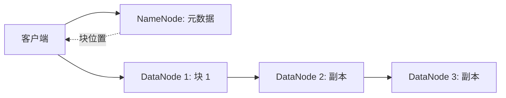
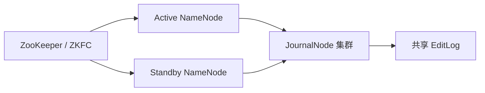

HDFS 的假设很明确：硬件会坏、文件很大、一次写入多次读取。它不是通用文件系统，不适合大量小文件与随机修改。理解这些假设，才能判断什么时候该用它。

## 主从架构

- **NameNode**：维护文件系统命名空间与块映射，所有元数据在内存中；
- **DataNode**：按块存储数据，定期发送心跳与块报告；
- 文件被切成块（默认 128MB），每块按副本因子保存多份；
- NameNode 不参与数据读写，只返回块位置。

元数据规模决定 NameNode 内存上限，文件越多、块越多，内存压力越大。小文件是 HDFS 的天然敌人。

## 块与副本

- 默认块 128MB，适合大文件顺序读写；
- 默认副本 3，第一份在本机/同机架，第二份跨机架，第三份在另一机架的另一节点；
- 副本保证节点或机架故障时数据仍可读；
- 机架感知减少跨机架流量，同时保留容灾能力。

副本因子可以按文件设置，但降低副本会削弱可靠性，生产不要为了省空间随意改成 1。

## 写入与读取

写入：

1. 客户端向 NameNode 申请新块与目标节点；
2. 客户端把数据写入第一个 DataNode；
3. 第一个节点边写本地边转发给第二个，第二个再转发给第三个；
4. 流水线完成后客户端关闭文件。

读取：

- 客户端从 NameNode 获取块位置；
- 优先读同节点、同机架的副本；
- 校验和不匹配时自动切换到其他副本。

## NameNode HA

单 NameNode 是早期 HDFS 的单点。生产使用双 NameNode + JournalNode：

- Active 与 Standby 通过 JournalNode 同步 EditLog；
- ZooKeeper 或 ZKFC 负责故障切换；
- 客户端通过 Nameservice 访问，不直接绑定某一台；
- 切换期间会有短暂不可用，需要重试。

## 适用与不适用

适合：

- GB 到 TB 级大文件；
- 一次写入、多次读取的批处理；
- 顺序流式读取；
- 与 MapReduce/Spark 同集群部署。

不适合：

- 海量小文件（元数据压力）；
- 低延迟随机读写；
- 频繁修改文件；
- 需要 POSIX 完整语义的场景。

## 常见问题

- **小文件过多**：NameNode 内存与查询都受影响，需要合并或使用对象存储；
- **副本不足**：节点故障后数据不可读，检查 `dfs.replication` 与 DataNode 状态；
- **磁盘不均衡**：新节点加入后需要 rebalance；
- **Safemode**：NameNode 启动时等待块报告，期间只读或不可用；
- **HA 切换失败**：JournalNode 或 ZKFC 异常，先看 NameNode 日志。

## 小结

- HDFS 为大数据文件与流式读取设计，主从架构；
- NameNode 管元数据，DataNode 存块，副本默认 3；
- 写入走流水线，读取优先就近副本；
- 生产用双 NameNode + JournalNode 做 HA；
- 小文件与随机读写不是 HDFS 的强项。
