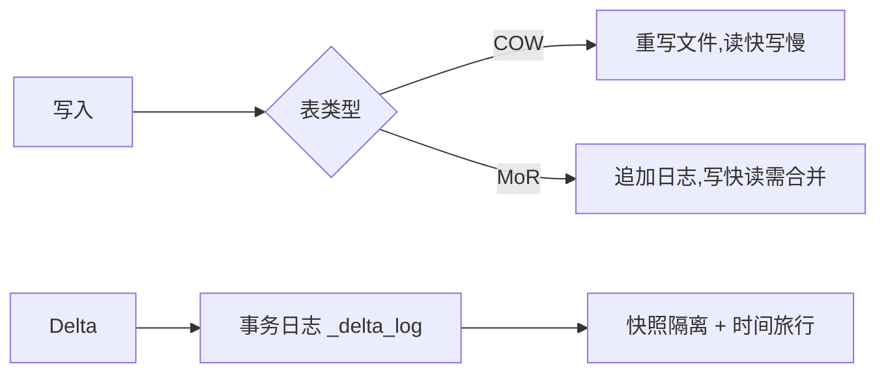

湖仓表格式不止 Iceberg。Hudi 偏重“可更新、增量拉取”，Delta Lake 以事务日志和 Spark 生态见长。选择取决于写入模式与查询引擎，而不是功能清单。

## Hudi

- **COW（Copy-on-Write）**：更新时重写整个文件，读性能好、写放大；
- **MoR（Merge-on-Read）**：更新写入日志文件，读取时合并，写快读慢；
- 支持 Upsert、增量查询（incremental query）与时间旅行；
- 索引（Bloom、HBase）加速记录定位；
- 需要定期 compaction 把日志合并为列式文件。

适合需要频繁更新、下游按增量消费的场景。

## Delta Lake

- 以 `_delta_log` 事务日志记录每次提交；
- 提供 ACID、快照隔离与时间旅行；
- 与 Spark 深度集成，`MERGE INTO` 支持 upsert；
- `OPTIMIZE` 合并小文件，`Z-ORDER` 提升多维过滤；
- 其他引擎通过连接器读取，生态较 Hudi/Iceberg 窄一些。

## 对比

| 维度 | Hudi | Delta Lake |
| --- | --- | --- |
| 写入模型 | COW / MoR | 事务日志 + 文件重写 |
| 更新能力 | 强，支持增量拉取 | 强，MERGE 友好 |
| 读取 | COW 快，MoR 需合并 | 依赖日志与文件 |
| 引擎生态 | Flink/Spark 较常用 | Spark 最成熟 |
| 维护 | compaction、清理 | OPTIMIZE、VACUUM |

## 选型建议

- Spark 为主、需要 MERGE 与时间旅行：Delta；
- Flink 写入、需要增量消费与频繁更新：Hudi；
- 多引擎共享、隐藏分区与表演进：Iceberg；
- 已有 Hive 生态且更新少：普通 Hive 表 + 分区即可。

三者都能解决“对象存储上的事务表”，差异在写入路径与生态，不必同时上多套。

## 常见问题

- **MoR 读取变慢**：日志未合并，查询要合并大量文件；
- **小文件过多**：频繁提交与分区过细，需要 compaction；
- **时间旅行依赖过多快照**：旧快照未清理，元数据膨胀；
- **并发写冲突**：缺少锁或 Catalog 并发控制；
- **只写不维护**：表逐渐不可用。

## 小结

- Hudi 的 COW/MoR 面向不同读写取舍；
- Delta 以事务日志提供 ACID 与时间旅行，Spark 生态最好；
- 选型看写入引擎、更新频率与查询方式；
- compaction、清理与并发控制是共同运维项；
- 不要在同一平台堆叠多套表格式。
