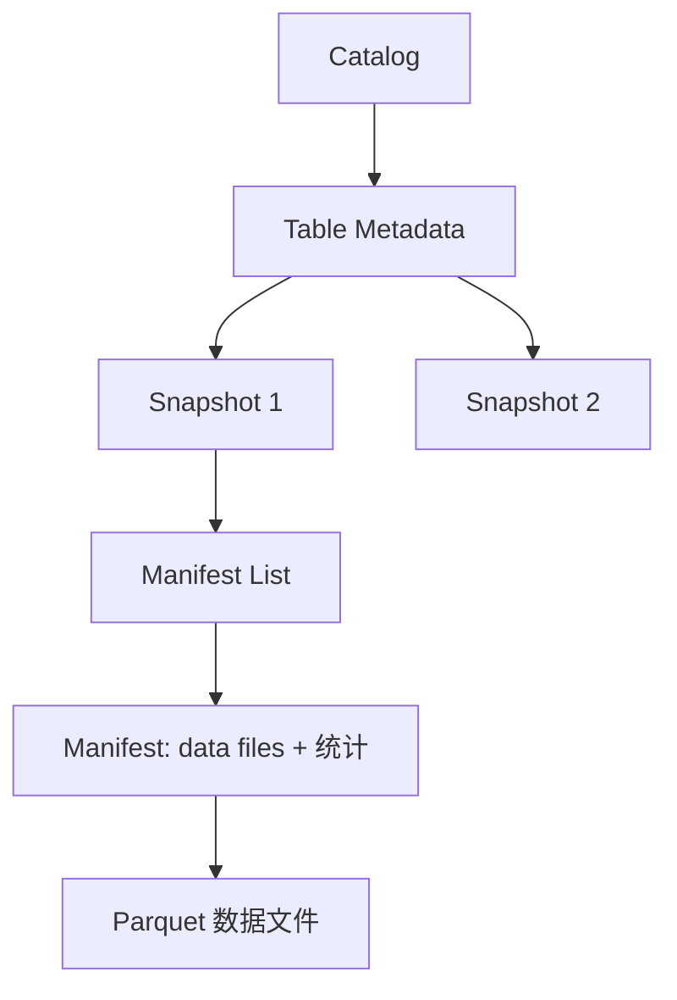

Iceberg 解决的是“对象存储上的表没有事务与目录”的问题。它用元数据文件记录快照，把数据文件组织成可追溯的版本，让 Spark、Flink、Trino 能安全地读写同一张表。



## 元数据树

- **Catalog**：表名到元数据位置的映射（Hive、REST、Glue）；
- **Table Metadata**：Schema、分区规则、快照列表；
- **Snapshot**：某一时刻的完整数据视图；
- **Manifest List**：快照包含哪些 Manifest；
- **Manifest**：数据文件路径与列统计（min/max、null 数）；
- **Data File**：Parquet/ORC/Avro 实际数据。

查询时先读元数据与 Manifest，利用统计信息裁剪文件，再读数据文件。这就是 Iceberg 的“文件级谓词下推”。

## 快照与时间旅行

```sql
SELECT * FROM orders VERSION AS OF 1234567890;
SELECT * FROM orders TIMESTAMP AS OF '2026-11-25 00:00:00';
```

- 每次提交生成新快照，旧快照保留到过期清理；
- 时间旅行用于排查、回滚与可复现分析；
- 快照过期（expire snapshots）释放旧文件，需配置保留策略。

## 隐藏分区

Iceberg 支持分区演进，并且分区可以隐藏在元数据中：

```sql
CREATE TABLE orders (id BIGINT, ts TIMESTAMP, region STRING)
USING iceberg
PARTITIONED BY (days(ts), region);
```

- 查询不需要写分区列，优化器自动裁剪；
- 分区规则可以演进，旧数据不重写；
- 避免 Hive 分区目录与查询条件强耦合的问题。

## Schema 演进

- 支持新增、删除、重命名列与类型提升；
- 列 ID 稳定，重命名不会破坏历史数据；
- 删除列不会立即重写文件，读取时按 Schema 投影；
- 演进要避免不兼容的类型变更。

## 写入与维护

- Spark/Flink 写入生成新数据文件与 Manifest；
- 小文件需要 compaction 合并；
- 定期 expire snapshots 与清理孤儿文件；
- 元数据文件数量也要控制，避免 Manifest 过大。

## Catalog 选择

| Catalog | 适用 |
| --- | --- |
| Hive Metastore | 已有 Hive 生态 |
| REST Catalog | 多引擎、云原生 |
| AWS Glue | AWS 环境 |
| 文件系统 Catalog | 测试与本地 |

Catalog 是并发控制与表发现的中心，生产要保证其高可用。

## 常见问题

- **快照不清理**：元数据与旧文件无限增长；
- **小文件过多**：查询规划与打开文件开销大；
- **并发写冲突**：多个作业同时提交，Catalog 需支持原子提交；
- **分区演进后旧查询变慢**：统计信息与 Manifest 需要维护；
- **直接删文件**：绕过元数据导致表损坏。

## 小结

- Iceberg 用元数据树管理数据文件，提供 ACID 与快照；
- Manifest 的列统计支撑文件级裁剪；
- 隐藏分区与分区演进降低查询耦合；
- Schema 演进依赖稳定的列 ID；
- Catalog、快照清理与 compaction 是运维重点。
