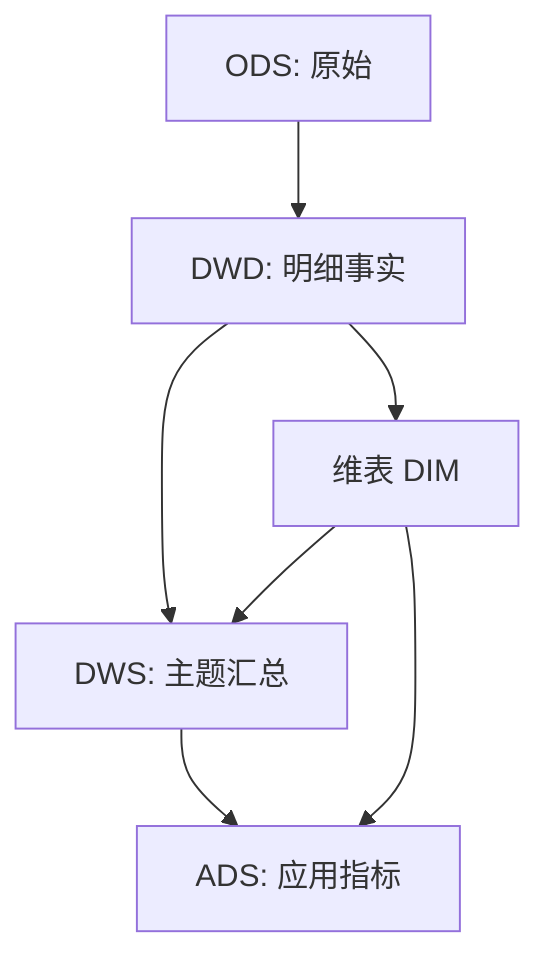

数仓分层的目的不是“多建几层表”，而是让每一层只解决一类问题：原始数据可追溯、明细可复用、汇总可复用、应用层薄。层与层的边界清楚，指标才不会各算各的。

## ODS

- 与源系统结构一致，尽量不做业务加工；
- 保留原始字段与分区，便于回溯；
- 只做必要的类型统一与脏数据隔离；
- 命名常见 `ods_业务_表_增量/全量`。

ODS 不是“随便堆原始文件”，仍要有分区、压缩与生命周期管理。

## DWD

- 清洗、去重、标准化后的明细事实；
- 一行一个业务事件，粒度明确；
- 统一字段命名、枚举值与时间格式；
- 关联必要的维度键，但不做重度聚合；
- 命名常见 `dwd_主题_实体_事件`。

DWD 是复用率最高的一层，设计时要考虑下游多种分析场景。

## DWS

- 按主题与维度做轻度汇总；
- 粒度通常是“天/小时 × 维度组合”；
- 指标可加、可复用，避免 ADS 重复计算；
- 命名常见 `dws_主题_维度_粒度`；
- 注意维度组合膨胀，按常用分析路径设计。

## ADS

- 直接服务报表、接口与看板；
- 结构与前端需求对齐，字段可读性优先；
- 数据量小，可放 OLAP 或缓存；
- 命名常见 `ads_应用_指标`；
- 不承担跨应用复用职责，复用下沉到 DWS。

## 维表

- 统一维度编码，避免同名不同义；
- 缓慢变化维（SCD）按业务选择保留历史或覆盖；
- 维表要稳定，变更走版本与审批；
- 公共维度独立成层，供 DWD/DWS 复用。

## 命名与分区

- 表名包含层、主题、实体与更新方式；
- 分区字段统一（如 `dt`），格式固定；
- 增量表与全量表明确区分；
- 注释与负责人写进元数据。

## 常见问题

- **跳过 DWD 直接做 ADS**：指标无法复用，口径重复；
- **DWS 粒度过细**：维度组合爆炸，存储与计算成本上升；
- **ODS 做业务加工**：原始数据不可追溯；
- **ADS 被多个应用复用**：需求一变就互相影响；
- **维表不统一**：同名维度在不同表里含义不同。

## 小结

- ODS 保原始，DWD 保明细复用，DWS 保汇总复用，ADS 保应用交付；
- 每层粒度与命名要固定，避免口径漂移；
- 维表独立管理，统一编码与变更策略；
- 分层不是越多越好，按团队与场景裁剪；
- 复用下沉，ADS 保持薄。
