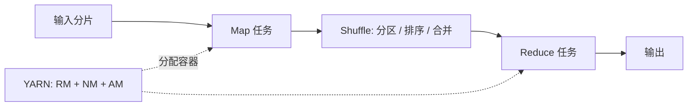

MapReduce 是 Hadoop 的第一代计算模型，YARN 是它的资源管理层。今天直接写 MapReduce 作业的场景不多，但“分片 → 并行 → 聚合”的思想仍是所有分布式计算的底层。

## MapReduce 模型

- **Map**：对每个输入分片并行处理，输出键值对；
- **Shuffle**：按 key 分区、排序、合并，把相同 key 发往同一 reducer；
- **Reduce**：对同一 key 的值聚合，输出结果。

一个作业的并行度由输入分片数决定，每个分片通常对应一个 HDFS 块。Shuffle 是性能核心，也是磁盘与网络开销的主要来源。

## 为什么被 Spark 取代

- 每个阶段都要落盘，多阶段作业反复读写 HDFS；
- 只提供 map/reduce 两种算子，复杂逻辑要拆成多个作业；
- 迭代计算（机器学习）每次都要重读数据；
- 开发效率低，调试与优化成本高。

Spark 把中间结果留在内存/本地磁盘，用 DAG 组织多阶段，迭代与交互式分析优势明显。MapReduce 仍适合超大规模、一次性、容错要求极高的批作业。

## YARN 架构

| 组件 | 职责 |
| --- | --- |
| ResourceManager | 全局资源分配与调度 |
| NodeManager | 单节点资源管理与容器启动 |
| ApplicationMaster | 单个应用的调度与容错 |
| Container | 资源与进程的隔离单元 |

作业提交后：

1. RM 分配一个容器启动 AM；
2. AM 向 RM 申请资源；
3. RM 返回 NodeManager 上的容器；
4. AM 在容器中启动任务并监控；
5. 失败时 AM 重新申请资源重试。

## 调度器

- **Capacity Scheduler**：按队列分配容量，适合多团队共享；
- **Fair Scheduler**：动态公平分配，适合交互与批混跑；
- 队列要设置最小/最大资源，避免一个大作业吃满集群；
- 生产按业务线划分队列，并配置 ACL。

## 资源模型

- 容器按 CPU 与内存申请，内存是主要约束；
- `yarn.nodemanager.resource.memory-mb` 决定单节点可分配内存；
- 资源不足时作业排队，表现为“提交成功但一直 ACCEPTED”；
- 小容器过多会增加 AM 与调度开销。

## 常见问题

- **数据倾斜**：某个 key 数据量过大，单个 reduce 拖慢整个作业；
- **Shuffle 失败**：磁盘满、网络抖动或 map 输出过大；
- **容器被 kill**：超出内存限制，检查 `Container killed by YARN`；
- **队列资源不足**：作业长期排队，先看队列使用率；
- **小文件输入**：分片过多，map 任务启动开销大于计算。

## 小结

- MapReduce 用 map、shuffle、reduce 处理有界数据；
- 多阶段落盘与算子受限，使它在大数据分析中被 Spark 取代；
- YARN 负责资源分配、容器与容错；
- 队列与资源模型决定作业能否按时获得资源；
- 倾斜、Shuffle 与容器内存是最常见的故障点。
