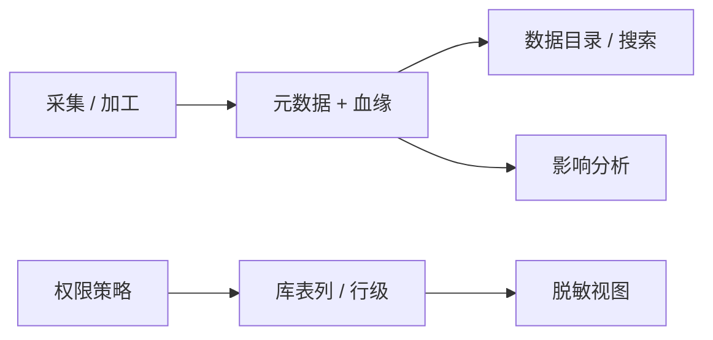

数据平台规模变大后，“有哪些表、这列从哪来、谁能看”会成为比计算更棘手的问题。元数据、血缘、权限与脱敏共同构成治理底座。

## 元数据

- **技术元数据**：表结构、分区、存储格式、文件数、更新时间；
- **业务元数据**：业务含义、负责人、指标口径、标签；
- **操作元数据**：任务、运行时长、数据量、质量结果。

元数据要自动采集，靠人工维护很快过期。采集频率与任务调度对齐。

## 血缘

- **表级血缘**：上游表到下游表；
- **字段级血缘**：列级来源与去向；
- 来源：SQL 解析、任务依赖、运行时采集；
- 用途：影响分析、故障定位、废弃表清理、合规审计。

字段级血缘比表级难得多，SQL 复杂时解析可能不完整，需要人工补录。

## 权限

- 库、表、列三级授权；
- 行级权限按业务线或区域过滤；
- 读写分离，生产表默认只读；
- 申请与审批留痕；
- 定期回收过期权限。

权限过宽是数据泄露的主要路径。默认拒绝、按需申请比“先给全权限再收”更安全。

## 脱敏

- 静态脱敏：写入时替换，适合测试环境；
- 动态脱敏：查询时按权限返回掩码，适合生产；
- 常见字段：手机号、身份证、银行卡、地址；
- 脱敏后仍要保持可关联性时，用哈希加盐；
- 脱敏规则与权限策略统一管理。

## 审计

- 记录谁在什么时间访问了哪张表、哪些列；
- 导出、下载与 API 调用同样审计；
- 审计日志单独存储，限制访问；
- 定期审查异常访问与权限变更。

## 常见问题

- **元数据无人维护**：搜不到表，口径靠问人；
- **血缘缺失**：改表不知道影响谁；
- **权限泛滥**：所有人都是管理员；
- **脱敏只在测试库**：生产导出仍泄露；
- **审计日志与数据同库**：被一并删除。

## 小结

- 元数据分技术、业务与操作三类，应自动采集；
- 血缘用于影响分析与合规审计，字段级更难但更有价值；
- 权限默认拒绝，库表列与行级按需授权；
- 脱敏分静态与动态，生产优先动态；
- 审计覆盖访问、导出与权限变更。
