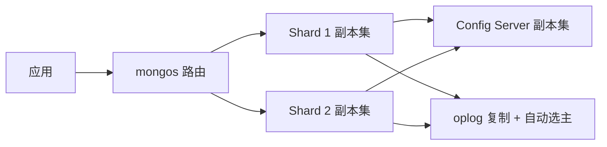

MongoDB 的高可用与扩展是两套机制：副本集解决节点故障与读扩展，分片解决数据量与写入扩展。两者可以叠加，但复杂度也随之上升。



## 副本集

- 一个 primary、多个 secondary，可选 arbiter；
- 写只进 primary，secondary 通过 oplog 复制；
- primary 故障时，多数派成员选举新主；
- 建议 3 或 5 个数据节点，保证多数派；
- arbiter 只参与投票，不存数据，适合预算有限但需奇数票的场景。

读偏好：

| 模式 | 行为 |
| --- | --- |
| primary | 只读主，强一致 |
| primaryPreferred | 主可用读主，否则读从 |
| secondary | 只读从，可能读到旧数据 |
| nearest | 读延迟最低的成员 |

写关注：

```javascript
db.orders.insertOne(doc, { writeConcern: { w: "majority", j: true } })
```

- `w:1` 主节点确认即返回，故障可能丢最近写入；
- `w:"majority"` 多数派确认，可靠性更高、延迟更大；
- `j:true` 等待 journal 落盘。

读关注 `readConcern: "majority"` 能避免读到尚未多数确认的数据，但同样增加延迟。

## 分片

- `mongos`：查询路由；
- `config server`：保存分片元数据，必须是副本集；
- `shard`：实际数据节点，通常是副本集；
- 分片键决定数据分布，选择后难以更改；
- chunk 是数据迁移单位，balancer 负责均衡。

分片键选择：

- **范围分片**：按时间或 ID 范围，适合范围查询，容易写热点；
- **哈希分片**：分布均匀，范围查询会广播到所有分片；
- 高基数、低频率、非单调递增的字段更适合；
- 复合分片键可以兼顾查询与分布。

```javascript
sh.enableSharding("shop")
sh.shardCollection("shop.orders", { userId: "hashed" })
```

## 运维

监控：

```javascript
db.serverStatus()
db.currentOp()
db.stats()
```

关注：

- 连接数与队列；
- 复制延迟（secondary 的 oplog 落后）；
- 分片 chunk 分布与迁移；
- 慢查询与全表扫描；
- 磁盘与 WiredTiger 缓存使用。

备份：

- `mongodump`/`mongorestore` 逻辑备份；
- 文件系统快照或云盘快照（需保证一致性）；
- 副本集可从 secondary 备份，降低主库压力；
- 分片集群要同时备份 config server 与各分片。

升级：

- 先升级 secondary，再 step down primary；
- 副本集滚动升级期间保持多数派可用；
- 跨大版本升级要核对兼容性与索引格式。

## 常见问题

- **分片键选择错误**：写入集中在一个 chunk，无法均衡；
- **读从库读到旧数据**：写后立即读要走 primary；
- **多数派不可用**：副本集失去多数派后无法选主；
- **备份只备主库**：分片或 config 缺失导致无法恢复；
- **副本集成员数为偶数**：选举可能僵持，建议奇数或加 arbiter。

## 小结

- 副本集用 oplog 复制，primary 故障由多数派选举；
- 读偏好与写关注在一致性与延迟之间取舍；
- 分片用 mongos + config server + shard，分片键决定分布；
- 范围分片易热点，哈希分片分布均匀但范围查询广播；
- 监控复制延迟、chunk 均衡与慢查询，备份覆盖 config 与所有分片。
