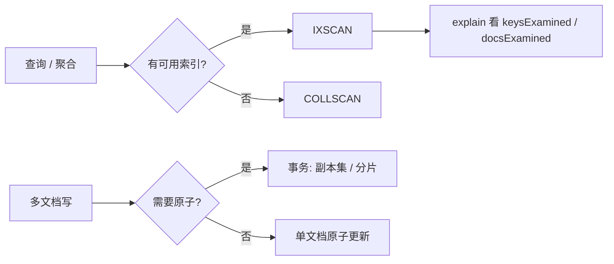

MongoDB 的查询性能同样取决于索引与执行计划。聚合管道把计算下沉到数据库，事务则补上了多文档一致性，但两者都有明确的适用边界。



## 索引类型

```javascript
db.orders.createIndex({ userId: 1, createdAt: -1 })
db.users.createIndex({ email: 1 }, { unique: true })
db.sessions.createIndex({ expireAt: 1 }, { expireAfterSeconds: 0 })
db.orders.createIndex(
  { status: 1 },
  { partialFilterExpression: { status: "pending" } },
)
```

| 类型 | 用途 |
| --- | --- |
| 单字段 | 常规过滤与排序 |
| 复合索引 | 多条件查询，字段顺序重要 |
| 唯一索引 | 业务唯一性 |
| TTL 索引 | 过期数据自动删除 |
| 部分索引 | 只索引满足条件的文档 |
| 文本索引 | 全文搜索 |
| 地理索引 | 位置查询 |

复合索引同样遵循最左前缀：`{ userId: 1, createdAt: -1 }` 支持按 `userId` 过滤并按时间排序，单独按 `createdAt` 查询则用不上。

## explain 与覆盖查询

```javascript
db.orders.find({ userId: 1 }).sort({ createdAt: -1 }).explain("executionStats")
```

关注：

- `stage`：`IXSCAN` 走索引，`COLLSCAN` 全表扫描；
- `keysExamined` 与 `docsExamined`：扫描的索引键与文档数；
- `totalDocsExamined` 远大于返回条数，说明索引不够精确；
- 查询字段与排序字段都在索引中时，可以只读索引（covered query）。

## 聚合管道

```javascript
db.orders.aggregate([
  { $match: { status: "paid", createdAt: { $gte: ISODate("2026-11-01") } } },
  { $group: { _id: "$userId", total: { $sum: "$amount" } } },
  { $sort: { total: -1 } },
  { $limit: 10 },
])
```

- `$match` 尽量放最前，优先利用索引；
- `$group` 之后索引失效，聚合本身消耗内存；
- `$lookup` 做关联，数据量大时成本高，能嵌入就嵌入；
- `$unwind` 展开数组，会放大文档数；
- `allowDiskUse(true)` 允许落盘，避免内存超限。

## 事务

```javascript
const session = db.getMongo().startSession()
session.startTransaction({
  readConcern: { level: "snapshot" },
  writeConcern: { w: "majority" },
})

try {
  const orders = session.getDatabase("shop").orders
  orders.updateOne({ _id: orderId }, { $set: { status: "paid" } })
  session.getDatabase("shop").inventory.updateOne(
    { sku: "A1" },
    { $inc: { stock: -1 } },
  )
  session.commitTransaction()
} catch (e) {
  session.abortTransaction()
  throw e
} finally {
  session.endSession()
}
```

限制：

- 4.0 起副本集支持多文档事务，4.2 起分片支持；
- 单个事务默认 60 秒，超时会中止；
- 事务内不能创建集合与索引；
- 事务的 oplog 条目受 16MB 限制；
- 跨分片事务成本更高，能按分片键设计就避免跨片。

## 索引与事务的取舍

- 事务保证一致性，但会持锁与增加开销，能单文档原子更新就不要开事务；
- 高频写入的集合，索引越多写入越慢；
- TTL 索引适合会话、验证码、临时日志；
- 部分索引能显著减小索引体积，但查询条件必须匹配。

## 常见问题

- **复合索引字段顺序错**：排序用不上索引；
- **聚合 `$match` 放在 `$group` 后**：无法利用索引；
- **过度使用 `$lookup`**：把 MongoDB 当关系库；
- **事务里做长计算**：超过 60 秒被中止；
- **TTL 索引误删数据**：过期字段类型或时区设置错误。

## 小结

- 索引决定查询能否走 IXSCAN，复合索引遵守最左前缀；
- `explain` 看 keysExamined 与 docsExamined；
- 聚合把 `$match` 前置，谨慎使用 `$lookup`；
- 多文档事务适用于副本集与分片，有 60 秒与大小限制；
- 能单文档原子更新就不要开事务，写入频繁时控制索引数量。
