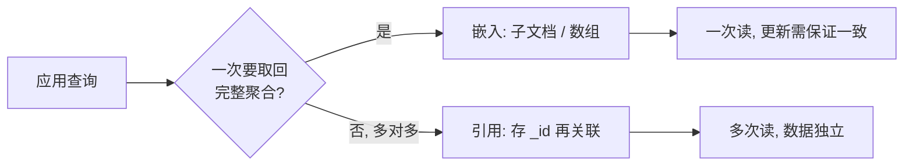

关系型数据库先定表结构再写数据，MongoDB 反过来：先看数据怎么被读写，再决定文档里放什么。文档模型让一次查询取回完整对象，但也把“如何组织字段”的责任交给了开发者。



## 文档与集合

```javascript
use shop

db.users.insertOne({
  _id: ObjectId(),
  name: "Ada",
  email: "ada@example.com",
  addresses: [
    { city: "Shanghai", zip: "200000" },
  ],
  createdAt: new Date(),
})
```

- 数据库包含集合，集合包含文档；
- 文档是 BSON，字段可嵌套、可数组；
- 每个文档有 `_id`，未指定时自动生成 ObjectId；
- 单个文档上限 16MB，超过应拆分为多文档；
- 集合默认不校验 Schema，需要约束时用 JSON Schema 校验。

## 嵌入还是引用

| 关系 | 建议 |
| --- | --- |
| 一对一、一对少 | 嵌入子文档 |
| 一对多且子数据常独立查询 | 引用（子文档存父 `_id`） |
| 多对多 | 双方各存对方 `_id` 数组，或中间集合 |
| 子数据无限增长 | 引用，避免文档超过 16MB |

嵌入的收益是一次读取代价是更新一致性与文档膨胀；引用的收益是独立与可扩展，代价是多次查询或 `$lookup`。

## CRUD

```javascript
// 插入
db.orders.insertMany([
  { userId: 1, amount: 199, status: "paid" },
  { userId: 2, amount: 59,  status: "pending" },
])

// 查询
db.orders.find({ status: "paid", amount: { $gte: 100 } })
  .sort({ amount: -1 })
  .limit(20)

// 更新
db.orders.updateOne(
  { _id: orderId, status: "pending" },
  { $set: { status: "paid" }, $currentDate: { paidAt: true } },
)

// 删除
db.orders.deleteOne({ _id: orderId })
```

要点：

- `updateOne` 只改匹配的第一条，批量用 `updateMany`；
- `$set` 局部更新，整文档替换会丢字段；
- 更新条件带上状态，能实现乐观并发控制；
- 写操作默认 `writeConcern: w:1`，需要更强保证时显式指定。

## 查询操作符

```javascript
db.products.find({
  category: { $in: ["book", "course"] },
  price: { $gt: 10, $lte: 100 },
  tags: { $all: ["new", "sale"] },
  reviews: { $elemMatch: { rating: { $gte: 4 }, user: "ada" } },
})
```

- `$in`/`$nin`：集合匹配；
- `$elemMatch`：数组元素同时满足多个条件；
- `$exists`：字段是否存在；
- `$regex`：正则匹配，前缀正则才能走索引；
- `$expr`：在查询里使用聚合表达式。

## 建模步骤

1. 列出核心查询与写入路径；
2. 确定哪些数据总是一起读；
3. 一对多判断嵌入还是引用；
4. 预估文档大小与增长；
5. 为高频查询建索引；
6. 用真实数据量验证。

## 常见问题

- **文档无限增长**：评论、日志直接嵌入，最终超过 16MB；
- **过度规范化**：每个字段都拆集合，查询需要多次往返；
- **用 MongoDB 做复杂 Join**：`$lookup` 可用但不适合重度关联；
- **忽略写关注**：默认 `w:1`，主节点故障可能丢最近写入；
- **集合无校验**：脏数据进入后再清洗成本高。

## 小结

- MongoDB 以 BSON 文档为单元，集合不强制固定结构；
- 建模由访问模式驱动，嵌入与引用按读写路径选择；
- 单文档 16MB 上限决定子数据是否独立成集合；
- CRUD 用 `$set` 局部更新，条件更新可实现乐观锁；
- Schema 校验与索引是文档模型的两条安全边界。
