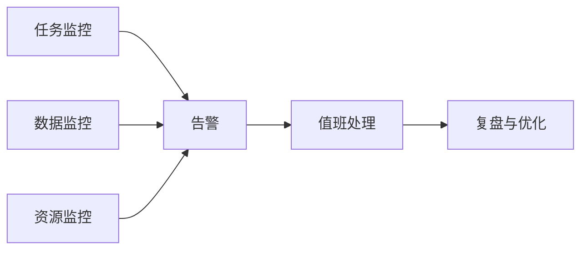

平台“能跑”与“可信”是两件事：任务成功不代表数据准时，资源充足不代表成本合理。监控要覆盖任务、数据与资源三条线。

## 任务监控

- 成功率、失败次数、重试次数；
- 运行时长与 SLA；
- 排队时长与并发；
- 失败原因分类（代码、资源、依赖、数据）。

## 数据监控

- 分区就绪时间与数据延迟；
- 行数、字节数与环比波动；
- 质量规则通过率；
- 实时链路 lag 与 Checkpoint 状态。

## 资源监控

- CPU、内存、磁盘、网络；
- YARN 队列使用率与等待任务；
- 小文件数量与平均文件大小；
- 存储增长与副本放大。

## 常见故障

| 现象 | 排查方向 |
| --- | --- |
| 任务大面积失败 | 资源不足、依赖故障、代码发布 |
| 单任务长尾 | 数据倾斜、Shuffle、外部依赖 |
| 数据延迟 | 上游未就绪、调度阻塞、实时 lag |
| 查询变慢 | 小文件、分区过多、统计信息过期 |
| 磁盘写满 | 保留策略、日志、临时文件 |

处理顺序：先止血（暂停下游/扩容/限流），再定位根因，最后补监控与规则。

## 成本构成

- 存储：原始数据、副本、中间结果、备份；
- 计算：常驻集群、批作业、流作业；
- 网络：跨区流量、Shuffle、公网出口；
- 商业组件与托管服务。

## 优化顺序

1. **消除浪费**：闲置集群、未清理临时表、过期快照；
2. **存储治理**：压缩格式、生命周期、冷热分层；
3. **计算治理**：小任务合并、资源规格、弹性伸缩；
4. **数据治理**：避免重复建设与全量重跑；
5. **预留与承诺**：稳定负载用长期折扣。

先做前两步，收益最大且风险最低。

## 常见误区

- **只看任务成功率**：数据延迟与质量问题被忽略；
- **告警无分级**：所有问题都打电话，最终没人看；
- **为省成本砍副本**：故障时无法恢复；
- **只扩计算不治小文件**：成本上升、性能不升；
- **没有成本分摊**：不知道哪个团队该优化。

## 小结

- 监控覆盖任务、数据与资源三条线；
- 故障先止血，再定位，最后补规则；
- 成本优化从浪费、存储、计算、治理依次推进；
- 可靠性冗余不应成为优化对象；
- 成本可见性与分摊是持续优化的前提。
