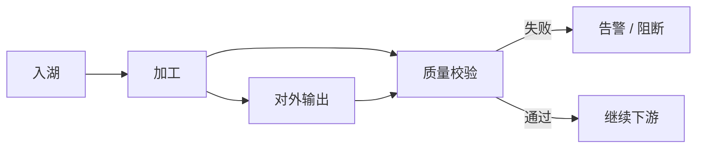

数据质量问题的代价往往在报表或决策之后才出现。把校验放在数据链路中，能在错误扩散前阻断或告警。

## 五类规则

| 维度 | 规则示例 |
| --- | --- |
| 完整性 | 主键非空、必填字段非空、分区行数不为 0 |
| 唯一性 | 主键唯一、业务键唯一 |
| 及时性 | 分区在约定时间前就绪 |
| 准确性 | 金额范围、枚举值、日期合法 |
| 一致性 | 主从表行数一致、汇总等于明细 |

规则要写成可执行 SQL 或断言，而不是口头约定。

## 校验时机

- **入湖前**：拦截明显错误，避免污染原始层；
- **加工后**：检查聚合结果与明细是否一致；
- **对外前**：发布指标前做最终校验；
- **持续监控**：对核心表按小时/天扫描。

越早发现问题，修复成本越低。

## 告警与阻断

- 严重问题阻断下游任务，防止错误扩散；
- 轻微问题告警并标记数据质量状态；
- 告警包含表、分区、规则、实际值与阈值；
- 同一问题去重，避免告警风暴；
- 建立值班与处理时限。

## 根因与修复

1. 确认影响范围（表、分区、时间）；
2. 定位来源（上游变更、代码 bug、迟到数据）；
3. 修复后重跑受影响分区；
4. 通知下游与业务方；
5. 补充规则，防止同类问题再次发生。

## 常见质量问题

- **上游字段变更**：类型或枚举变化导致解析失败；
- **迟到数据**：分区已产出但数据未全到；
- **重复写入**：重跑不幂等，行数翻倍；
- **空值激增**：上游采集或解析异常；
- **口径变更**：指标 SQL 改了但未同步文档。

## 指标

- 规则通过率；
- 问题发现到修复的时长；
- 重复问题占比；
- 受影响的下游任务数。

## 小结

- 质量规则覆盖完整性、唯一性、及时性、准确性与一致性；
- 校验放在入湖、加工与对外三个关口；
- 严重问题阻断，轻微问题告警；
- 修复流程要包含影响范围与补规则；
- 质量指标用于衡量治理效果。
