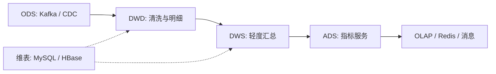

实时数仓的目标不是“所有指标都秒级”，而是让需要及时性的指标走流，其余仍走批。流批共用一套分层与口径，才能避免两套数字打架。



## 分层

- **ODS**：原始日志与 CDC，保留原始结构；
- **DWD**：清洗、去重、标准化，形成明细事实；
- **DWS**：按主题与维度轻度聚合；
- **ADS**：面向看板与接口的指标结果。

实时层通常只覆盖核心链路，历史与全量仍由离线层补齐。

## 流式聚合

```sql
CREATE TABLE dwd_orders (
  order_id STRING,
  user_id  STRING,
  amount   DECIMAL(12,2),
  ts       TIMESTAMP(3),
  WATERMARK FOR ts AS ts - INTERVAL '5' SECOND
) WITH ('connector' = 'kafka', ...);

SELECT
  TUMBLE_START(ts, INTERVAL '1' MINUTE) AS win,
  COUNT(*) AS order_cnt,
  SUM(amount) AS gmv
FROM dwd_orders
GROUP BY TUMBLE(ts, INTERVAL '1' MINUTE);
```

窗口聚合会持续更新结果，下游要能接收撤回流或 upsert。

## 维表关联

```sql
SELECT o.order_id, o.amount, u.city
FROM dwd_orders AS o
JOIN dim_user FOR SYSTEM_TIME AS OF o.proc_time AS u
ON o.user_id = u.user_id;
```

- Lookup Join 在处理时查询外部维表，适合维度变化不频繁；
- 维表要加缓存与 TTL，避免每条记录都打数据库；
- 维表延迟会影响关联结果，需监控查询耗时。

## 双流 Join

- **Interval Join**：两条流在时间区间内关联，适合订单与支付；
- **Regular Join**：保留双方状态，状态会持续增长，必须设置 TTL；
- **Temporal Join**：按版本时间关联维表历史，适合汇率、价格；
- 双流 join 的状态大小与乱序容忍度要提前评估。

## 结果输出

- 写入 OLAP（ClickHouse/Doris）供查询；
- 写入 Kafka 供下游消费；
- 写入 Redis 供接口低延迟读取；
- Sink 要支持幂等或事务，保证端到端一致性。

## 口径一致

- 实时与离线使用同一套指标定义与维度编码；
- 时间窗口、时区、去重规则保持一致；
- 实时结果允许“进行中”，离线结果作为最终值；
- 建立对账机制，比较同一时间段的实时与离线结果。

## 常见问题

- **状态膨胀**：双流 join 没有 TTL，Checkpoint 越来越大；
- **维表查询打爆数据库**：缺少缓存与限流；
- **窗口结果重复**：Sink 非幂等，重启后重复写入；
- **口径不一致**：实时与离线过滤条件不同；
- **数据延迟**：源端或水位线阻塞，监控端到端延迟。

## 小结

- 实时数仓沿用 ODS/DWD/DWS/ADS 分层；
- Flink SQL 覆盖窗口聚合、维表 join 与双流 join；
- 维表要缓存，双流 join 要控制状态；
- Sink 的幂等与事务决定端到端一致性；
- 实时与离线必须共用指标口径并定期对账。
