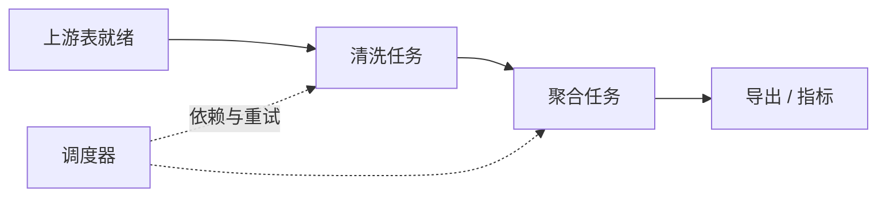

数据平台每天有成百上千个任务，靠 crontab 只能解决“按时启动”，解决不了依赖、重试、补数与阻塞。调度器把这些规则变成可管理的 DAG。

## DAG 与依赖

- DAG 描述任务之间的有向依赖，不能有环；
- 任务只有在所有上游成功后才会执行；
- 依赖可以按时间（每日 02:00）与数据（上游分区就绪）组合；
- 失败任务按策略重试，超过次数后阻塞下游。

依赖写错比任务失败更常见：漏掉一个上游，任务会在数据未就绪时运行，产出错误结果。

## Airflow

- 用 Python 定义 DAG，灵活、可编程；
- Scheduler 解析 DAG，Executor 执行任务；
- 支持回填（backfill）与 SLA 告警；
- 适合工程团队，DAG 可纳入代码评审。

缺点是调度器与元数据库需要维护，大量小任务时调度压力明显。

## DolphinScheduler

- 可视化编排，适合数据团队与运维共同使用；
- 支持多租户、队列与优先级；
- 内置补数与依赖任务类型；
- 与 Hadoop/Spark/Flink 任务集成较好。

选择取决于团队习惯：代码化选 Airflow，可视化与多租户选 DolphinScheduler。

## 补数与重跑

- 补数按历史日期批量重跑；
- 补数必须幂等，重复执行不产生重复数据；
- 补数任务要限流，避免打满集群；
- 补数完成后触发下游，保持依赖一致；
- 记录补数范围与结果。

## 并发与资源

- 限制同一队列的并发任务数；
- 区分高优先级核心链路与低优先级报表；
- 设置任务超时与 SLA；
- 避免所有任务整点启动造成资源尖峰。

## 常见问题

- **依赖缺失**：任务读到未就绪的上游分区；
- **时区不一致**：调度时间与业务日期错位；
- **补数不幂等**：重复写入导致数据翻倍；
- **任务堆积**：并发过高，资源争抢；
- **失败无告警**：下游延迟到用户发现。

## 小结

- 调度器管理 DAG、依赖、重试与补数；
- Airflow 代码化灵活，DolphinScheduler 可视化多租户；
- 依赖要按数据就绪而非仅按时间；
- 补数必须幂等并限流；
- 并发、SLA 与告警是生产调度的基础配置。
