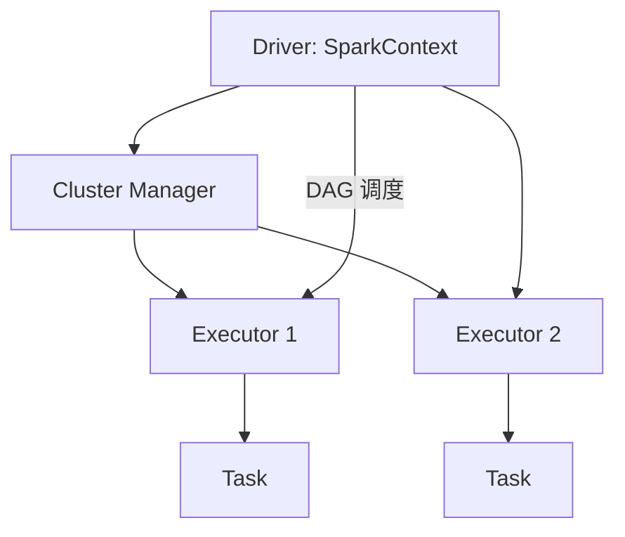

Spark 的性能来自“把多阶段计算组织成 DAG，并尽量把中间数据留在内存”。理解 Driver、Executor 与 Stage 的划分，才能解释一个作业为什么被拆成多次 Shuffle、为什么某个 Stage 特别慢。



## 组件

- **Driver**：运行 main、创建 SparkContext、解析 DAG、调度任务；
- **Executor**：工作节点上的进程，执行 Task 并缓存数据；
- **Cluster Manager**：Standalone、YARN 或 Kubernetes，负责资源；
- **Task**：最小执行单元，一个分区一个 Task。

Driver 必须能被 Executor 访问，集群模式下 Driver 运行在集群内，客户端模式运行在提交机器上。

## Job、Stage 与 Task

- **Job**：一次行动算子（count、collect、save）触发；
- **Stage**：按 Shuffle 边界切分，宽依赖产生新 Stage；
- **Task**：Stage 内按分区并行执行。

```text
Job 1
├── Stage 0: map/filter
├── Shuffle
└── Stage 1: groupBy/aggregate
```

窄依赖（map、filter）可以在同一 Stage 流水线执行；宽依赖（groupByKey、join）需要 Shuffle，落盘并跨节点传输。

## 惰性求值

转换算子只记录血缘，不立即执行；行动算子才触发计算。这让 Spark 能整体优化执行计划，也意味着“写了代码却没跑”是常见现象。

```python
df = spark.read.parquet("s3://bucket/orders")   # 未读
df = df.filter("amount > 100")                  # 仍未读
df.count()                                      # 触发 Job
```

## 部署模式

| 模式 | Driver 位置 | 适用 |
| --- | --- | --- |
| client | 提交机器 | 交互调试、Notebook |
| cluster | 集群内 | 生产作业 |

生产用 cluster 模式，避免提交机断连导致作业失败。`spark-submit` 负责上传代码与配置。

## 内存模型

- Executor 内存分为执行内存与存储内存，可动态借用；
- 缓存（persist/cache）占用存储内存，内存不足会落盘；
- Shuffle 需要临时磁盘与网络；
- 序列化（Kryo）影响内存与网络开销。

## 常见问题

- **Stage 过多**：频繁 Shuffle，检查是否可以用宽依赖替代；
- **Executor 空闲**：分区数少于核数，增大并行度；
- **Driver OOM**：collect 到 Driver 的数据过大，改用写文件或聚合；
- **任务长尾**：数据倾斜，见调优篇；
- **缓存不生效**：persist 后又被新 DataFrame 覆盖，注意变量复用。

## 小结

- Driver 调度、Executor 执行，资源由 Cluster Manager 提供；
- Job 按 Shuffle 边界切 Stage，Stage 内按分区生成 Task；
- 转换惰性、行动触发，执行计划可以整体优化；
- 生产用 cluster 模式，Driver 不依赖提交机；
- Shuffle、分区与内存是 Spark 性能的三个关键词。
