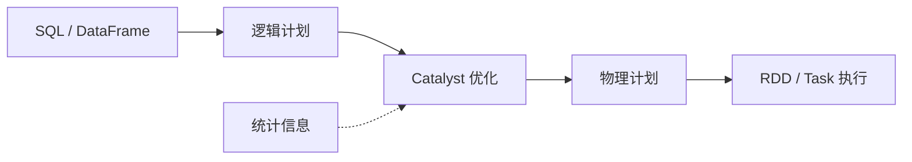

Spark SQL 是 Spark 使用频率最高的入口：同一套 SQL 能跑在 Parquet、Hive 表、Iceberg 与流式数据上。它的性能取决于优化器能否把过滤、列裁剪与 Join 下推到正确的位置。



## DataFrame 与 SQL

```python
orders = spark.read.parquet("s3://bucket/orders")
orders.createOrReplaceTempView("orders")

spark.sql("""
  SELECT user_id, SUM(amount) AS total
  FROM orders
  WHERE dt = '2026-11-25'
  GROUP BY user_id
""").show()
```

DataFrame API 与 SQL 最终都走同一条优化链路，选择取决于可读性与复用方式。复杂逻辑用 SQL，参数化与单元测试用 DataFrame 更自然。

## Catalyst 优化

1. 解析 SQL 为未解析逻辑计划；
2. 绑定表、列与类型，形成逻辑计划；
3. 规则优化：谓词下推、列裁剪、常量折叠、Join 重排；
4. 生成多个物理计划，按成本选择；
5. 编译为 RDD 执行。

统计信息影响 Join 顺序与策略。表长期不 `ANALYZE`，优化器只能按默认值估算，容易选错。

## 谓词下推与列裁剪

- 过滤条件下推到数据源，Parquet 只读匹配的 Row Group；
- 只读取 SELECT 需要的列，减少 IO；
- 分区字段放在过滤条件里，直接跳过目录；
- 函数包裹分区字段会让下推失效。

```sql
-- 可下推
WHERE dt = '2026-11-25'
-- 失效
WHERE date_format(dt, 'yyyy-MM-dd') = '2026-11-25'
```

## Join 策略

| 策略 | 适用 | 注意 |
| --- | --- | --- |
| Broadcast Hash Join | 小表可放进内存 | 小表不能太大，避免 Driver/Executor OOM |
| Sort Merge Join | 两表都大 | 需要 Shuffle 与排序 |
| Shuffle Hash Join | 单侧分区可放入内存 | 分区倾斜时风险高 |

小表广播由 `spark.sql.autoBroadcastJoinThreshold` 控制，也可以显式提示：

```sql
SELECT /*+ BROADCAST(dim) */ *
FROM fact JOIN dim ON fact.dim_id = dim.id;
```

## 文件与分区

- 分区字段选择高基数、常用过滤的列（日期、区域）；
- 单分区文件数控制在合理范围，避免小文件；
- 写前按分区重分布，减少每个分区的小文件；
- 使用 Parquet/ORC 获得列裁剪与统计信息。

## 常见问题

- **全表扫描**：过滤条件没用分区或索引，检查执行计划；
- **Join 选错**：统计信息缺失或小表估算过大；
- **广播 OOM**：阈值过大，把大表当小表；
- **分区过多**：目录与小文件膨胀；
- **UDF 阻断优化**：尽量用内置函数，UDF 会阻止下推。

## 小结

- SQL 与 DataFrame 共享 Catalyst 优化链路；
- 谓词下推、列裁剪与分区过滤决定 IO；
- Join 策略依赖统计信息与表大小；
- 分区与文件格式影响扫描范围与小文件数量；
- 看执行计划比猜参数更有效。
