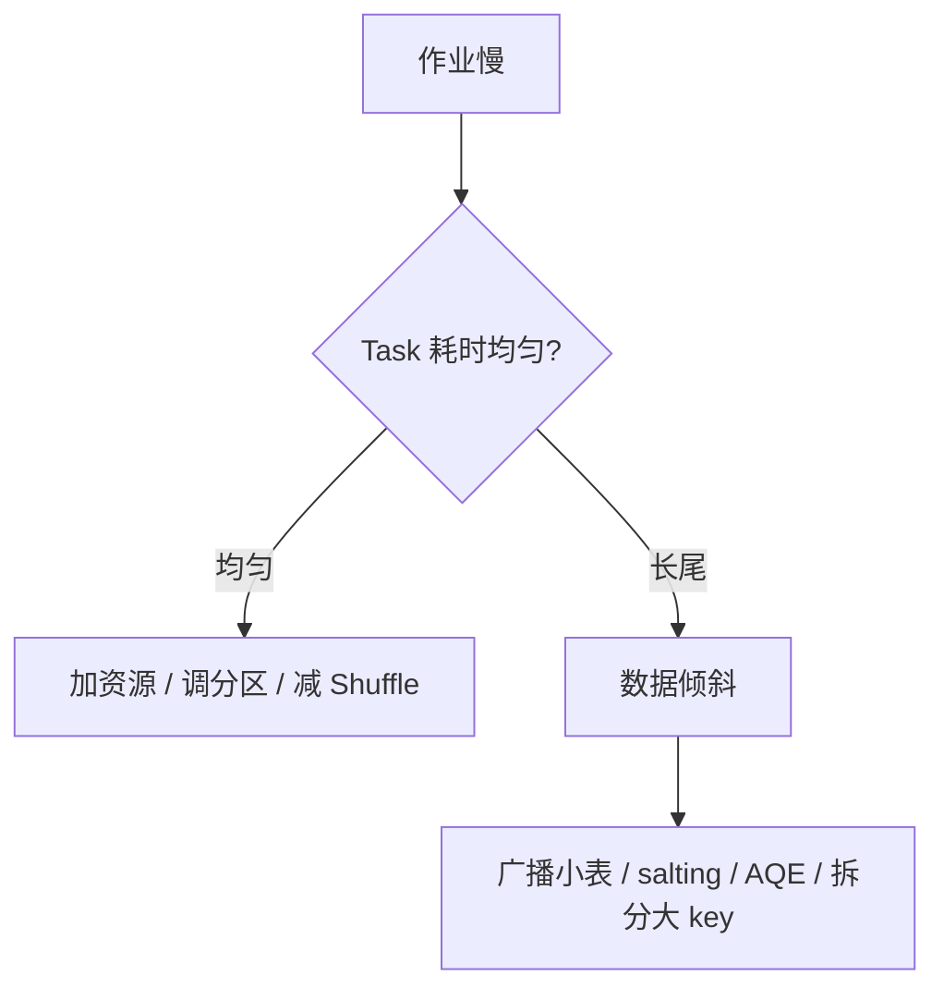

Spark 作业慢，先看 Stage 的 Task 耗时分布：如果少数 Task 远慢于其他，是倾斜；如果所有 Task 都慢，是资源或 Shuffle 配置问题。两类问题处理方式完全不同。



## Shuffle 的成本

Shuffle 把数据按 key 重新分区，涉及：

- map 端写临时文件与索引；
- 网络传输；
- reduce 端拉取、合并与排序；
- 磁盘与内存同时承压。

减少 Shuffle 的方式：能广播就广播、能提前过滤就过滤、避免不必要的 `groupByKey`（用 `reduceByKey`/聚合代替）。

## 分区数

```text
spark.sql.shuffle.partitions=200
```

- 默认 200 对大作业偏小、对小作业偏大；
- 经验值：核数 × 2–3，再按数据量调整；
- 分区太小：单任务数据量大，容易 OOM；
- 分区太大：任务调度与小文件开销上升；
- AQE 开启后会动态合并分区。

## 数据倾斜

识别：

- Stage 内少数 Task 处理的数据量远大于其他；
- Task 耗时 P99 是中位数的数倍；
- Shuffle spill 集中在少数 Task。

处理：

1. **广播小表**：大表 join 小表时避免 Shuffle；
2. **加盐（salting）**：给热点 key 加随机前缀，聚合后再合并；
3. **拆分热点 key**：把大 key 单独处理，其余正常 join；
4. **AQE 倾斜处理**：`spark.sql.adaptive.skewJoin.enabled=true`；
5. **两阶段聚合**：先局部聚合再全局聚合。

```sql
-- 广播提示
SELECT /*+ BROADCAST(dim) */ *
FROM fact JOIN dim ON fact.id = dim.id;
```

## AQE

自适应查询执行在运行时根据统计信息调整计划：

```text
spark.sql.adaptive.enabled=true
spark.sql.adaptive.coalescePartitions.enabled=true
spark.sql.adaptive.skewJoin.enabled=true
```

- 动态合并小分区；
- 运行时切换 Join 策略；
- 处理倾斜分区；
- 需要 Spark 3.x 及以上，部分场景与静态提示冲突。

## 内存与序列化

- 使用 Kryo 序列化，减少内存与网络开销；
- 避免在 Executor 中缓存超大对象；
- 关注 spill（内存不足落盘），它会显著拖慢任务；
- UDF 尽量用内置函数，减少序列化与 Python 进程通信。

## 小文件

- 写前按分区重分布，控制每个分区文件数；
- 输出后做 compaction；
- 动态分区写入容易产生大量小文件，开启 AQE 或限制分区数。

## 常见问题

- **collect 到 Driver**：结果集过大导致 Driver OOM；
- **笛卡尔积**：Join 条件缺失，任务数爆炸；
- **缓存滥用**：persist 大表占满存储内存；
- **分区键基数过高**：单分区数据过小，调度开销大。

## 小结

- 先区分“均匀慢”与“长尾慢”；
- Shuffle 是主要成本，能广播与预聚合就减少 Shuffle；
- 分区数按核数与数据量调整，AQE 可动态合并；
- 倾斜处理优先广播，其次加盐与拆分；
- 序列化、内存与 spill 决定单 Task 的稳定上限。
