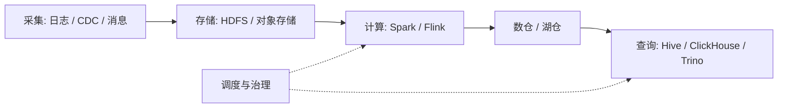

大数据平台常被当成“装一堆组件”，真正需要先回答的是：数据从哪来、存在哪、怎么算、给谁查。每个组件只负责其中一段，选型顺序错了，后面会不断补丁。

## 五层职责

| 层 | 解决什么 | 常见组件 |
| --- | --- | --- |
| 采集 | 把数据搬进平台 | Flume、Filebeat、CDC、Kafka |
| 存储 | 低成本、可扩展地保存原始与加工数据 | HDFS、S3/OSS、HBase |
| 计算 | 批量或流式处理 | MapReduce、Spark、Flink |
| 建仓 | 组织分层与指标 | Hive、Iceberg、Hudi |
| 查询 | 面向分析的低延迟读取 | ClickHouse、Doris、Trino |

调度（Airflow、DolphinScheduler）与治理（元数据、质量、权限）横跨各层，不是独立的一层，但决定平台能否长期运行。

## 存储决定上限

存储选型决定成本与后续计算方式：

- HDFS 适合自建集群、顺序大文件读取；
- 对象存储适合存算分离、按量计费与海量文件；
- 文件格式决定压缩率与查询跳过能力，Parquet/ORC 是列式分析的主流；
- 小文件会拖垮 NameNode 与查询，需要在写入端合并。

先确定“数据放哪、用什么格式”，再谈计算引擎。反过来先上 Spark，存储仍是大量小文件，性能问题不会消失。

## 计算按延迟选

- **批处理**：小时/天级，吞吐优先，Spark 是事实标准；
- **流处理**：秒级/亚秒级，Flink 提供事件时间、状态与 Exactly-once；
- **即席查询**：交互式分析，走 OLAP 引擎或 Trino 联邦查询；
- **轻量转换**：能用 SQL 就不写代码，Hive/Spark SQL 降低维护成本。

## 平台能力的下限

- 调度：任务依赖、失败重试、补数；
- 元数据与血缘：知道表从哪来、被谁用；
- 数据质量：空值、唯一性、波动监控；
- 权限：库表列级授权与脱敏；
- 监控：任务失败率、数据延迟、资源使用。

这些能力缺失时，平台会在“数据不准、任务没人管、权限失控”上付出更高代价。

## 选型顺序

1. 明确数据量与延迟要求；
2. 选存储（自建 HDFS 还是对象存储）与文件格式；
3. 选计算（批、流或两者）；
4. 选查询引擎与数仓分层；
5. 最后补调度、质量与权限。

## 常见误区

- **组件堆叠**：每层都有多套，维护成本翻倍；
- **先买计算再想存储**：小文件与冷数据拖垮集群；
- **把 Kafka 当存储**：消息保留有限，不能替代数据湖；
- **跳过治理**：表和指标口径失控，平台无法交付可信数据。

## 小结

- 大数据是采集、存储、计算、建仓、查询的链路；
- 存储与文件格式决定成本上限，计算按延迟选择；
- 批用 Spark、流用 Flink，查询按场景选 OLAP；
- 调度与治理是平台可用的前提；
- 选型顺序是存储 → 计算 → 查询 → 治理。
