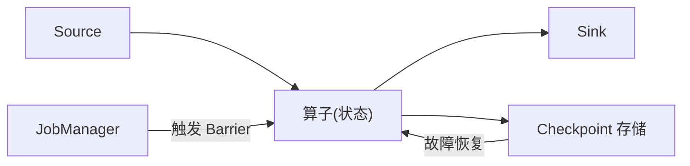

无状态的流处理只能做逐条转换。一旦需要窗口聚合、去重、join 或模式匹配，就必须保存状态。状态让 Flink 能做复杂计算，也带来一致性与容量问题。



## 状态类型

- **Keyed State**：按 key 分区，只能在 keyBy 之后使用，常见 ValueState/ListState/MapState；
- **Operator State**：与算子实例绑定，例如 Kafka 消费位移；
- Keyed State 随 key 分布，单个 key 过热会导致状态倾斜；
- 状态要设置 TTL，否则会无限增长。

## 状态后端

| 后端 | 存储 | 适用 |
| --- | --- | --- |
| HashMapStateBackend | JVM 堆内存 | 小状态、低延迟 |
| EmbeddedRocksDBStateBackend | 本地磁盘 + 堆外 | 大状态、TB 级 |

RocksDB 把状态放在本地磁盘，支持超大状态，但读写有序列化开销。状态大小超过内存时不要硬撑 HashMap。

## Checkpoint

Checkpoint 是运行中的一致性快照：

1. JobManager 周期性注入 Barrier；
2. Barrier 随数据流向下游传递；
3. 算子收到 Barrier 后对齐输入，快照本地状态；
4. 快照写入持久化存储（HDFS/对象存储）；
5. 全部完成后标记本次 Checkpoint 成功。

关键参数：

- `execution.checkpointing.interval`：间隔，影响恢复点与开销；
- `execution.checkpointing.timeout`：超时，背压下容易失败；
- `execution.checkpointing.mode`：Exactly-once 或 At-least-once；
- 状态越大、间隔越短，Checkpoint 开销越高。

## Exactly-once

端到端 Exactly-once 需要三部分配合：

- Source 可重放（Kafka 位移随 Checkpoint 保存）；
- 算子状态一致（Checkpoint 对齐）；
- Sink 支持事务或幂等写入（如 Kafka 两阶段提交、支持 upsert 的数据库）。

只保证“算子内 Exactly-once”而 Sink 非事务，端到端仍可能重复。下游要能按主键幂等。

## Savepoint

Savepoint 是手动触发的快照，用于升级、迁移与暂停恢复：

```bash
flink savepoint <job-id> s3://bucket/savepoints
flink run -s s3://bucket/savepoints/savepoint-xxx app.jar
```

升级作业时要保证状态兼容，改变状态结构需要自定义序列化或迁移逻辑。

## 常见问题

- **Checkpoint 一直失败**：状态过大、背压、存储写入慢；
- **恢复后重复消费**：Sink 非事务且不幂等；
- **状态无限增长**：未设置 TTL 或 key 基数持续上升；
- **RocksDB 磁盘满**：本地磁盘容量不足；
- **Savepoint 不兼容**：算子 UID 变化导致无法恢复。

## 小结

- 状态是窗口、去重与 join 的基础；
- 小状态用内存后端，大状态用 RocksDB；
- Checkpoint 通过 Barrier 生成一致性快照；
- 端到端 Exactly-once 需要 Source、状态与 Sink 三者配合；
- Savepoint 用于升级与迁移，必须保证状态兼容。
