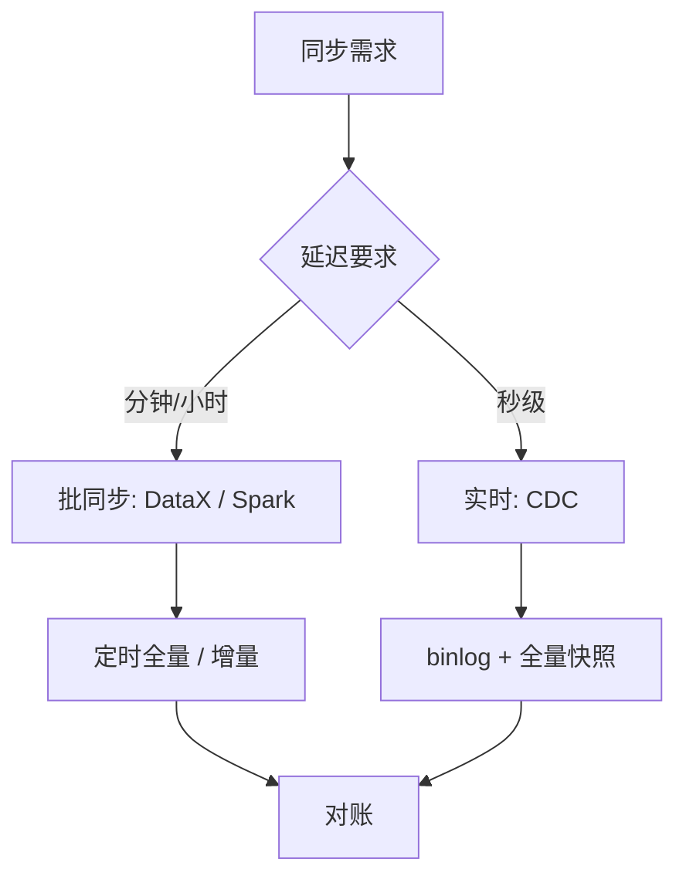

同步方式的选择取决于“数据要多快到、能接受多少成本、源库能不能承压”。绝大多数团队最终采用混合：核心表实时，非核心表按批。

## 批同步

- 按调度周期抽取（小时/天）；
- 全量抽或按时间戳/自增 ID 增量；
- 工具：DataX、Sqoop、Spark JDBC；
- 优点：实现简单、对源库影响可控、易重跑；
- 缺点：延迟高、删除难捕获、全量压力大。

增量批同步要处理边界：时间戳重叠、更新延迟、删除标记。只按创建时间抽会漏掉更新。

## 实时同步

- 基于 binlog/redo 的 CDC；
- 延迟秒级，能捕获插入、更新、删除；
- 优点：及时、对源库压力小；
- 缺点：组件多、位点与 DDL 处理复杂。

实时同步不是“批同步的替代品”，它需要下游支持 upsert 与 Schema 演进。

## 混合方案

- 核心交易、订单、支付：实时 CDC；
- 商品、配置、维表：定时批同步；
- 历史数据：一次性全量初始化；
- 同步失败时用批任务兜底补齐。

维表变化不频繁，用批同步足够；事实表要求及时，用 CDC。

## 一致性对账

- 按主键比对行数与关键字段；
- 抽样比对明细；
- 检查删除是否同步；
- 记录延迟与差异，定期复盘；
- 对账任务本身要可重跑。

## 常见问题

- **只按时间戳增量**：更新与删除漏同步；
- **全量抽锁表**：影响源库业务；
- **实时链路无监控**：位点停滞无人发现；
- **下游无主键**：重复数据无法覆盖；
- **Schema 变更未评估**：同步任务直接失败。

## 小结

- 批同步简单、延迟高；实时 CDC 及时、复杂度高；
- 删除与更新是批同步的薄弱点；
- 混合方案按数据重要性与延迟要求分层；
- 下游必须有主键与幂等写入；
- 对账是同步链路的最后一道保险。
