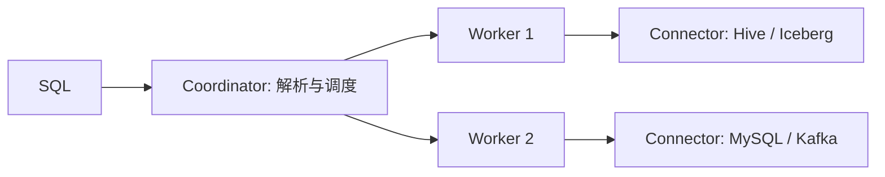

Trino 的价值是“不搬数据也能查”：一条 SQL 同时访问 Hive、Iceberg、MySQL、Kafka 与对象存储。代价是性能取决于各连接器的下推能力与网络。

## 架构

- **Coordinator**：解析 SQL、生成计划、调度任务；
- **Worker**：执行扫描、过滤、聚合与 Join；
- 计算与存储分离，本身不持久化数据；
- 结果通常返回客户端或写入目标表。

## 连接器

- Hive/Iceberg/Delta：读湖仓表；
- MySQL/PostgreSQL：读业务库；
- Kafka：按主题读取消息；
- 对象存储：直接读文件；
- 每个连接器支持的下推能力不同。

下推越完整，性能越好。连接器不支持过滤下推时，Trino 会把全量数据拉到计算层再过滤。

## 适用场景

- 跨源即席分析：业务库 + 湖仓 + 日志；
- 数据虚拟化：不搬迁，统一 SQL 入口；
- ETL 的轻量转换与验证；
- 多团队共享的查询网关。

## 不适用场景

- 高并发低延迟的点查；
- 超大规模多表 Join（内存与网络压力大）；
- 需要强事务与频繁更新的场景；
- 对稳定性要求极高的核心报表（依赖多源）。

## 性能要点

- 尽量让过滤、列裁剪与聚合下推到连接器；
- 大表 Join 注意内存与 spill；
- 控制并发，Coordinator 容易成为瓶颈；
- 结果集不要过大，避免拉回客户端；
- 对热点查询使用物化视图或预聚合表。

## 常见问题

- **全表扫描**：连接器不支持谓词下推；
- **Join 爆内存**：大表关联没有预聚合；
- **元数据慢**：Hive Metastore 或 Catalog 响应慢；
- **权限复杂**：多源权限模型不一致；
- **网络瓶颈**：跨区域读取数据。

## 小结

- Trino 是查询层，不存数据，靠连接器访问多源；
- Coordinator 规划、Worker 执行，计算存储分离；
- 下推能力决定性能，跨源 Join 要控制规模；
- 适合即席分析与数据虚拟化，不适合高并发点查；
- 权限与元数据是多源查询的长期治理点。
