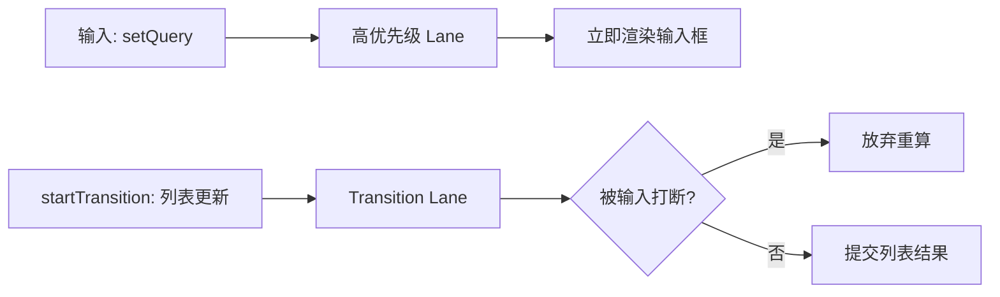

并发渲染不是“同时跑多个渲染”，而是“渲染可以暂停、放弃、重排”。用户输入保持高优先级，列表、图表这类重更新降级为过渡，必要时被新的输入打断。



## useTransition

```jsx
const [isPending, startTransition] = useTransition()

function onChange(e) {
  setQuery(e.target.value)
  startTransition(() => {
    setList(filter(e.target.value))
  })
}
```

- `startTransition` 内的更新被标记为 Transition Lane；
- 输入更新保持高优先级，先渲染；
- 列表渲染可被打断，旧结果暂时保留；
- `isPending` 表示过渡尚未完成，可用于弱提示。

过渡更新不是延迟执行，而是低优先级执行；如果一直有高优先级更新，过渡可能迟迟不完成。

## useDeferredValue

```jsx
const deferred = useDeferredValue(query)
const list = useMemo(() => filter(deferred), [deferred])
```

- 返回一个“滞后”的值，先渲染旧值；
- 后台用新值重渲染，完成后替换；
- 与 Transition 的区别：它延迟的是值，不是更新函数；
- 适合无法把 setState 包进 Transition 的场景（如第三方组件）。

## Suspense

```jsx
<Suspense fallback={<Spinner />}>
  <LazyChart />
</Suspense>
```

- 子组件抛 Promise 时，Suspense 捕获并显示 fallback；
- 数据加载与代码分割都可以用；
- 并发模式下可以“先显示旧内容，再切换到新内容”；
- 多个 Suspense 边界能隔离加载状态。

## 并发渲染的边界

- 只有使用了并发特性（Transition、Deferred、Suspense）的更新才走并发路径；
- 普通 `setState` 仍是高优先级，可能同步渲染；
- 渲染必须无副作用，否则中断重跑会产生重复操作；
- 第三方库若依赖同步渲染，可能不兼容。

## 与 Vue 的对比

| 维度 | React | Vue |
| --- | --- | --- |
| 更新调度 | 优先级 + 可中断 | 响应式触发，同步批量 |
| 过渡 | useTransition | 无直接等价，靠 watch/防抖 |
| 异步边界 | Suspense | Suspense（实验性） |
| 渲染单位 | 组件重渲染 | 依赖精确更新 |

React 需要显式标记低优先级；Vue 的细粒度依赖让它默认只更新受影响的组件。

## 常见问题

- **在 Transition 里做输入更新**：输入变卡，优先级被降级；
- **依赖 isPending 做 loading**：它只表示过渡，不代表请求完成；
- **Suspense 包裹过多**：一个慢请求拖住整块内容；
- **在 render 中发起请求**：没有缓存会重复请求，需配合框架或数据层。

## 小结

- 并发渲染让更新可中断、可重排；
- `startTransition` 降低更新优先级，`isPending` 表示过渡状态；
- `useDeferredValue` 延迟值，适合第三方组件；
- Suspense 提供异步边界与 fallback；
- 并发特性要求渲染无副作用，第三方库需评估兼容性。
