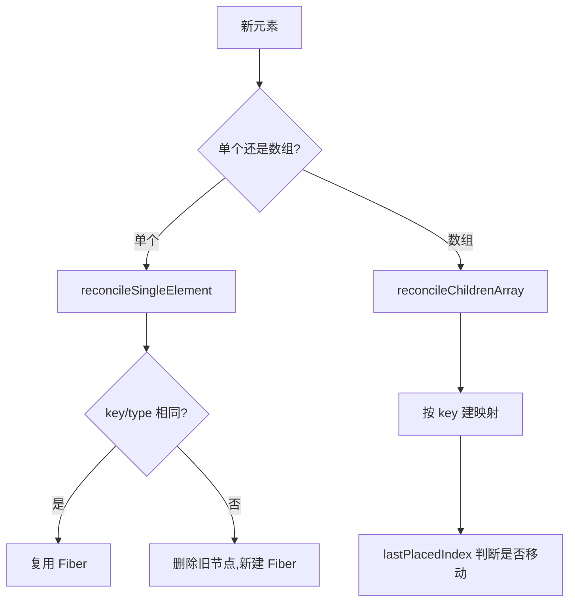

React 不会跨层级比较，也不会做“最优树编辑距离”。它只做三件事：同层比较、按 key 匹配、能复用就复用。这个策略把 O(n³) 的树 diff 降到 O(n)。



## 同层比较

- 只比较同一父节点下的子元素；
- 跨层级移动会被视为删除 + 新建；
- 类型不同直接替换，不尝试复用；
- 类型相同则复用 Fiber，更新 props。

## 单节点

`reconcileSingleElement` 的逻辑：

- key 相同且 type 相同：复用，标记更新；
- key 相同但 type 不同：删除旧的，创建新的；
- 没有 key：按位置比较 type；
- 旧的多个子节点会被全部删除。

## 数组与 key

`reconcileChildrenArray` 分两轮：

1. 同步遍历，能复用的直接复用；
2. 剩余节点按 key 建映射，再匹配。

`lastPlacedIndex` 记录已处理节点中最大的旧索引；新节点的旧索引小于它，说明需要移动。

```ts
if (child._mountIndex < lastPlacedIndex) {
  placements.push(child)
} else {
  lastPlacedIndex = child._mountIndex
}
```

- 稳定 key 能让复用率最高；
- index 作 key 在插入/删除时导致后续全部更新；
- key 只在兄弟节点间唯一，不需要全局唯一。

## 双缓冲

- `current` 是页面上正在显示的树；
- `workInProgress` 是正在构建的树；
- `alternate` 互相引用；
- commit 后交换 `root.current`；
- 复用 Fiber 时同时复用 DOM 与状态。

## 与 Vue diff 的差异

| 维度 | React | Vue |
| --- | --- | --- |
| 遍历结构 | Fiber 链表 | vnode 数组 |
| 可中断 | 是（并发） | 否（同步） |
| 列表优化 | key + lastPlacedIndex | key + LIS |
| 更新粒度 | 组件重渲染 | 依赖精确到节点 |

React 把“是否需要重渲染”交给组件（memo/state），Vue 用响应式精确知道谁变了。

## 简化实现

```js
function reconcile(oldChildren, newChildren) {
  const map = new Map(oldChildren.map((c) => [c.key, c]))
  return newChildren.map((child) => {
    const old = map.get(child.key)
    if (old && old.type === child.type) {
      old.props = child.props
      return old
    }
    return { ...child, dom: null }
  })
}
```

真实实现还要处理插入、删除、移动与副作用标记。

## 常见问题

- **key 用 index**：列表头部插入导致全部重建；
- **key 重复**：复用错乱，状态串位；
- **组件内联定义**：type 每次不同，强制重建；
- **误以为 React 会跨层复用**：跨层移动等于删除重建。

## 小结

- React diff 只做同层比较与 key 匹配；
- 单节点按 key/type 决定复用或替换；
- 数组用 key 映射与 lastPlacedIndex 判断移动；
- 双缓冲复用 Fiber 与 DOM；
- 稳定 key 是列表性能的前提。
