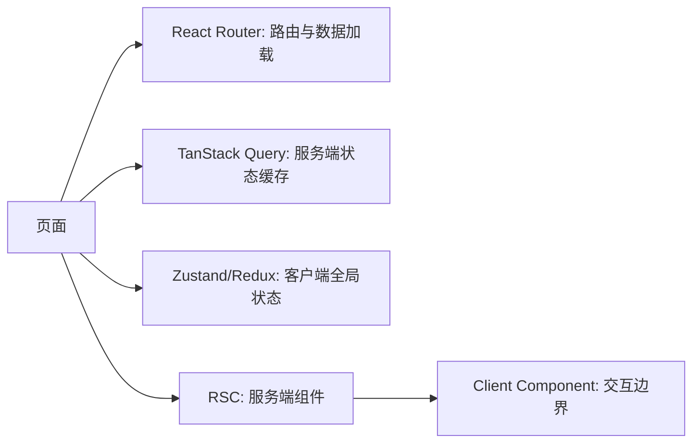

React 只提供组件模型与渲染，路由、数据、全局状态、SSR/RSC 都要选配。选型的核心是分清“服务端状态”和“客户端状态”，别用一种方案硬套所有场景。



## 路由

React Router 的数据路由把加载与提交前移：

```tsx
const router = createBrowserRouter([
  {
    path: '/orders/:id',
    loader: ({ params }) => fetchOrder(params.id),
    element: <OrderPage />,
  },
])
```

- `loader` 在渲染前加载数据，组件用 `useLoaderData` 读取；
- `action` 处理表单提交与重定向；
- 支持嵌套路由、错误边界与并行加载；
- Next.js App Router 用文件系统路由，思路相同。

## 服务端状态

接口数据不是“全局状态”，而是带缓存与失效的服务端状态：

- TanStack Query/SWR 管理请求、缓存、重试、失效；
- 组件通过 key 订阅，避免手写 loading/error；
- 缓存按 staleTime 与 invalidate 控制；
- 不要把接口数据复制进 Redux，容易出现两份真相。

## 客户端全局状态

跨组件共享的本地状态：

- Context 适合低频、少量共享（主题、登录态）；
- Zustand 轻量，选择器订阅粒度细；
- Redux Toolkit 适合复杂流程、时间旅行与严格约束；
- 状态就近原则：能放组件就不上全局。

## RSC 与 Next.js

React Server Components 在服务端渲染，不把组件 JS 发到浏览器：

- 服务端组件可以直接读数据库、访问文件；
- 客户端组件用 `'use client'` 标记，负责交互；
- 两者通过 props 与序列化边界通信；
- Next.js App Router 集成 RSC、流式渲染与缓存。

RSC 不是“更快的 SSR”，它改变了组件在哪执行、哪些代码进入客户端包。

## 工程化

- Vite：轻量、快，适合 SPA；
- Next.js：RSC、SSR/SSG、路由与部署一体化；
- Remix/React Router：数据路由与服务端提交；
- 测试：Vitest + Testing Library + Playwright；
- 监控：Error Boundary + RUM + Source Map。

## 选型矩阵

| 需求 | 选择 |
| --- | --- |
| 纯 SPA | Vite + React Router |
| SEO/首屏 | Next.js 或 Remix |
| 大量接口缓存 | TanStack Query |
| 复杂全局流程 | Redux Toolkit |
| 轻量共享 | Zustand / Context |
| 服务端数据直读 | RSC |

## 常见问题

- **接口数据进 Redux**：缓存与失效难管理；
- **所有状态都上全局**：组件耦合、调试困难；
- **RSC 里用浏览器 API**：服务端没有 window；
- **客户端组件过大**：'use client' 边界把整棵树带进包；
- **路由数据与组件请求重复**：loader 已取，组件又请求一次。

## 小结

- React 只负责视图，路由、数据、状态、渲染模式由生态补齐；
- 服务端状态用 TanStack Query，客户端状态按规模选 Context/Zustand/Redux；
- 数据路由把加载与提交前移，减少瀑布请求；
- RSC 改变执行位置与打包边界，不等于更快的 SSR；
- 选型先分状态类型，再选工具。
