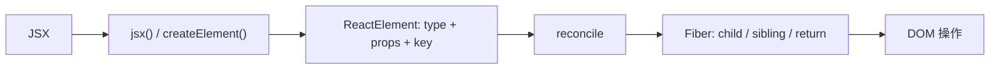

JSX 不是模板，也不是字符串。它编译成函数调用，返回普通对象——React 元素。元素只描述“要渲染什么”，真正参与调度的是之后创建的 Fiber 节点。



## 元素结构

```ts
const element = {
  $$typeof: Symbol.for('react.element'),
  type: 'div',
  key: null,
  ref: null,
  props: { className: 'box', children: 'hi' },
}
```

- `type` 是标签名、组件函数或 Fragment；
- `key` 与 `ref` 被单独提取，不放在 props 里；
- `props` 包含 children 与其他属性；
- 元素不可变，每次渲染都创建新对象；
- `$$typeof` 用于识别合法元素，降低注入风险。

## JSX 编译

```jsx
<div className="box">hi</div>
```

在自动运行时下编译为：

```js
import { jsx as _jsx } from 'react/jsx-runtime'
_jsx('div', { className: 'box', children: 'hi' })
```

- `jsx` 与 `jsxs` 分别处理单子节点与多子节点；
- 开发环境用 `jsxDEV` 带调试信息；
- `createElement` 是传统入口，仍用于动态场景。

## 从元素到 Fiber

`reconcile` 时，元素被转换成 Fiber：

```ts
function createFiberFromElement(element, mode, lanes) {
  const fiber = createFiberFromTypeAndProps(
    element.type,
    element.key,
    element.props,
    element.ref,
    mode,
    lanes,
  )
  return fiber
}
```

Fiber 的关键字段：

| 字段 | 作用 |
| --- | --- |
| `tag` | 节点类型（FunctionComponent、HostComponent 等） |
| `stateNode` | 对应的 DOM 或组件实例 |
| `return` / `child` / `sibling` | 树结构，用链表代替递归 |
| `memoizedState` | Hooks 链表 |
| `lanes` | 更新优先级 |
| `alternate` | 双缓冲中的另一棵树 |

Fiber 是链表树，遍历可以中断与恢复，这是并发渲染的基础。

## 两棵树的区别

- **元素树**：每次 render 新建，轻量、不可变；
- **Fiber 树**：长期存在，记录状态、优先级与 DOM 引用；
- 元素是“描述”，Fiber 是“工作单元”；
- diff 比较的是新旧元素，结果更新到 Fiber。

## 简化实现

```js
function createElement(type, props, ...children) {
  return {
    type,
    props: { ...props, children: children.length === 1 ? children[0] : children },
    key: props?.key ?? null,
  }
}

function createFiber(element, parent) {
  return {
    type: element.type,
    props: element.props,
    parent,
    children: [],
    dom: null,
  }
}
```

真实 Fiber 还要处理优先级、副作用与双缓冲，但“元素 → Fiber”的关系不变。

## 常见问题

- **认为元素就是 DOM**：元素只是对象，渲染后才产生 DOM；
- **在元素上改属性**：元素不可变，应通过 state 重新生成；
- **key 放在 props 里**：key 是元素字段，不会传给组件；
- **组件内联定义**：每次 render 产生新 type，导致子树重建。

## 小结

- JSX 编译为 jsx/createElement 调用，产出不可变元素；
- 元素只描述 UI，Fiber 才参与调度与状态记录；
- Fiber 用 return/child/sibling 组成可中断的链表树；
- key 与 ref 是元素字段，不进入 props；
- 理解两棵树，才能理解 React 的更新模型。
