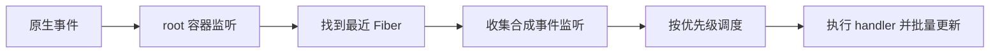

React 不在每个节点上绑事件，而是在根容器统一监听，再按虚拟树分发。这减少了监听器数量，也让事件可以参与优先级调度。



## 事件委托

React 17 起把事件委托到根容器（通常是 `#root`），而不是 `document`：

- 每个事件类型只绑一个原生监听；
- 事件触发后从 target 向上找 Fiber；
- 收集路径上的 `onClick` 等监听；
- 按捕获/冒泡顺序执行。

好处：动态节点无需重新绑定，监听器数量与组件数量解耦。

## SyntheticEvent

```jsx
function handleClick(e) {
  e.preventDefault()
  e.stopPropagation()
  console.log(e.nativeEvent)
}
```

- 合成事件包装原生事件，提供统一 API；
- React 17 起不再使用事件池，事件对象可以异步访问；
- `nativeEvent` 指向原生事件；
- `stopPropagation` 只影响合成事件链，不阻止原生监听。

## 事件优先级

| 事件类型 | 优先级 |
| --- | --- |
| click、keydown | Discrete |
| mousemove、scroll | Continuous |
| 其他 | Default |

离散事件需要立即响应，连续事件可以合并。React 根据事件类型分配 Lane，进而决定渲染优先级。

## 批量更新

在 React 18 中，事件处理器里的多次 `setState` 会自动批量合并，只触发一次渲染；Promise、setTimeout 里的更新也会批量。

需要同步读取 DOM 时：

```jsx
import { flushSync } from 'react-dom'

flushSync(() => setCount((c) => c + 1))
// 这里 DOM 已更新
```

`flushSync` 会强制同步渲染，滥用会破坏批处理与并发特性。

## 常见问题

- **在合成事件里访问 event 异步**：React 17 后可以，但旧代码仍有池化假设；
- **stopPropagation 与原生监听混用**：原生 `addEventListener` 仍会触发；
- **在事件里做重计算**：离散事件优先级高，会阻塞输入；
- **flushSync 包裹大更新**：失去并发与批处理收益。

## 小结

- React 把事件委托到根容器，减少监听器；
- SyntheticEvent 提供统一 API，17 后不再池化；
- 事件类型决定优先级与 Lane；
- 事件处理器内的更新自动批量；
- `flushSync` 只用于必须同步读取 DOM 的场景。
