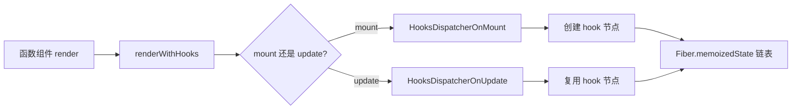

React 靠调用顺序识别 Hooks，而不是变量名。每个函数组件对应一个 Fiber，Hooks 以链表形式挂在 `memoizedState` 上；mount 与 update 使用不同的 dispatcher，这就是“第一次渲染”和“后续更新”行为不同的原因。



## dispatcher 切换

```ts
const HooksDispatcherOnMount = {
  useState: mountState,
  useEffect: mountEffect,
  useMemo: mountMemo,
  useRef: mountRef,
}

const HooksDispatcherOnUpdate = {
  useState: updateState,
  useEffect: updateEffect,
  useMemo: updateMemo,
  useRef: updateRef,
}
```

`renderWithHooks` 根据当前 Fiber 是否有 `memoizedState` 选择 dispatcher。组件首次渲染走 mount，之后的更新走 update。

## Hooks 链表

```ts
function mountWorkInProgressHook() {
  const hook = {
    memoizedState: null,
    baseState: null,
    baseQueue: null,
    queue: null,
    next: null,
  }
  if (workInProgressHook === null) {
    currentlyRenderingFiber.memoizedState = workInProgressHook = hook
  } else {
    workInProgressHook = workInProgressHook.next = hook
  }
  return hook
}
```

- 每个 Hook 是链表节点；
- 顺序 = 调用顺序，不能在条件或循环里调用；
- update 时按同样顺序取节点，所以顺序必须稳定；
- 链表挂在 Fiber 上，跨渲染保留。

## useState

```ts
function mountState(initialState) {
  const hook = mountWorkInProgressHook()
  hook.memoizedState = hook.baseState = initialState
  const queue = { pending: null, dispatch: null }
  const dispatch = (queue.dispatch = dispatchSetState.bind(null, fiber, queue))
  hook.queue = queue
  return [hook.memoizedState, dispatch]
}
```

更新时：

- `dispatchSetState` 创建更新对象，按 Lane 优先级入队；
- 调度一次重新渲染；
- `updateState` 从队列计算新 state，支持函数式更新；
- 相同 state 仍可能渲染一次，之后 bailout。

## useEffect

- mount 时创建 effect 对象并 push 到 Fiber 的 updateQueue；
- update 时比较依赖，变化则标记；
- commit 的 layout 之后异步执行（useLayoutEffect 在 layout 阶段同步执行）；
- 清理函数在下次执行前调用；
- 依赖数组为空只执行一次，不传则每次执行。

## 闭包陷阱

```jsx
useEffect(() => {
  const id = setInterval(() => console.log(count), 1000)
  return () => clearInterval(id)
}, [])   // count 永远是 0
```

effect 捕获的是当次渲染的 `count`。依赖数组漏写会读到旧值；写全又会频繁重建定时器。常见解法是 `useRef` 保存最新值，或用函数式更新。

## 常见问题

- **条件调用 Hooks**：链表顺序错位，状态串位；
- **依赖数组写错**：闭包旧值或无限循环；
- **在 render 里创建大量对象**：触发子组件重复渲染；
- **useMemo 当语义保证**：React 可能丢弃缓存，不能依赖它做副作用。

## 小结

- Hooks 是挂在 Fiber 上的链表，按调用顺序匹配；
- mount 与 update 使用不同 dispatcher；
- useState 的更新进入队列，按 Lane 调度；
- useEffect 在 commit 后执行，依赖决定是否重跑；
- 闭包与依赖数组是 Hooks 最常见的错误来源。
