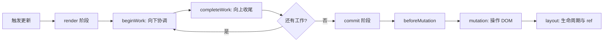

React 的更新不是“从头执行一遍就改 DOM”。render 阶段只计算变化，commit 阶段才真正操作 DOM。前者可被打断，后者必须一次完成，这是并发渲染能成立的前提。



## render 阶段

入口是 `renderRootSync` 或 `renderRootConcurrent`，核心循环：

```ts
function workLoopConcurrent() {
  while (workInProgress !== null && !shouldYield()) {
    performUnitOfWork(workInProgress)
  }
}
```

- `workInProgress` 是当前处理的 Fiber；
- `shouldYield()` 检查是否用尽时间片；
- 可中断意味着 render 阶段不能有副作用；
- 中断后从当前 Fiber 继续，而不是从头开始。

## beginWork

`beginWork` 处理当前 Fiber，返回子 Fiber：

- 根据 `tag` 分派：函数组件、类组件、HostComponent；
- 函数组件调用 `renderWithHooks`；
- 协调子元素，创建/复用子 Fiber；
- 标记 `flags` 表示需要插入、更新或删除；
- 没有子节点时进入 complete。

## completeWork

`completeWork` 从下往上收尾：

- HostComponent 创建 DOM 实例，计算属性差异；
- 把子 DOM 插入父 DOM 的离屏树；
- 标记副作用（插入、更新、删除）；
- 处理 context、事件与 ref；
- 返回父 Fiber 继续。

DOM 在这一阶段创建，但还没挂到页面上。

## commit 阶段

`commitRoot` 分三个子阶段：

| 阶段 | 内容 | 是否可中断 |
| --- | --- | --- |
| beforeMutation | 读取 DOM 快照、调度 effect | 否 |
| mutation | 插入/更新/删除 DOM | 否 |
| layout | 生命周期、ref、useLayoutEffect | 否 |

commit 必须同步完成，否则用户会看到半成品界面。

## 双缓冲

React 维护两棵 Fiber 树：current 与 workInProgress。

- 更新在 workInProgress 上进行；
- commit 完成后交换 `root.current`；
- `alternate` 指向另一棵树；
- 复用节点减少创建开销。

## 常见问题

- **在 render 阶段做副作用**：并发模式下可能重复执行；
- **useEffect 与 useLayoutEffect 混用**：布局读取放 layout，异步副作用放 effect；
- **长任务阻塞 commit**：commit 不可中断，重 DOM 操作要拆分；
- **误以为 render 等于 DOM 更新**：render 只计算，commit 才落地。

## 小结

- render 阶段构建 Fiber 树，可中断；
- beginWork 向下、completeWork 向上；
- commit 分 beforeMutation、mutation、layout，不可中断；
- 双缓冲让新旧树切换保持一致；
- 副作用必须放在 commit 对应的生命周期里。
