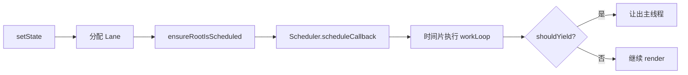

React 18 之后，更新有了优先级：用户输入要快，过渡更新可以让路。实现上，Lane 用位运算表示优先级，Scheduler 用时间片决定“现在还能不能继续渲染”。



## Lane 模型

```ts
export const SyncLane = 0b0001
export const InputContinuousLane = 0b0010
export const DefaultLane = 0b0100
export const TransitionLanes = 0b1111111100000
export const IdleLane = 0b100000000000
```

- 每个更新带一个 Lane；
- 多个更新用按位或合并；
- 高优先级 Lane 可以打断低优先级渲染；
- 低优先级长期得不到执行会“饥饿”，React 用过期时间兜底。

## 调度入口

```ts
function ensureRootIsScheduled(root) {
  const nextLanes = getNextLanes(root)
  if (nextLanes === NoLanes) return
  const newCallbackPriority = getHighestPriorityLane(nextLanes)
  if (newCallbackPriority === existingCallbackPriority) return
  scheduleCallback(
    laneToSchedulerPriority(newCallbackPriority),
    performConcurrentWorkOnRoot.bind(null, root),
  )
}
```

- 相同优先级的任务不重复调度；
- Scheduler 的优先级映射到 Lane；
- 渲染完成后继续检查是否有新更新。

## Scheduler 与时间切片

```ts
function workLoop(deadline) {
  while (taskQueue.length > 0) {
    const task = peek(taskQueue)
    if (task.expirationTime > deadline.timeRemaining() + getCurrentTime()) {
      break
    }
    task.callback()
    if (shouldYield()) break
  }
}
```

- 用 MessageChannel 在不阻塞输入的情况下让出主线程；
- 每个时间片默认 5ms 左右；
- 让出后从上次的 Fiber 继续，不从头开始；
- 同步更新（SyncLane）不切片，直接执行。

## 优先级来源

| 场景 | 优先级 |
| --- | --- |
| 用户输入、点击 | InputContinuous / Sync |
| 普通 setState | Default |
| startTransition | Transition |
| 离屏、预渲染 | Idle |

`useTransition` 把更新标记为 Transition，允许被输入打断；`useDeferredValue` 延迟某个值，保持输入流畅。

## 饥饿与过期

低优先级任务如果一直被打断，会超过过期时间，React 把它提升为同步执行，避免永远不更新。这是“时间切片”能长期工作的保护机制。

## 常见问题

- **误以为所有更新都可中断**：SyncLane 仍同步执行；
- **在 render 里做重计算**：时间切片救不了单次超长任务；
- **Transition 里做紧急更新**：优先级被错误降级；
- **依赖 useTransition 的 isPending 做业务锁**：它只表示过渡状态。

## 小结

- Lane 用位运算表示与合并优先级；
- Scheduler 用时间片执行可中断渲染；
- 高优先级可打断低优先级，低优先级有过期保护；
- 用户输入优先，过渡更新让路；
- 时间切片只能切分任务，不能消除单次长任务。
