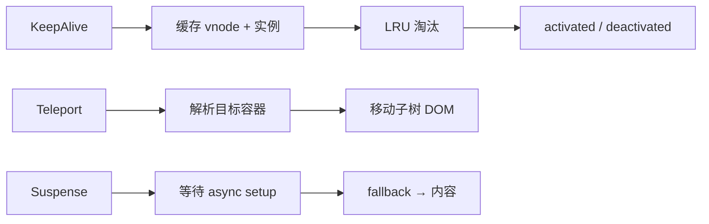

框架的内置组件不是普通业务组件，它们直接操作渲染器：缓存实例、移动 DOM、控制异步边界。理解它们，才能解释“为什么切回来状态还在”“为什么弹层挂到了 body”。



## KeepAlive

```vue
<KeepAlive :max="10" include="UserView">
  <component :is="current" />
</KeepAlive>
```

源码要点：

- 用 `Map` 缓存组件的 vnode 与实例；
- `max` 超出时按 LRU 淘汰最久未访问的项；
- 命中缓存时复用实例，不重新执行 setup；
- 激活/失活触发 `activated` 与 `deactivated` 钩子，而不是 `mounted`/`unmounted`；
- 缓存的实例仍占用内存，`max` 要按业务设置。

KeepAlive 只对组件生效，缓存的是实例而非 DOM 字符串。

## Teleport

```vue
<Teleport to="body">
  <div class="modal">...</div>
</Teleport>
```

- `to` 可以是 CSS 选择器或 DOM 元素；
- 渲染时把子树挂到目标容器，逻辑上仍在原组件树；
- 事件与响应式照常工作，但 DOM 位置变化；
- 目标容器不存在时会延迟挂载或报错；
- 适合弹窗、Toast、全屏遮罩，避免被父级 `overflow` 裁剪。

## Suspense

```vue
<Suspense>
  <template #default><AsyncView /></template>
  <template #fallback><Skeleton /></template>
</Suspense>
```

- 子组件 `async setup()` 返回 Promise 时，Suspense 等待；
- 等待期间显示 fallback；
- 多个异步依赖会一起等待，任一失败进入 error 状态；
- 需要 `defineAsyncComponent` 或 async setup 配合。

Suspense 在 Vue 3 中仍标记为实验性，生产使用要评估路由与数据预取方案。

## 其他内置能力

- `Transition`：在进入/离开时添加 class 与钩子；
- `TransitionGroup`：列表增删的过渡；
- `component :is`：动态组件，配合 KeepAlive 使用；
- `slot`：内容分发，不是内置组件但由渲染器处理。

## 常见问题

- **KeepAlive 缓存无限增长**：未设置 `max` 或 include；
- **Teleport 目标容器晚于挂载**：目标不存在导致渲染失败；
- **Suspense 包裹过多**：一个慢请求拖住整块内容；
- **缓存组件里持有外部订阅**：deactivated 时未清理，造成泄漏。

## 小结

- KeepAlive 缓存实例并按 LRU 淘汰，切换触发 activated/deactivated；
- Teleport 只移动 DOM，不改变组件逻辑关系；
- Suspense 等待异步 setup，期间展示 fallback；
- 内置组件直接操作渲染器，行为与普通组件不同；
- 缓存与订阅要配套清理，避免内存泄漏。
