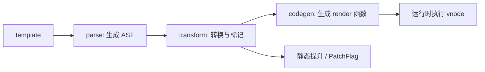

模板不是运行时解析的字符串。构建阶段，`@vue/compiler-dom` 把模板编译成渲染函数；浏览器拿到的已经是可执行的 JS。理解这三阶段，才能解释“为什么 Vue 更新时知道只改哪个节点”。



## parse

`compiler-core/src/parse.ts` 用状态机扫描模板：

- 识别标签、属性、文本、插值；
- 生成基础 AST 节点（Element、Text、Interpolation、Directive）；
- 记录源码位置，便于报错与 source map。

parse 只负责“结构”，不做语义优化。

## transform

`transform` 阶段按插件顺序遍历 AST，每个插件处理一类语法：

- `transformElement`：处理标签与 props，生成 PatchFlag；
- `transformExpression`：处理插值与指令表达式；
- `transformIf` / `transformFor`：结构指令转成条件与循环；
- `transformHoist`：静态节点提升到 render 函数外。

PatchFlag 用位标记“这个节点的哪些部分是动态的”：

```ts
export const enum PatchFlags {
  TEXT = 1,
  CLASS = 1 << 1,
  STYLE = 1 << 2,
  PROPS = 1 << 3,
  FULL_PROPS = 1 << 4,
  DYNAMIC_SLOTS = 1 << 5,
  STABLE_FRAGMENT = 1 << 6,
  KEYED_FRAGMENT = 1 << 7,
}
```

运行时 diff 只看标记过的部分，未标记的节点整棵跳过。

## codegen

`codegen` 把转换后的 AST 拼成字符串：

```js
// 模板：<div class="static">{{ msg }}</div>
// 生成的渲染函数（简化）
import { createElementVNode as _createElementVNode, toDisplayString as _toDisplayString } from "vue"

export function render(_ctx) {
  return _createElementVNode("div", { class: "static" },
    _toDisplayString(_ctx.msg), 1 /* TEXT */)
}
```

- 静态属性直接内联；
- 动态文本带 `PatchFlag=1`；
- 静态节点被提升为常量，不参与每次 render 创建。

## 编译时优化

| 优化 | 作用 |
| --- | --- |
| 静态提升 | 静态 vnode 只创建一次 |
| PatchFlag | 运行时只 diff 动态部分 |
| 事件缓存 | 内联 handler 复用，减少更新 |
| Block Tree | 动态节点收集到 block，diff 跳过静态子树 |
| v-memo | 指定依赖，未变则跳过 |

这些优化把“整棵树 diff”变成“只 diff 动态节点”，是 Vue 3 性能提升的关键。

## 运行时编译

- 构建时编译：Vite/Plugin 预编译，运行时无编译器；
- 运行时编译：完整版 `vue` 包含 compiler，体积更大；
- 动态模板（如服务端下发）才需要运行时编译；
- 生产默认用 `vue.runtime.esm-bundler.js`，模板在构建期处理。

## 常见问题

- **模板里写复杂表达式**：编译后仍是运行时计算，不如下沉到 computed；
- **动态组件过多**：Block Tree 收集的动态节点变多，diff 范围扩大；
- **用运行时编译却以为是构建时**：包体积与首屏变差；
- **静态节点被误判为动态**：检查是否引用了响应式变量。

## 小结

- 编译器分 parse、transform、codegen 三阶段；
- transform 生成 PatchFlag 与静态提升信息；
- codegen 输出可直接执行的渲染函数；
- 编译时优化减少运行时 diff 的范围；
- 生产环境优先构建时编译，避免引入完整编译器。
